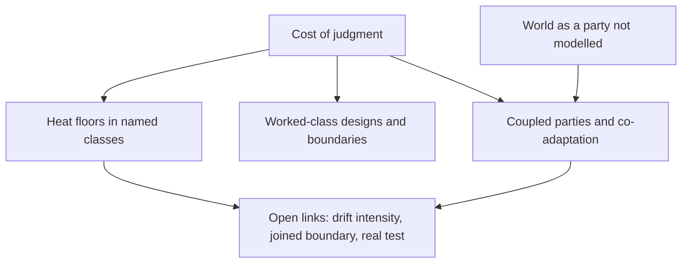

# CLAIM_MAP_v2: A Theory of Adaptive Organization (GTAO), with proxy-aware statuses

Sunday 15 November 2026, about 08:15–08:20 AM ET (America/New_York). Grok Bot executor for Chad Mitchell, via Ace. Nothing was posted or sent by that work. This map **supersedes the status column** of `reviews/night1/CLAIM_MAP_FINAL.md`. That file still holds the full evidence, scope and credit for each row, and row IDs are unchanged. The reason for every change is the measurement re-audit in `FRAMEWORK.md` (same folder). Gates MV1–MV10 are defined in FRAMEWORK §2.2 and bind every new prereg from 18 Nov 2026 (v2.40 note).

<!-- history:begin (dated record; text unchanged) -->

**v2.1 note (15 Nov 2026, 09:02 AM ET).** Section N adds night-2 results and the audit corrections (`reviews/night2/AUDIT_DIVERGENCE.md`). Rows are interpreted under THEORY.md v1.2 §2.5: a constant quoted for class R (a = b = ½) is the H = ½ instance; for reset reads with Hurst H, a = b = 1/(1+2H). The headline hypothesis was rows K12–K13 and N7; it is untested, not peripheral. *(v2.3: superseded; see the v2.3 note.)*

**v2.3 note (15 Nov 2026, about 10:00 AM ET; THEORY.md v1.4).** THEORY v1.4 demotes the tracking layer (K12, K13, N11) to classical filtering and approximation theory plus a price; the headline is now the empirical bet N13 (measured-input optimality, OPEN) and its cross-scale form J6 (OPEN). Added: LEARNSIM rows G23–G29 (from `reviews/night2/LEARNSIM_REFEREE.md` §8, applied here with two in-model statuses defined below), N12 (formal exponents are α-independent for the two sensing technologies; self-checked, not refereed) and N13. N7's scope is updated. No existing row changes status.

**v2.4 note (15 Nov 2026; THEORY.md v1.4.1).** Per `reviews/night2/V14_REVIEW.md` Fix 2, J16 moves PRIOR ART → OPEN: definitional inside the model (Axiom 5), but as a claim about real systems it has testable content (sufficiency: no fourth cost type needed at any level, plus J6). The tally table is updated (PRIOR ART 20 → 19, OPEN 42 → 43). N12 is unchanged here; its narrowing (V14_REVIEW Fix 1) is pending a separate referee.

**v2.5 note (15 Nov 2026; THEORY.md v1.4.2, PR #18; edits independently reviewed, `reviews/night2/N12_EDITS_REVIEW.md`).** N12 PROVED (in-model) → **MATH-CORRECTED** per `reviews/night2/N12_REFEREE.md`: onset exponent confirmed for every α > 1; premises (same α for shared and private drift, exact reads at the level) and the α-dependent formal exponents (vigilance growth, mixed-technology e_u) stated; "only through constants" withdrawn.

**v2.6 note (15 Nov 2026, about 11:20 AM ET; QUEUE PRIORART-LFK-ALPHA, ledger 34–35).** N11 qualifier PRIOR ART (in substance) → **PRIOR ART (stated in mapped form)**, per `reviews/night2/PRIORART_LFK_ALPHA/REPORT.md` (locked decision rule D1). Status word unchanged, so the tally is unchanged. THEORY.md not edited; proposed credit and premise edits E1–E3 are queued (PRIORART-CREDIT-EDITS, TELEGRAPH-LINEAR-PREMISE) for independent review.

**v2.7 note (15 Nov 2026, about 11:21 AM ET; GITHUB-UPSTREAM, ledger 36).** Adds N14–N15 from `night2/GITHUB/RESULTS.md` (locked under THEORY v1.1/v1.2; read here under v1.4.2 §2.2). No existing row changes status; THEORY.md: only its CLAIM_MAP version pointer is updated.

**v2.8 note (15 Nov 2026, about 11:30 AM ET; QUEUE TELEGRAPH-LINEAR-PREMISE, ledger 37–40).** New row **N16** (PROVED in-model, leading order + numerics; self-checked; not refereed): for a two-state jump world the Bayes-optimal tracker's exponents differ from the linear tracker's at the same spectrum; exact reset reads and projection kernels are unaffected (`reviews/night2/TELEGRAPH_LINEAR_PREMISE/REPORT.md`). N11 evidence gets a pointer; no existing status changes, so the v2 tally is unchanged. THEORY.md not edited; edits E2′, E4–E6 proposed for independent review (TLP-EDITS-REVIEW). (Written as N14/v2.7 on branch queue-pick6; renumbered at merge after GITHUB-UPSTREAM took N14–N15/v2.7.)

**v2.9 note (15 Nov 2026, about 11:48 AM ET; QUEUE TELEGRAPH-REFEREE, pick 7, ledger 41–44).** N16 PROVED (in-model, not refereed) → **MATH-CORRECTED** (in-model; refereed) per `reviews/night2/TELEGRAPH_REFEREE/REPORT.md`: core results and the Conti & Mora diagnosis confirmed with independent code; the adaptation constant corrected (−0.7 → −(γ+1)); the projection-kernel invariance narrowed to regressions on the tracker's own observations; precision vs effort elasticity label fixed; leading-order error asymptotics PRIOR ART (Khasminskii & Zeitouni 1996; Golubev 2000) and the single-log form PRIOR ART in form (quickest detection). Section N is outside the 167-row tally, so the table is unchanged. THEORY.md: only its CLAIM_MAP version pointer is updated.

**v2.10 note (15 Nov 2026, about 12:35 PM ET; QUEUE D3-TWO-EXPONENT-OOS, pick 8, uniform slot, ledger 45–48).** New row **N17** (PROXY-FAIL for pure renewal) from `tests/D3_OOS/RESULTS.md` (lock `83aba94`; not refereed). N10 gains a pointer; no existing row changes status (H19 stays MATH-CORRECTED, N10 stays PROXY-PASS non-discriminating). Section N is outside the 167-row tally. THEORY.md: only its CLAIM_MAP version pointer is updated.

**v2.11 note (15 Nov 2026, about 12:45 PM ET; QUEUE TLP-EDITS-REVIEW, pick 9, rule slot, ledger 49–52).** THEORY.md v1.4.3 applies N16's premise and credits to the theory text (§2.2 Regime A premise bullet and Regime B premises column, §2.5 premise list, kernel sentence and N12 homogeneity caveat, §10 credits) and points the §2.4 D3 row to N17; edits applied by an executor who authored none of the proposed texts, with a second pass by the same executor (`reviews/night2/TLP_EDITS_REVIEW.md`); independent after-the-fact review and three wording fixes in THEORY v1.4.3a (`reviews/night2/V143_INDEPENDENT_REVIEW.md`). No row changes status; the tally is unchanged.

**v2.12 note (15 Nov 2026, about 1:45 PM ET; QUEUE AQN-ESTIMATORS, pick 11, unaided slot, ledger 57–59, outcome 61).** New row **N18** (DECIDED: a method decision, not a claim about the world): the estimators for N13's inputs, validated on synthetic truth (`measurement/estimators/RESULTS.md`, lock `3595c48`; not refereed). No existing row changes status; section N is outside the 167-row tally. THEORY.md not edited (edits E-A1–E-A5 proposed).

**v2.13 note (15 Nov 2026, about 1:55 PM ET; QUEUE WIKIDATA-BAND, the pre-existing locked test, out of cycle, unscored; ledger outcome 65).** New rows **N19** (OPEN: P1 drift gradient, P2 N effect, P3 hold vs freeze INCONCLUSIVE; known-groups check failed) and **N20** (PROXY-PASS: P4 replication across editions) from `prereg/WIKIDATA-BAND/RESULTS.md` (lock `7cffd93`, addendum `28a0f21`; predictions locked under THEORY v1.2; not refereed). F13 gains a pointer; its in-model status is unchanged. No existing row changes status; section N is outside the 167-row tally. THEORY.md not edited (edits proposed in RESULTS §5).

**v2.14 note (15 Nov 2026, about 2:55 PM ET; QUEUE STAKES-EXOGENOUS, pick 12, uniform slot, ledger 62–64, outcome 70, renumbered from 66 at the q-pick13 merge).** New row **N21** (INCONCLUSIVE on proxy: a measurement of an input, not a claim test) from `tests/STAKES_EXOGENOUS/RESULTS.md` (lock `27bbe72`; not refereed). No existing row changes status; section N is outside the 167-row tally. THEORY.md: only its CLAIM_MAP version pointer is updated.

**v2.15 note (15 Nov 2026, about 2:55 PM ET; QUEUE HEADLINE-PREMISE-APPLY, pick 13, rule slot, ledger 66–68; PR not merged until a separate independent reviewer passes it, Chad t1916).** N13 row text only: the claim adds the further inputs (jump rate and jump size separately) only where the optimum compared is the Bayes optimum of a non-Gaussian world, and the notes add the lock (exactly one optimum fixed in the prereg and scored; best linear when a prereg names none). **No status change** (N13 stays OPEN). THEORY.md v1.4.4 applies the same premise clause to the status block, §0, §1 N6, §2.1, §2.4, §2.5 and §9 (`reviews/night2/HEADLINE_PREMISE_APPLY.md`).

**v2.16 note (15 Nov 2026, about 3:30 PM ET; QUEUE HEADLINE-PREMISE-REVIEW, pick 14, rule slot, ledger 71–75).** Independent review of the v2.15 / THEORY v1.4.4 change by an executor that authored none of it: **PASS with three narrow THEORY fixes** (a fourth, to the causal kill in N6/§9, proposed only: CAUSAL-KILL-INPUTS) (`reviews/night2/HEADLINE_PREMISE_REVIEW.md`). N13 row text unchanged; **no status change** (N13 stays OPEN). N16's precision elasticities checked numerically by the reviewer (local constant-η formula 1/(θ+η) = 0.542 vs exact optimum 0.552 at κ = 10⁻³, θ = 1: the formula is first-order in the slowly varying η; the difference from the linear 2/3 stands).

**v2.17 note (15 Nov 2026, about 4:00 PM ET; QUEUE ONA-MORE, pick 16, uniform slot, ledger 79–82).** Gate check only (`reviews/night2/ONA_MORE_GATE.md`): no public ONA dataset meets referee REPORT §6.3 (tenure, real reporting units, shared-environment vs own-task generators). No data analysed; **no row or status change** (H8 vigilance stays OPEN). If q-pick15 (STAKES-SHIFT-CAISO) also writes a v2.17 note, it takes v2.18 at merge.

**v2.18 note (15 Nov 2026, about 4:40 PM ET; QUEUE REGIME-C-GAUSSIAN-PREMISE, pick 18, rule slot, ledger 87–90; THEORY v1.4.6; independent review PASS-WITH-FIXES, ledger 99, `reviews/night2/REGIME_C_PREMISE_REVIEW.md`).** Regime C (model size ∝ Q^{1/β}) has no row; scope recorded in THEORY §2.2: the exponent is derived for independent modes of one sub-Gaussian shape (any β) or any finite-variance shape at β > 1; not derived for dependent modes or for β ≤ 1 with a shape that is not sub-Gaussian (`reviews/night2/REGIME_C_PREMISE.md`). **No row or status change.**

**v2.19 note (15 Nov 2026, about 4:40 PM ET; QUEUE STAKES-SHIFT-CAISO, pick 15, unaided slot, ledger 76–78, outcome 91; v2.18 is taken by the unmerged q-pick18 branch).** New row **N22** (INCONCLUSIVE on proxy: the first locked N6 causal-form test, one system) from `tests/STAKES_SHIFT_CAISO/RESULTS.md` (lock `874576f`; not refereed). N21 row gains a pointer (status unchanged): on the like-for-like error the 2024→2025 stakes fall is ~34% with a CI including 0, not ~4×. No existing row changes status; section N is outside the 167-row tally. THEORY.md: only its CLAIM_MAP version pointer is updated.

**v2.20 note (15 Nov 2026, about 4:50 PM ET; QUEUE CAUSAL-POWER-GATE, pick 19, ledger 92–95; v2.18 is taken by the unmerged q-pick18 branch).** No row changes status. N22 pointer: its "a ~7× stakes change needed" is the coin-flip point; as locked, its PASS region was empty (band top 0.352 < 1.96·se_tot 0.671) and its FAIL rule (absolute ε 0.05) unreachable at any stakes change; both rules at 0.8 would need ×17.8 in one year or ≥ 49 contrasts of the observed size (`reviews/night2/CAUSAL_POWER_GATE.md`). New lock gate FRAMEWORK MV10. THEORY.md: only its CLAIM_MAP version pointer is updated.

**v2.21 note (15 Nov 2026, about 5:15 PM ET; QUEUE SPF-RIGIDITY-OOS, pick 20, uniform slot, ledger 96–98 + outcome).** No row changes status; **N13 stays OPEN**. The out-of-sample test of the post hoc SPF rigidity pattern (consensus CG ≈ 2.5–6 × the optimal noisy-filter β at measured nowcast noise, SPF-NOISE-PROXY S-1) failed the FRAMEWORK MV10 power gate on the only unseen SPF variables (best P(PASS | ×2.5) 0.62, P(FAIL | optimum) 0.60), so nothing was locked and no outcome exists (`tests/SPF_RIGIDITY_OOS/RESULTS.md`). The pattern remains post hoc evidence only. THEORY.md: only its CLAIM_MAP version pointer is updated.

**v2.22 note (15 Nov 2026, about 5:20 PM ET; QUEUE NOISE-PROXY-REFEREE, pick 22, rule slot, ledger 104–106 + outcome 111).** No row changes status; **N13 stays OPEN**. Independent referee of SPF-NOISE-PROXY: PASS-WITH-FIXES on proxy "SPF within-forecaster nowcast dispersion" (`reviews/night2/NOISE_PROXY_REFEREE.md`). The post hoc rigidity pattern S-1 narrows to UNEMP, HOUSING, TBILL (RSLGOV's noise is not identified). THEORY.md: only its CLAIM_MAP version pointer is updated.

**v2.26 note (15 Nov 2026, authored about 5:37 PM ET, reviewed and merged about 6:02 PM ET; QUEUE DISCRETE-TA, pick 23, unaided slot, ledger 108–110 + outcome 127; independent review QUEUE DISCRETE-TA-N16-REVIEW, out-of-cycle and unscored, ledger 133, PASS-WITH-FIXES, `reviews/night2/DISCRETE_TA_N16_REVIEW.md`; THEORY v1.4.9; numbered before v2.27, which was written while this PR was open).** N16 row: definition and sampled-grid scope added to the evidence column (`reviews/night2/DISCRETE_TA/REPORT.md`): the continuous t_A is derived for the quiet pre-switch law (a switch at a typical time differs by O(κ ln 1/κ), 3% at κ = 10⁻²); on data sampled every Δ, timed from the last pre-switch sample, the sampled adaptation time is t_A + c√(ΔN)/μ + O(Δ), with c → −ζ(½)/√(2π) ≈ 0.58 as κ → 0 (about 0.57 at κ = 10⁻²); for the quiet law within 10% of the formula only at ≥ 10–27 samples per t_A and within 5% at ≥ 30–120 (κ = 10⁻⁶ to 10⁻²), for the typical-switch law 10–16 and 30–47. In-model; **no status change** (N16 stays MATH-CORRECTED); the tally is unchanged. THEORY §2.2 carries the same text.

**v2.24 note (15 Nov 2026, about 5:45 PM ET; QUEUE SPECTRUM-MAP-FIXES, pick 26, rule slot, ledger 120–122 + outcome 123).** SPECTRUM_MAP_REFEREE §8 items 2–8 applied as dated errata in `reviews/night2/SPECTRUM_MAP/README.md` (`reviews/night2/SPECTRUM_MAP_FIXES.md`, own checks `SPECTRUM_MAP_FIXES_checks/`). One referee number corrected: the one-store excess constant 0.14 in K12 (and THEORY N4 / §2.2 store row) is an artifact of `c3_layers.py`'s unpolished K = 1 fit; polished, c ≈ 0.03–0.11 (span 10²–10⁴), law (α−2)² unchanged; "two stores at |α−2| = 0.05 once ψ ≈ 10⁴" survives (threshold ψ ≈ 4.9–9.8×10³). THEORY text edit is a separate PR (DO NOT MERGE without separate reviewer PASS). D3S rerun bit-reproducibly (median Δβ 0.024, S1 PASS on proxy, non-discriminating). **No row changes status.** If PR #48 also adds a note, it takes the next number.

**v2.23 note (15 Nov 2026, about 5:25 PM ET; QUEUE EFFORT-UNITS-ERRATUM, pick 25, rule slot, ledger 116–118 + outcome).** Dated erratum to formal Lemma 1(viii) and the T5 Definition (`reviews/night1/formal/THEOREMS.md`, `FIXES.md` G1; checks `reviews/night2/EFFORT_UNITS_ERRATUM_checks/`), from `reviews/night2/N12_REFEREE.md` C3: "effort = spend/price" is precision only at θ = 1; A_θ precision elasticities are (a/θ, b/θ); small-share onset vigilance is ∝ ρ^{−θ} in spend/price units and ρ^{−1} in precision units. Unit qualifiers added to A5, E9 and E10. **No row changes status** (A5's and E10's night-1 scope already used spend/price units; N12 already named both units). No locked prereg is affected: SELF (R1 reset reads) and STAKES-SHIFT-CAISO (θ = 1) use technologies where the two units coincide; STAKES-EXOGENOUS gives no verdict from precision. H8 vigilance stays OPEN. If PR #48 also adds a note, it takes the next number.

**v2.25 note (15 Nov 2026, about 5:50 PM ET; QUEUE CAUSAL-KILL-MAGNITUDE-REVIEW, out-of-cycle and unscored, ledger 124).** No row changes status; **N13 stays OPEN**. THEORY v1.4.7 (PR #48, independent review PASS-WITH-FIXES, `reviews/night2/CAUSAL_KILL_MAGNITUDE_REVIEW.md`): N13's causal form (THEORY §1 N6, §9) now kills when the measured move falls short, in the predicted direction and beyond measurement error, of a share κ_F (0 < κ_F ≤ ½, fixed in the prereg) of the locked optimum's predicted move scaled by measured adjustment share and input reliability; a predicted move of zero is unscored. N22 (STAKES-SHIFT-CAISO) is unchanged: INCONCLUSIVE on its proxy, and it could not fail under the new wording either.

**v2.29 note (15 Nov 2026, about 6:15 PM ET; QUEUE ONSET-NOISY-READS, pick 29, rule slot, ledger 134–136 + outcome; THEORY v1.4.11, author-only PR #60; separate reviewer PASS-WITH-FIXES and merged, QUEUE ONSET-NOISY-READS-REVIEW, pick 30, `reviews/night2/ONSET_NOISY_READS_REVIEW.md`).** No row changes status; **N12 stays MATH-CORRECTED**. Evidence for premise (ii) moves from "numerical, not proved" to "derived at physicist's rigour, refereed" (the author's one assumed asymptote derived by the reviewer from the Kolmogorov–Szegő formula; −2 limit in the ratio sense N\*ρ²/σ² → C_α; constants for negligible member read noise; curvature test only on ρ windows straddling ρ_c): N\*ρ = X_α(σ²/ρ); noise-limited level is θ = 1 (exponent −2 at every α); ρ_c = σ² C_α α^{−α/(α−1)} (≈ 2.7, 4.8, 8.4 σ² at α = 1.5, 2, 2.5). `reviews/night2/ONSET_NOISY_READS/REPORT.md`.

**v2.33 note (15 Nov 2026; authored about 6:40 PM ET as v2.30 with pick 32's PR #64, renumbered at merge about 7:30 PM ET because v2.31 and v2.32 merged first; v2.30 unused; QUEUE ONSET-ACROSS-ALPHA-SIM, pick 32, uniform slot, ledger 149–151 + outcome 156; THEORY v1.4.14; separate reviewer PASS-WITH-FIXES, QUEUE ONSET-ACROSS-ALPHA-REVIEW, ledger 166, `reviews/night2/ONSET_ACROSS_ALPHA_REVIEW.md`).** N12 gains one in-model evidence pointer: `tests/ONSET_ACROSS_ALPHA/RESULTS.md` (lock `2921bb2`): reset-read learners (population selection on realized payoffs) at α = 1.5 and 2.5, exponent difference +0.013 [−0.072, +0.118] vs locked margin ±0.267, passed in-model on proxy "learned reset-read pooling onset in simulated fBm worlds"; 95% bound |Δ| ≲ 0.13 (a 1/α-sized movement is excluded, not every α-dependence). Replicated with independent code (Cholesky fBm; ES learner Δ +0.012 [−0.116, +0.137]; grid learner INCONCLUSIVE at the locked 16 seeds, +0.119 [−0.028, +0.273], and −0.007 [−0.070, +0.065] at 48 seeds, post hoc). **No row changes status** (N12 stays MATH-CORRECTED; nothing in the field).

**v2.31 note (15 Nov 2026, about 6:50 PM ET; QUEUE KERNEL-MEASURE-REFEREE proxy-validity part, pick 33, rule slot, ledger 153–155 + outcome; THEORY v1.4.13, PR #66; separate reviewer PASS-WITH-FIXES and merged).** No row changes status; **K13 stays MATH-CORRECTED**, N13 OPEN. Pick 28's VIX kernel stays passed on proxy, exploratory. Proxy validity refereed for the shape statistic (consistent, not certified): VIX-free realized-target kernel survival 0.259 ± 0.058 vs 0.258 like-with-like (passed on proxy, exploratory; 0.004 slack at the locked bootstrap seed); VIX − realized target 0.0005 ± 0.055 (post hoc; in-model reference about +0.02); locked VIX-vs-realized-level P2 UNRESOLVED; Jensen +0.003 in-model; gain post hoc and target-dependent (VIX − realized mean log −0.12 ± 0.05, VIX − realized log level −0.05 ± 0.05). `reviews/night2/KERNEL_PROXY_REVIEW.md`. Independent review PASS-WITH-FIXES (ledger 158, `reviews/night2/KERNEL_PROXY_REVIEW2.md`): numbers reproduce with own code; identity valid in population; 'supported' → 'consistent'; gain sentence narrowed. (v2.30 is taken by the open pick-32 PR.)

**v2.32 note (15 Nov 2026, about 7:20 PM ET; QUEUE STAKES-REFEREE, pick 34, rule slot, ledger 159–162; v2.30 is reserved by the open PR #64).** No row changes status; N21 and N22 stay INCONCLUSIVE, N13 OPEN, H8 vigilance OPEN. Hostile referee of N21 (`reviews/night2/STAKES_REFEREE.md`): PASS-WITH-FIXES. Locked R-EIV passed on proxy "CAISO night-hour k_lin, ACTUAL vs RTD reference error" (pick 15's BTM-definition mechanism, ~79% of the log gap; non-classical). N21 row gains a pointer. THEORY.md: only its CLAIM_MAP version pointer is updated.

**v2.34 note (15 Nov 2026, about 7:28 PM ET (corrected in review from "7:45", later than its commit); QUEUE CAUSAL-NULL-INVARIANCE, pick 35, unaided slot, ledger 163–165 + outcome 167; THEORY v1.4.15; independent review PASS-WITH-FIXES, `reviews/night2/CAUSAL_NULL_INVARIANCE_REVIEW.md`, ledger 175).** N16 gains one scope and evidence pointer (`reviews/night2/CAUSAL_NULL_INVARIANCE.md`): Bayes and linear optima separate only through κ = λN/μ²; the separation depends on the loss (0–1-payoff-best one-pole linear tracker moves Δln t_A +0.318, 90% of the Bayes +0.354 under a q-fixed κ ×4 change, exact grid value from the independent review; authored as 70–81% from noise-limited Monte Carlo; two-pole kernels of equal accuracy +0.32 to +0.37; so a Bayes-locked causal test cannot fail it); locked in-model learner check passed on proxy "MSE-payoff-selected learners, zero-crossing t_A on a Δ = 0.01 grid" (lock `93a6ca4`, MV10 met; independent re-implementation, seven replicates, D = 0.347 ± 0.012, all passed). **No status change** (N16 stays MATH-CORRECTED; N13 OPEN; H8 vigilance OPEN); the tally is unchanged.

**v2.35 note (15 Nov 2026, about 7:36 PM ET; QUEUE LAB-AKLMT-TAU, pick 36, uniform slot, ledger 168–170 + outcome; v2.34 is reserved by the open PR #70).** New row **N23** (PROXY-PASS, weak, at the boundary; not refereed) from `tests/LAB_AKLMT_TAU/RESULTS.md` (lock `1b47884`). No existing row changes status; N6/N13 stay OPEN; H8 vigilance OPEN; section N is outside the 167-row tally. THEORY.md not edited. The lab participants are not a strongly selected system, so N23 cannot move N6.

**v2.36 note (15 Nov 2026, about 7:50 PM ET; QUEUE PREREG-LOSS-LOCK, pick 37, rule slot, ledger 172–174 + outcome; THEORY v1.4.16, author-only PR, DO NOT MERGE without separate reviewer PASS).** No row changes status; N6/N13 OPEN, N16 unchanged, H8 vigilance OPEN. Scope pointer for N13 (in this note; the row text is unchanged; `reviews/night2/PREREG_LOSS_LOCK.md`): the loss is an input of the locked optimum (squared error in every §2.2 row; reset-read elasticities 2/(2+p(α−1)), p/(2+p(α−1)) under |e|^p, equal only at p = 2); a prereg fixes it and the rival family and computes named rivals for the same loss (sign-payoff one-pole rival ≈ 90% of the Bayes t_A move, two-pole 90–105%, per ledger 175); MV10 discrimination line. In-model checks only. **Independent review (QUEUE PREREG-LOSS-LOCK-REVIEW, `reviews/night2/PREREG_LOSS_LOCK_REVIEW.md`, own code `PREREG_LOSS_LOCK_REVIEW_checks/`): PASS-WITH-FIXES.** Exponents re-derived (sympy; precision by quadrature at α 1.5/2/2.5 within 10⁻⁵; reset-read 0.03 gap at α 1.5, p ½ is a short-interval sampling effect). Exact grid (own engine): one-pole sign-best +0.318 (90% of Bayes +0.354); squared-error-best one-pole = Kalman −0.068 (the author's 'about 0' fixed the output scale at 1); absolute-error-best −0.23 (opposite sign, confirmed). Fixes: unnamed loss defaults to squared error; requirements bind preregs locked after v1.4.16, no earlier verdict relabelled; 'in any world' → Gaussian errors; credit formal Lemma 1(iv)/Cor. 4.1; separable onset at α = 2 is −2/p (Theorem 4 checks), not 'not derived'; H3 range p > 2(α−2)/(α−1).

**v2.37 note (15 Nov 2026, about 7:59 PM ET; QUEUE CAUSAL-KAPPA-LENIENCY, pick 38, rule slot, ledger 177–179 + outcome 180; THEORY v1.4.17, author-only PR #74, merged about 8:19 PM ET after separate reviewer PASS-WITH-FIXES, ledger 186, `reviews/night2/CAUSAL_KAPPA_LENIENCY_REVIEW.md`).** **No row changes status.** THEORY §1 N6's causal-form PASS is made the mirror of its kill (move established above κ_F of the scaled prediction, not only above 0); binds preregs locked after v1.4.17, not retroactive. N23 keeps its locked PROXY-PASS; report-only re-reading under the mirror rule: INCONCLUSIVE (D − 1.96σ = 0.424 < kill line 0.492; share 0.53 [0.43, 0.62], below the locked optimum's move), and its Exp 3 replicate likewise (0.444 < 0.514). N13/N6 OPEN; H8 vigilance OPEN (`reviews/night2/CAUSAL_KAPPA_LENIENCY.md`).

**v2.38 note (18 Nov 2026, about 7:20 AM ET; QUEUE SENSE-CELL and SENSE-CELL-REFEREE, out-of-cycle and unscored, ledger 187-190; PR #78 author, separate referee `reviews/night2/SENSE_CELL_REVIEW.md` PASS-WITH-FIXES).** New row **N24** (INCONCLUSIVE, Tier 3). No existing row changes status; **N6/N13 stay OPEN**; H8 vigilance OPEN. The locked H2 rule output was FAIL (beta_phys 18 [12.5, 26.2]) on a mismatched proxy (whole mixed array at 500 µM MeAsp vs a Tar-model best-performance line; imprecision at that stimulus is attributed to methylation-site saturation) and is not counted as evidence against. THEORY.md: only its CLAIM_MAP version pointer is updated.

**v2.39 note (18 Nov 2026, about 1:15 PM ET; QUEUE SCALE-ENDS and SCALE-ENDS-INDEP-REVIEW, out of cycle and unscored, ledger 191–196; PR #80; THEORY v1.4.18 §2.3; independent referee `reviews/night2/SCALE_ENDS_INDEP_REVIEW.md` PASS-WITH-FIXES).** New rows **N25–N29** from `theory/SCALE_ENDS.md` (the ends of the scale, under Chad's t1927 scope: the costs apply from atoms to the cosmos). No existing row changes status. None of these rows is a field result, and MV1/MV8-ii still fail at both ends, which enter as derived corners and as known-group calibrations (MV7).

**v2.40 note (18 Nov 2026, about 3:55 PM ET; repo consistency audit, branch `docs/consistency-audit-2026-11-18`; status-label and pointer fixes, no theory claim changes).** **M2 (validity gates MV1–MV10 and the admissibility rule): DECIDED → DECIDED; BINDING, treated as binding from 18 November 2026, on Chad's instruction to proceed without his sign-off (t1927).** On 18 Nov 2026 (t1927) Chad said his ideas are done and the remaining work is to flesh out, prove, validate and verify; `theory/SCALE_ENDS.md` records the same decision as "the MV gates stay binding". The gates are therefore treated as binding from 18 November 2026, on Chad's instruction to proceed without his sign-off (t1927), for every new prereg; this is a working decision, not a formal approval. MV9's externally timestamped lock is an outside act and still needs Chad's go for each lock (FRAMEWORK MV9), so no Tier-1 result can exist until that go is given or MV9 is met another way. Gate range in the header and in M2 corrected from MV1–MV9 to MV1–MV10 (MV10 was added in v2.20). No other row changes status. No row has FIELD-PASS or FIELD-FAIL; no Tier-1 test has run.

**v2.67 note (dynamics; 20 Nov 2026, first written about 2:55 PM ET, rebased about 3:20 PM ET onto `main` at `1998a2d` (PR #115 merged as v2.66) and revised after independent review of PR #117 (READY-WITH-FIXES, 2 blockers); branch `v2.9-dynamics`; draft PR; written by one executor for Chad after a wide-net scan (t2015), whose top three findings were re-derived from scratch first; a self-check, not independent).** **No existing row changes status.** New rows in section O: CL19, CL20, CL21 (PRIOR ART: redesign-cost inaction band and hysteresis, Dixit 1989/1991, aggregation Caballero & Engel 1999; bet-hedging, Cohen 1966 and successors; time vs ensemble average, Peters & Gell-Mann 2016, Peters 2019), CT41, CT42, CT43 (PROVED (in-model): when a non-move is a miss; when the lineage objective differs from per-unit J; where J is already the time average and what a ruin threshold fixes), CX9, CX10 (OPEN: layer-count hysteresis; the lineage objective in the field). The master equation is unchanged. The kill rule "fails to move … counts as a miss" (THEORY §3, §8; FRAMEWORK §9 item 5; README) gains the redesign-band exception (CT41): a non-move is excused only when the post-change gap is inside the band at the lower bound of a preregistered redesign cost measured independently of the design, with w, the input-process type and T or σ_d preregistered; a gap between the lower- and upper-bound bands is INDETERMINATE; a move test whose predicted move lies inside the upper-bound band is NOT A TEST. **Review fixes (about 3:30 PM ET):** CT41 as just stated (blocker B1); the Bode verdict in DYNAMICS §5 is OVERREACH for continuous observation and OPEN for periodic or sampled reads (blocker B2, new check `d5_bode_discrete.py`); CT42, CT43, CL19, CL20, CX9 rows corrected per the review's should-fixes. No status changes from the review. Tally OPEN 82, PROVED (in-model) 91, PRIOR ART 32, total 312 (on top of v2.66). Dated deviations: `theory/measured/ecoli/DEVIATIONS.md` DV2 (name the objective and the compared statistic before any E. coli data) and `theory/measured/grid/DEVIATIONS.md` DV-DYN1 (preregister the redesign band for any grid move test). **Numbering:** IDs follow CT37–CT40, CL18, CX7, CX8 from PR #115, which merged first as v2.66 (`1998a2d`); this note is v2.67. Draft PR #116 (ht-index) must take v2.68. The tally is the union, recomputed by `tools/check_consistency.py`. Text: `theory/DYNAMICS.md`; checks: `theory/dynamics_checks/`, `tools/test_dynamics_checks.py`.

**v2.65 note (20 Nov 2026; branch `v2.6-griddx`; first written about 1:30 PM ET, revised about 1:42 PM ET after independent review of PR #113, NOT READY, then again about 2:05 PM ET after the confirm round, READY-WITH-FIXES; one executor for Chad, a self-check, not independent).** Follows the v2.64 note from PR #112 (merged as `45a70cf`). GRID-DX (`theory/measured/grid/PREREG_GRIDDX.md`, original lock branch commit 5d0c11a (merged on `main` as `1597218`), 1:22:47 PM ET; rebased as branch commit d70c540 (merged on `main` as `1597218`)). Part A: GB's balancing system was **NOT QUALIFIED** under the operational definition as written at the GRID-2 lock (first on main at `b311a40`; also on PR #110 head branch commit 36416d2, squash-merged on `main` as `e1be66e`); the qualification check should have been done before scoring and was not (`theory/measured/grid/QUALIFICATION.md`). GB is not qualified: N_e = 1, so the band cannot exclude a rival; T_red was never defined; measured outturn inertia 229 → 168 GVA·s; (a) is not established (Ofgem BSIS made σ computable; it was not computed). Field results are first gated on qualification under the pre-written definition, then reported as passed or failed on proxy (THEORY §3). Compound status, applied **symmetrically** to every field claim that lacked a recorded pre-test qualification check, passes included: **NOT A TEST (qualification not established; proxy: passed)** or **(…; proxy: failed)**; for GB (P19, P21), **NOT A TEST (not qualified; proxy: failed)**. The original proxy result and the validity-gate reasons stay visible in the status column and in the cell; nothing is deleted. "Patient" is used in prose only, glossed "examined to prescribe; no inefficiency shown," and is not a status. Each retyped row has a one-line qualification-prospect note (reviewer judgment, not a verdict): E. coli (P1, P3, P4, P13) is plausibly qualifiable if σ, N_e and T_red are recorded from the literature before any re-score; some firm rows are possibly qualifiable; the others, including P18/P20, are substantively unlikely. New counted rows: P23 (qualification audit, **DECIDED**: NOT QUALIFIED), P24 (prescriptive GB diagnosis, **INCONCLUSIVE**: integer gap under B1 is 3; B1 assumes ruin slack; GB's ruin constraint binds (FRCR DC sized for an 1,800 MW largest loss). The gap may reflect costs or constraints the design space does not represent (e.g. ruin-binding reserve sizing, short-duration fast units, actuation limits); it is not shown to be excess, and no mechanism is established. See `theory/ROBUSTNESS.md` (separate draft PR in progress). £ saving inconclusive; 2020–2024 direction **UNTESTED/INCONCLUSIVE**), P25 (cross-grid rank test, **OPEN**: Pass 1 scores committed; rank test UNTESTED because n = 1 complete d1 pair; also, no grid in the set qualifies, so the test cannot test the hypothesis as scored). The tally moves PROXY-FAIL 18 → 0, PROXY-PASS 10 → 0, NOT APPLICABLE 2 → 0, and adds the compound NOT A TEST rows (proxy: passed 10; qualification not established / proxy: failed 18; not qualified / proxy: failed 2); DECIDED 4 → 5, INCONCLUSIVE 6 → 7, OPEN 77 → 78, total 294 → 297 (on top of v2.64).
**v2.66 note (robustness; 20 Nov 2026, first written about 1:50 PM ET, revised about 2:20 PM ET after independent review 30, READY-WITH-FIXES; THEORY v2.7 draft, branch `v2.7-robust` off `45a70cf`, draft PR #115; written by one executor on Chad's t2007 question; the revisions are a self-check).** **No existing row changes status.** New rows in section O: CT37 (copies under component failure inside J; known in substance, Kettelle 1962), CT38 (reserve above the fitted-model optimum under an ambiguity set; faster checks), CT39 (zero margin when ruin binds; elementary), CT40 (antifragility in the fixed world under Taleb & Douady's convexity definition; part (c) is the Oi–Hartman–Abel effect), all PROVED (in-model); CL18 PRIOR ART (common-cause floor; the state-of-knowledge correlation, Apostolakis & Kaplan 1981, which review 30 found behind the former CT38 copy-count part; the prediction-interval buffer and plug-in excess failure, Gerrard & Tsanakas 2011, Bignozzi & Tsanakas 2016; tail and moment worst cases); CX7 OPEN (layer count under binding ruin or uncertainty, diversity, whose record); CX8 OPEN (ROBUST-SLACK, preregistered at branch commit a0e97cb (merged on `main` as `1998a2d`) and amended by `prereg/ROBUST-SLACK/DEVIATIONS.md` before any data; lock times self-attested). Tally OPEN 80, PROVED (in-model) 88, PRIOR ART 29, total 304 (on top of v2.65). Derivations `theory/ROBUSTNESS.md`; checks `theory/robust_checks/`, `tools/test_robust_checks.py`; 31 DOIs verified on Crossref (`theory/robust_checks/crossref.out`). **Numbering:** PR #113 merged first as `1597218` (CLAIM_MAP v2.65, P23–P25). This note stays v2.66; the tally is the union, recomputed by `tools/check_consistency.py`.

**v2.68 note (fractal structure and design; 20 Nov 2026, first written about 2:50 PM ET, revised about 4:00 PM ET after independent review of draft PR #116, NOT-READY, confirm review READY; branch `v2.8-htindex` rebased on `main` at `b12af70` (PR #117 merged as v2.67); written by one executor on Chad's t2009u prompt via Ace; the review fixes were a self-check, then independently confirmed).** **No existing row changes status.** New rows **N58–N63**: N58, N59, N60 PROVED (in-model) (N60 given convexity, numerical), N61 MATH-CORRECTED, N62, N63 OPEN. New note `theory/HT_INDEX.md` with checks in `theory/ht_checks/` and `tools/test_ht_index.py`. The ht-index (Jiang 2013; Jiang & Yin 2014) of a 1-D record does not estimate K\*: it is blind in the linear-Gaussian class (for one linear read-out) and grows as ln n for heavy tails; K\* is set by the noise-normalized spectrum read through the cost; a spectral fit fed to the repo's optimizer recovers it better than record-shape statistics, but beats the plain pole count only at small K\*. Review fixes: the nested-agent numbers were pseudo-replicated and are withdrawn and redone (arm D2); the MF-DFA claim is corrected (the width is a crossover bias that does not vanish with n); a pre-existing bug in `theory/layers_checks/stores.py` (MSE below the causal minimum when two stores share a rate) is fixed with a regression test; merged results using that optimizer were rerun and none relied on it. No field data opened, no prereg written. Tally: OPEN 84, PROVED (in-model) 94, MATH-CORRECTED 23, PRIOR ART 32, total 318 (on top of v2.67). **Numbering:** This note is v2.68, the next free number after PR #117 merged as v2.67 (`b12af70`). The tally is the union, recomputed by `tools/check_consistency.py`.

**v2.69 note (EVO1; 21 Nov 2026, about 10:15 AM ET; branch `v2.6-evo`, draft PR #114, merged with `main` at `cd84095`; written by one executor for Chad via Ace; the results and writeup were independently reviewed by a separate agent, READY-WITH-FIXES, no blockers; fixes applied; `reviews/evo1_2026-11-21/REVIEW.md`).** **No existing row changes status.** New section **Q** (EVO1, `tests/EVO1/`): nine counted rows Q1–Q9 for the designed-world in-silico evolution test, preregistered and locked at `70fcbad` (20 Nov 2026, 1:39:31 PM ET), all 96 locked runs scored by the unchanged `analyze_evo.py`. Q1 (PC), Q2 (W1), Q3 (W2) and Q9 (design moves, store-noise threshold, interlacing) SIM-PASS; Q4 (W3) NOT EVIDENCE (INVALID by the locked ruin gate; the raw rule passed 0/8); Q5 (W4, 3/8) and Q6 (W4b, 8/8) SIM-FAIL; Q7 (S031) and Q8 (S07) SIM-INCONCLUSIVE (2/8 misses each, both on criterion A, by 1.5–16% over the band (closest miss: S07 seed 1, 1.5%)). All are in-model results about the authors' own simulator on the proxy: they show what selection finds in designed worlds priced with J's costs, nothing about nature. The two FAILs are a reachability qualifier on the principle, not a rescue: W4's creation valley met the D2b bar (4/4); W4b's D1b bar was not met (2/4); D1a shows the minimum is selection-stable once reached (4/4). See `tests/EVO1/RESULTS_EVO.md` and `DEVIATIONS_EVO.md` D1–D5 (D4 discloses that `stores.py` changed on `main` after scoring and that the analysis is unchanged under it). Tally: SIM-PASS 7 (+4), SIM-FAIL 8 (+2), SIM-INCONCLUSIVE 5 (+2), NOT EVIDENCE 21 (+1), total 327 (+9). **Numbering:** This note is v2.69, the next free number after v2.68 (PR #116); `main` had not bumped it since. The tally is recomputed by `tools/check_consistency.py`.

**v2.88 note (multi-mode heat floor, after the review of draft PR #180; 22 Nov 2026; branch `heat-floor-general-2026-11-22`; a self-check, not an independent review).** **No row changes status.** The four-mode blind stake is \(1000/1111=0.900090009001\). The trace \(9.090909090909\) is the off-diagonal entry \(0.1\); at correlation coefficient \(0.1\) the trace is \(8.417508417508\). The quartic learning rate sits above \(R\), and the heat infimum on an equilibrium OU signal remains the Gaussian rate. A general rule for which bath pays is OPEN in §8 and in IP14, the same statement. Tanaka, Skoglund, and Ugrinovskii 2017, Gorbunov and Pinsker 1973 and 1974, and Stavrou et al. 2018 are cited next to the \(\tfrac12\log\) allocation. The geometric count is \(\lfloor\log(wv/(kTa))/\log\rho\rfloor+1\). Tally stays 392. The master equation and the hypothesis sentence are unchanged.

**v2.87 note (multi-mode heat floor; 22 Nov 2026; branch `heat-floor-general-2026-11-22`; a self-check, not an independent review).** **No existing row changes status.** New rows IP12 and IP13, PROVED (in-model): for independent exogenous equilibrium OU modes the per-mode heat infimum is the sum of the Kalman rates, approached by a product of fast shrunk springs, and the sum-loss floor is attained by one memory with gains \(1/(a_k+\mu)\). Identical modes: separate memories cost \(K\) times that heat. IP14 is OPEN for equality outside this class. The comparison with N65 is a distinction of formulas; N65 is unchanged. Tally 389 → 392 (PROVED 133 → 135, OPEN 96 → 97). The master equation and the hypothesis sentence are unchanged.

**v2.86 note (attainability, after the review of draft PR #178; 22 Nov 2026; branch `attainability-2026-11-22`; a self-check, not an independent review).** **No row changes status.** IP11 now scores the loss on the decision, an action of the current memory state, and records the centered spring with conditional-mean readout (decision error \(0.2\), heat \(4.000012\)) beside the shrunk spring. The constant \(kT\,a\) is that scoring gap. The floor limit has path rate \(999.503\) and sensory capacity \(0.004\). The \(K\)-bin figures are learning rates. A dated correction, `theory/INFO_PHYSICS_CORRECTION_2026-11-22.md`, supersedes the merged note's attainment sentences for this signal and this loss. The reviews of PR #175 remain correct for the centered spring at raw coordinate error. Tally stays 389. The master equation and the hypothesis sentence are unchanged.

**v2.85 note (OU heat-floor attainability; 22 Nov 2026; branch `attainability-2026-11-22`; a self-check, not an independent review).** **No existing row changes status.** New row IP11, PROVED (in-model): for an exogenous equilibrium Ornstein–Uhlenbeck signal and a mean squared error, the infimum of the memory-bath heat is the Kalman rate \(kT\,a(v-\varepsilon)/\varepsilon\), approached at finite heat by a linear spring whose rest point is \(cX\). The centered spring's extra \(kT\,a\) is the gap between the conditional error and the raw coordinate error on that family. Sensory capacity 1 forces at least twice the learning rate, which is Hartich, Barato, and Seifert 2016, and that design sits above this floor. Tally 388 → 389 (PROVED 132 → 133). The master equation and the hypothesis sentence are unchanged.

**v2.84 note (information physics, second review of draft PR #175; 22 Nov 2026; branch `info-physics-2026-11-22`; a self-check, not an independent review).** **No row changes status.** The spring's \(kT\,av/\varepsilon\) is the heat floor and the top of the information flow, not the flow floor. The flow rises from the Kalman rate, and the heat diverges there. The two objectives select different designs. The reference sensor is one 4-cycle with affinity \(\ln 64\), inside Barato and Seifert 2015; Gingrich et al. 2016 stays the general theorem. IP1 names \(I(M;X_{\le t}\mid X_{>t})\), not nonpredictive information. \(J_{\mathrm{phys}}\) is the heat plus \(w\,\mathbb{E}[\ell]\). The flow is a floor, tight on the telegraph frontier and not the price on the spring. Tally stays 388. The master equation and the hypothesis sentence are unchanged.

**v2.83 note (information physics, after the review of draft PR #175; 22 Nov 2026; branch `info-physics-2026-11-22`; a self-check, not an independent review).** **No existing row changes status.** IP3 now states the floor as \(0.6\ln 4=0.831776616672\), with the grid minimum 0.831836613672 recorded separately. IP5's witness is the stake table and the residual 0.617160, not one price vector. IP6 restricts the joint inequality to \(I(M;X_{\le t}\mid X_{>t})\) and separates it from Still's gap. The v2.83 wording called the sensor multicyclic and credited its uncertainty check to Gingrich et al. 2016. That wording was wrong: the sensor is one 4-cycle, affinity \(\ln 64\), inside Barato and Seifert 2015, and Gingrich et al. 2016 is the general theorem. The v2.83 wording also wrote \(J_{\mathrm{phys}}=kT\,\dot I+w\,\mathbb{E}[\ell]\) for both models. That equality is the telegraph frontier. It is not the spring. The v2.84 note is the correction. New rows IP8 and IP9 were added PROVED (in-model), with the stake tables. IP10 OPEN: the conditions past those two models. Tally 385 → 388 (PROVED 130 → 132, OPEN 95 → 96). The master equation in THEORY and the hypothesis sentence are unchanged. \(J_{\mathrm{phys}}\) is a proposed replacement (open work T40), not an adopted equation. The tally is recomputed by `tools/check_consistency.py`.

**v2.82 note (information physics; 22 Nov 2026; branch `info-physics-2026-11-22`; a self-check, not an independent review).** **No existing row changes status.** New section **Y** (`theory/INFO_PHYSICS.md`): seven rows. IP1 and IP3 and IP4 and IP6 PROVED (in-model): the past-stock chain rule and joint subadditivity under conditional independence; the two-state sensor (heat at least the information flow, heat unbounded at fixed error and fixed mutual information); which master-equation terms the bound forces and which it does not; layers scored on the joint memory. IP2 PRIOR ART: Landauer, Still, Sagawa and Ueda, the uncertainty relation, CT7, and the other cited dissipation bounds, not re-derived. IP5 FALSE: that the master equation is the Lagrangian of the physical frontier. IP7 OPEN: whether a qualifying system sits near the floor. The term list, the cap, and the linear prices stay assumptions. Tally 378 → 385 (PROVED 126 → 130, PRIOR ART 36 → 37, FALSE 4 → 5, OPEN 94 → 95). The Part 2 hypothesis sentence and every locked file are unchanged. The tally is recomputed by `tools/check_consistency.py`.

**v2.81 note (growth bridge; 22 Nov 2026; branch `growth-bridge-2026-11-22`; a self-check, not an independent review).** **No existing row changes status.** New section **X** (`theory/GROWTH_BRIDGE.md`): seven rows. GB1 and GB4 PROVED (in-model): the scoped small-noise expansion (weak selection on a gapped finite menu; diffusion limit \(\mu-\sigma^2/2\)) and the extinction and hitting formulas, including the B9 level set as a bounded interval of \(\tau\). GB2, GB3, GB5, and GB6 FALSE: the unscoped identity \(\mathbb{E}[\log W]=\mathbb{E}[W-1]-\mathrm{Var}(W)/2+O(\text{third moment})\); diffusion scaling or an interior stake reducing \(\lambda\) to risk-neutral currency; that hitting geometry being the master equation; H3 for memory, acquisition rate, task loss, ruin, and attention from first principles. GB7 OPEN: no locked preregistration that a real offspring map sits in the weak-selection regime on those coordinates. The master equation stays an assumption. V1–V6 and GF1–GF5 are unchanged. Tally 371 → 378 (PROVED 124 → 126, OPEN 93 → 94, FALSE 0 → 4). Repaired after the READY-WITH-FIXES review of PR #166: the Galton–Watson chain, the mean-gap label, the partial reading of H3, and the half-space caveat. No row changes status. The Part 2 hypothesis sentence and every locked file are unchanged. The tally is recomputed by `tools/check_consistency.py`.

**v2.80 note (general form, after the NOT-READY review of PR #161; 22 Nov 2026; branch `general-form-2026-11-22`; a self-check, not an independent review).** **No existing row outside section W changes status. Section W keeps five rows and the same status words: GF1–GF4 PROVED (in-model), GF5 OPEN. The claims are narrowed.** GF1 is now Lemma LY under H1–H3 (a growth exponent strictly decreasing in a chosen bad vector has Pareto maximizers) plus the log-linear corollary and the trichotomy. Occupation of the front is not proved. GF2 splits a floor that mentions a slot from H3, which is not proved. GF4 names \(N^\star\)'s parameter as the drift ratio \(\rho=q_g/q_u\). GF5 no longer treats excess over the information relaxation as a miss of the achievable front. V5 stays OPEN. V1–V6 and N66–N68 are unchanged. Tally stays 371. The Part 2 hypothesis sentence and every locked file are unchanged. **Numbering:** v2.79 was this branch's previous wording; v2.80 is the next free number after merged v2.78 (PR #153) because the section W claims changed. The tally is recomputed by `tools/check_consistency.py`.

**v2.78 note (chain-to-diffusion and Model S convexity for three modes; 22 Nov 2026, morning UTC; branch `diffusion-convexity-2026-11-21`, draft PR; a self-check, not an independent review).** New rows **N66**, **N67**, **N68**. N66 (PROVED (in-model), narrowed after the review of PR #153): the static chain is exactly Gibbs, and the excess sits below \(d/(2\beta)\) by at most \(\sum_k 8\pi^2/(\beta a_k)\exp(-2\pi^2/a_k)\) when each \(a_k=\beta\lambda_k\delta^2\le 1\). For one coordinate, a quadratic cost and a Brownian centre, the identity \(\mathbb{E}[J]-\mathrm{DS1}=\mathbb{E}[R]/(4 D_m\beta)\) holds, the stationary excess equals the DS1 value plus \(O(\delta^2)\) as \(\delta\to 0\) with \(\beta,h,D_m,D\) fixed, and the path measure converges in Skorokhod space when the initial laws converge and have a uniform second moment. An Ornstein–Uhlenbeck centre, a constant velocity and a non-diagonal Hessian are sketches, not part of the proved claim: the jump defect of \(L\theta^\star\) is not \(R(L)\). N67 (PROVED (in-model)): a nondegenerate two-mode Model S world at lead 0 stays convex in \(K\) when a third mode of any fixed rate is added with small enough variance. N68 (OPEN): Model S with three or more distinct rates, none negligible, at lead 0. No certified counterexample on 96 worlds (minimum relative slack \(3.3\times 10^{-9}\)). **No existing row changes status. S1's why-text gains a pointer to N66; the status stays PRIOR ART. N64's why-text gains a pointer to N67 and N68; the status stays PROVED (in-model).** The Part 2 hypothesis sentence and every locked prereg or hash file are unchanged. Tally (on top of v2.77): PROVED (in-model) 118 → 120, OPEN 91 → 92, total 363 → 366. **Numbering:** written as v2.77; renumbered v2.78 because PR #154 took v2.77 (representation of J, section V). The tally is recomputed by `tools/check_consistency.py`. Text: `theory/CHAIN_DIFFUSION.md`, `theory/MODEL_S_J3.md`. Checks: `tools/chain_diffusion_checks.py`, `tools/model_s_j3_checks.py`.

**v2.76 note (layer-count rule; 21 Nov 2026, evening ET; branch `layer-count-rule-2026-11-21`, draft PR #150; revised after independent review `reviews/layer_count_rule_2026-11-21/REVIEW.md` and the confirm should-fixes in `reviews/layer_count_rule_2026-11-21/CONFIRM.md`; revisions are a self-check, not yet re-reviewed).** New row **N65** (DECIDED: a method decision, not a claim about the world): the operational rule for counting layers in a real system (T15), finalized in `measurement/LAYER_COUNT_RULE.md`. The observation side counts distinct in-band memory time constants by degree from a measured response kernel (degree 0 always eligible, largest K with ΔBIC ≥ 10 against every lower degree, classify local vs shared before within-class resolution merge, relay test labels the candidate level without changing K_obs). The prediction side is: K* is always argmin J, equal to the lower-convex-hull increment test (`core/KEYSTONE_NOTE.md` §4); on a finite domain, the from-0 count K*_0(R) = #{K ≥ 1 : R d_K > 1} equals the leftmost argmin for all R ≥ 0 if the decrements of ε_K are non-increasing, with the converse under positive, pairwise distinct decrements (distinctness with the threshold decrement positive is enough; see theory/LAYER_CONVEXITY.md; d = (−2, −1) is a counterexample to a bare iff; Fox 1966; PR #145, N64), and is not used when convexity fails, as it can when S/N has a peak. A later N56 comparison uses the THEORY §3 cost band, not a raw count match. **No existing row changes status; N56 stays OPEN; N60 keeps its status, PROVED (in-model) given convexity (numerical); CX1 stays OPEN.** Tally (on top of v2.75): DECIDED 5 → 6, total 356 → 357. The Part 2 hypothesis sentence and every locked prereg or hash file are unchanged. **Numbering:** v2.76 is the next free number on `main` after v2.75 (PR #148, `b16193d`); if another branch lands a v2.76 first, renumber at merge. The tally is recomputed by `tools/check_consistency.py`.

**v2.77 note (representation of J, and the CT22 multiplier proof; 22 Nov 2026; branch `representation-2026-11-21`, draft PR, off `main` at `d1a6de4`; written by one executor for Chad; a self-check, not an independent review; opening corrected after the blind confirm).** **No existing row changes status.** New section **V** (`theory/REPRESENTATION.md`): six counted rows. V1 (Theorem R1, narrowed): on a product of at least three essential intervals, A1–A7 give an additive cost up to one positive scale and one additive constant. Those axioms do not sign the prices. A8, each concatenating coordinate is a bad, is what makes the prices nonnegative. On three intervals, I + A − E[ℓ] satisfies A1–A7 and has a negative error price. Layer count is discrete and is not a Debreu factor; hK is the integer Cauchy equation, and it enters the sum only under an extra separability assumption. The affine map preserves the argmin on a menu that does not depend on the numerical cost, and it preserves d/(2β) only when the scale is fixed and β is held fixed; the fractional excess also moves with the additive constant. V1 is **PROVED (in-model)** for that statement. V2 (Theorem R2, narrowed): Kelly and Lundberg have different argmins from expected currency cost, so the four verbs do not force J. Kelly's mixture is q* = 0.26 against per-unit means 1.235 and 1.0425. On the published path τ_S = 0.2362 and τ_E = 0.3162. This row does not claim a one-axiom ablation. F1, CT34, CT36, S4, c·r + wD, and F3 stay inside an additive cost or drop more than one axiom. Still's I_mem − I_pred drops the information choice and separability together. V2 is **PROVED (in-model)** for the argmin gap. V3 (CT33 for every cost S + wE on a stake-independent menu, CT24 for every price vector in the linear class, CT20(ii) for every price ratio with sensing fixed and ruin slack, CT1 as an information bound) is **PROVED (in-model)** and adds no inequality. V4 (which concatenating coordinate the acquisition price is linear in) is **OPEN**. CT22 stays **PROVED (in-model)** on the scalar diffusion path: J'' > 0 and (s²)'' > 0 together, and θ′ ≠ 0 off the survival endpoint. Hypothesis F (V5) is **OPEN**: a selected design on the Pareto front of memory held, information bought, error, attention, and ruin risk. V6 is **PROVED (in-model)**: the front is antitone, the information floors constrain the feasible set, and a convex free-disposal set has every Pareto point as a nonnegative weighted-sum minimum. A coordinate cap ρ ≤ ε preserves convexity. The attained scores are the continuous image of a nonempty compact design set; the free-disposal hull is a different, unbounded set. Tally: OPEN 89 → 91, PROVED (in-model) 114 → 118, total 357 → 363. The Part 2 hypothesis sentence is unchanged. **Numbering:** v2.77 is the next free number after v2.76. These rows are V1–V6, not the selection note's R1–R3. The tally is recomputed by `tools/check_consistency.py`.
**v2.75 note (co-adaptation, T12; 21 Nov 2026, evening ET; branch `coadaptation-2026-11-21`, draft PR #148; review fixes applied + CA5–CA7, P1–P4/F6, and single-basin bracket refutation folded in; self-check, not independently reviewed after fixes; relabeled at merge onto `main` `e88b692`).** **No existing row changes status; CX1 and CX2 stay OPEN.** New section **U** (`theory/COADAPTATION.md`): twelve counted rows, U1–U6 and U8–U12 PROVED (in-model; P2 has explicit loose constants), and U7 OPEN. Tally: OPEN 88 → 89, PROVED (in-model) 103 → 114, total 344 → 356. The CX2 row gains a pointer to section U. Checks: `tools/coadaptation_checks.py`, `tools/test_coadaptation_checks.py` (23 tests). The Part 2 hypothesis sentence, locked files, CT31, CT32 and CT34 are unchanged. **Numbering:** written as v2.72, section S (rows S1–S12); renumbered v2.75 and relettered U at merge because PR #146 (drift selection) took v2.72 and section S, PR #145 (layer convexity) took v2.73, and PR #149 (Theorem P drift) took v2.74 and section T. The reviews in `reviews/coadaptation_2026-11-21/` refer to the old S labels; the mapping is S_n → U_n (S1–S12 → U1–U12). The tally is recomputed by `tools/check_consistency.py`.

**v2.74 note (Theorem P for drifting worlds; 21 Nov 2026, evening ET; branch `theorem-p-drift-2026-11-21`, draft PR #149, merged with `main` `8e829e5`; written by one executor for Chad; a self-check, not independent).** **No existing row changes status.** New section **T** (`theory/THEOREM_P_DRIFT.md`): nine counted rows. PD1a (the general information floor for any exogenous world with a density, fBm included: D ≥ n N_inn e^{−2r̄/n}, r̄ the long-run inflow) is **PROVED (in-model)**; it is elementary and novelty is not claimed. PD1b (the sharp floor for linear worlds with independent shocks, r̄ ≥ log\|det A\| + (n/2)log(1 + N_W/(\|det A\|^{2/n}D/n)), scalar ½log(a²+q/D), tight for Kalman) is **PRIOR ART** (Tatikonda, Sahai & Mitter 2004; Kostina & Hassibi 2019). PD2–PD6 (CT1–CT4's drifting twins: persistence bound; a model is necessary at every income under unbounded loss; a lead cap that holds even with unlimited information; the first bit always pays, with a closed form whose continuous-time limit is CT7's σ√(2wc); and the raw stock I(M_t;X_t) diverging when world variance grows without bound, so it cannot serve as the viability term there while stationary I_mem stays valid on its domain and a renormalized stock stays OPEN) are **PROVED (in-model)**. PD7 (the continuous-time OU inflow rate ≥ σ²/(2D) − θ, with Kalman–Bucy equality) is **PRIOR ART** (Duncan 1970). PD8 (a renormalized stock for κ, a sharp floor for non-Markov worlds, a tight vector floor, almost-sure ruin without ergodicity, non-sampled continuous designs, controlled worlds) is **OPEN**. CX1 stays **OPEN**, with a partial-resolution pointer (after independent review of `12cf955`, blind confirm of `9489486`, the CE7 stock and scope fixes, CONFIRM2 READY, merge of PR #149, and a 23 November 2026 re-confirm of the live `main` text, READY): the flow form of Theorem P is proved for drifting worlds, and when world variance diverges the raw stock cannot be the viability term while stationary I_mem stays valid on its domain (PD6; booking a rate or a renormalized stock stays OPEN in PD8). R1 gains credit text only (Hartl & Taubes 1998; Poon & Otto 2000; Tenaillon et al. 2007); its status is unchanged. The Part 2 hypothesis sentence is unchanged; no locked prereg or hash file was edited. Tally: PRIOR ART 34→36, PROVED (in-model) 97→103, OPEN 87→88, total 335→344. **Numbering:** written as v2.73; renumbered v2.74 at merge because PR #146 (drift selection) took v2.72 and PR #145 (layer convexity) took v2.73. The tally is recomputed by `tools/check_consistency.py`. Text: `theory/THEOREM_P_DRIFT.md`; checks: `tools/theorem_p_drift_checks.py`, `tools/test_theorem_p_drift_checks.py`.

**v2.72 note (drift selection; 21 Nov 2026, evening ET; branch `drift-selection-2026-11-21`, draft PR; written by one executor for Chad; revised after the independent review of draft PR #146, NOT READY; a self-check of those fixes, not independently reviewed).** **No existing row changes status.** New section **S** (`theory/DRIFT_SELECTION.md`): four counted rows. S1 (Theorem DS1: in the diffusion limit of the weak-mutation Moran chain on a uniform lattice, quadratic cost, optimum moving as OU or Brownian motion or at constant speed, time-averaged excess d/(2β) + ½Tr[H(D_mβH+γI)⁻¹Q]; Brownian: (d/2β)(1+D/D_m), curvature cancels; constant speed: d/(2β)+vᵀH⁻¹v/(2β²D_m²)) is **PRIOR ART** in substance (Held, Nourmohammad & Lässig 2014 give equilibrium plus adaptive load, linear in slow driving and saturating at the peak variance, for one trait; the fast-driving line of their eq. 54 matches DS1(d); their eq. 54's slow-driving line is twice the value implied by their eqs. 33 and 52, and that value is DS1; the coefficient used is derived here and checked against the lattice chain). S2 (Theorem DS2: the exact chain's per-coordinate mean speed is below v_max = Nμδ/(2d); an optimum moving steadily faster than that, once t is large enough that the lag lower bound is nonnegative, gives a time-averaged excess that grows without bound; the equality case |v_k| = v_max is not included) is **PROVED (in-model)**, elementary. S3 (the regime between the linear limit and v_max, and coarse steps) is **OPEN** with sketches. S4 (DS-P1: fractional excess rises linearly in D at fixed σN_e) is **OPEN**, not locked. CX1 (Theorem P for drifting worlds) stays **OPEN**: section S is the selection-side companion, not the information floor. Credit flag for R1 (no status change): the static d/2 equipartition is also credited by Held et al. to Hartl & Taubes 1998, Poon & Otto 2000 and Tenaillon et al. 2007; R1's credit text is left for a later pass. The Part 2 hypothesis sentence is unchanged; no locked prereg or hash file was edited. Tally: PRIOR ART 33→34, PROVED (in-model) 95→96, OPEN 85→87, total 330→334. **Numbering:** This note is v2.72, the next free number after v2.71. The tally is recomputed by `tools/check_consistency.py`. Text: `theory/DRIFT_SELECTION.md`; checks: `tools/drift_selection_checks.py`, `tools/test_drift_selection_checks.py`. **Review fixes:** DS2's cost and divergence bounds are restricted to |v_k| > v_max once the lag lower bound is nonnegative (the equality case is dropped; squaring a negative lag bound is not a lower bound on the cost); the factor-of-2 clause is retired as above; the fast-fluctuation excess includes the static scatter d/(2β); ε_lat is defined as the fitness-step quantity, with the geometric lattice-to-scatter ratio written beside it; SA3 is compared to the tracking term of DS1(b); the simulator is described as tau-leaping with exact Moran φ. CX1 stays **OPEN**. The Part 2 hypothesis sentence is unchanged; no locked prereg or hash file was edited.

**v2.73 note (layer convexity; 21 Nov 2026, evening ET; branch `layer-convexity-2026-11-21`, draft PR; written by one executor for Chad; a self-check, not independent; revised after independent review).** New row **N64** (PROVED (in-model)): on a finite domain, the from-0 count K*_0(R) = #{K ≥ 1 : R(ε_{K−1} − ε_K) > 1} equals the leftmost argmin J for all R ≥ 0 if ε_K has non-increasing decrements, and the converse holds under positive, distinct decrements (elementary; without positivity and distinctness the bare "iff" fails, e.g. d = (−2, −1); N60 as written in `core/KEYSTONE_NOTE.md`, 1 + #{k ≥ 2 : R d_k > 1}, has the K* = 0 hole: it equals K*_0(R) when ≥ 1 and returns 1 when K*_0(R) = 0); in the band model 𝓑 (ideal low-pass layers, zero-phase) ε_K is convex for every world whose S/N does not rise with frequency (Monge / 1-D clustering exchange argument, prior art in the parts); in Model S with J ≤ 2 modes at lead 0, ε_K is convex on K ≥ 0 (positive residues of the causal Wiener filter). Model S with J ≥ 3 stays numerical (144/144 convex) and N60 keeps its status, **PROVED (in-model) given convexity (numerical)**. Tally: PROVED (in-model) 95 → 96, total 330 → 331. `theory/LAYER_CONVEXITY.md`. The Part 2 hypothesis sentence and every locked prereg or hash file are unchanged. **Numbering:** v2.72 is the next free number at writing; if another branch lands a v2.72 first, renumber at merge. **Numbering:** written as v2.72; renumbered v2.73 at merge because PR #146 (drift selection) took v2.72 first.

**v2.71 note (selection fold; 21 Nov 2026, evening ET; branch `selection-fold-2026-11-21`, draft PR; written by one executor for Chad; a self-check, not independent).** **No existing row changes status; tally unchanged (OPEN 85, PROVED (in-model) 95, PRIOR ART 33, total 330).** The bridge file `core/bridge_2026-11-21/SELECTION.md` now states the population model explicitly (haploid Moran β=α(N−1); diploid Wright–Fisher β=α(2N−1), an approximation). THEORY §4 no longer records near-minimization as a primitive assumption: the derived in-model result is the selection note's excess formula, under that note's A1, A2-L, weak mutation, and SA1–SA1b, and the excess is small only when that note's σN_e is large compared with the number of soft coordinates; the empirical bet is the note's §10 (qualifying systems meet those assumptions with parameters that make the remainder small), tested by SA-P1, which is not locked. Appendix A.1's Selection bullet is updated in the same pass. Holdability cuts named in `reviews/selection_axioms_2026-11-21/CONFIRM.md` were applied to `theory/SELECTION_AXIOMS.md`. R1's Why no longer says the bridge still writes β=α(N_e−1). T27's official P3 remains failed and is not rescued; no locked prereg or hash file was edited; the Part 2 hypothesis sentence is unchanged. **Numbering:** This note is v2.71, the next free number after v2.70. The tally is recomputed by `tools/check_consistency.py`.

**v2.70 note (selection axioms; 21 Nov 2026, evening ET; branch `selection-axioms-2026-11-21`, draft PR; written by one executor for Chad; a self-check, not independent).** **No existing row changes status.** New section **R** (`theory/SELECTION_AXIOMS.md`): three counted rows. R1 (Theorem SA1 / SA1b / Corollary SA1c: Boltzmann π∝e^{−βJ} with β=αν, absolute excess d/(2β), and fractional excess (E[J]−J*)/J* ≈ d/(2σ N_e) with N_e equal to Sella and Hirsh's ν, under A1, A2-L, Nμ≪1, a connected undirected graph with equal mutation clocks, quadratic minimum) is **PRIOR ART** (Sella & Hirsh 2005 derive the stationary weight; d/(2β) is equipartition under that weight, not their eqs. 11–13 load; the Moran weight and the fractional form are in `core/bridge_2026-11-21/SELECTION.md`, which still writes β=α(N_e−1), later corrected in the v2.71 note). R2 (Theorem SA2: long-run operational excess √(kwσ²/6)+d/(2β) and total rate including lumps 2√(kwσ²/6)+d/(2β) under the assumptions now stated in the theorem, including zero discount, the lumpy coordinate off the substitution chain, and the weak-but-fast-mixing pair) is **PROVED (in-model)**; each term is prior art (CL19/Dixit and R1), and the sum is linearity of expectation, not a new mechanism. R3 (SA-P1, two-sided kill on the lag-corrected fractional excess versus d/(2σ N_e), with N_e=ν and d=dim y excluding the lumpy gap) is **OPEN**, not locked. T27's official P3 remains failed and is not rescued; the Part 2 hypothesis sentence is unchanged. Tally: PRIOR ART 32→33, PROVED (in-model) 94→95, OPEN 84→85, total 327→330. **Numbering:** This note is v2.70, the next free number after v2.69. The tally is recomputed by `tools/check_consistency.py`. Text: `theory/SELECTION_AXIOMS.md`; checks: `tools/selection_axioms_checks.py`, `tools/test_selection_axioms_checks.py`.

**v2.64 note (premise; 20 Nov 2026, committed 1:07 PM ET, revised 1:20 PM ET after independent review 29 READY-WITH-FIXES; THEORY v2.5.4, branch `v2.5.4-premise`, PR #112; written by one executor on Chad's instruction; the revisions are a self-check).** **No row changes status; tally unchanged (OPEN 77, PROVED (in-model) 84, total 294).** CT21's interlacing ("each layer faster than its mode") now names its premise in THEORY.md §1, §6 item 4, (iii) and Appendix C, and in the README opening and bullet: exogenous noise and speed-free upkeep. From Model S+ (`theory/STORE_NOISE.md` E1-a): when a store's own noise dominates, the best one-store memory is λτ\* = (1 − s)/s at low SNR (below 1 iff s > 1/2) and shorter at every positive SNR, so s ≥ 1/2 gives a store faster than its mode at any positive SNR. Re-derived symbolically (including the first-order identity behind the any-SNR bound, as review 29 found) and checked on a 37 × 13 grid in `theory/store_noise/threshold_check.py`, run by `tools/test_store_noise.py`; E2 stays in `checks.py` §4. E. coli s = 0.31 gives λτ\* ≈ 2.2 (post hoc). Prior art credited (ten Wolde line; Tjalma & ten Wolde 2024). The map captions now say the map was revised after independent map reviews 26 (NOT READY, then READY-WITH-FIXES) and 28 (READY-WITH-FIXES, fixes confirmed READY by the same reviewer).

**v2.63 note (map; 20 Nov 2026, about 11:30 AM ET, renumbered about 1:00 PM ET after PR #110 merged as v2.54–v2.62; THEORY v2.5.1, PR #111, branch `v2.5-map`; written by one executor on Chad's instructions after independent review 26 returned NOT READY; a self-check, not independent; first numbered v2.54-map; renumbered v2.63 because PR #110 merged first).** **No existing row changes status.** New counted rows: CT35 (the map theorem, exact iff subadditive) and CT36 (joint value as a common-mode reference), both PROVED (in-model); CX6 (subadditivity in the separate-channel class), OPEN, numerical only. The v2.5 claims that the map's edges hold for any world and any reading price, and that greedy store placement is exact on one stream, are withdrawn. The tally moves OPEN 76 → 77, PROVED (in-model) 82 → 84, total 291 → 294 (on top of v2.62).

**v2.62 note (20 Nov 2026, about 12:25 PM ET; branch `v2.5-measure`; re-review REVIEW2 of branch commit da0a5a6 (merged on `main` as `e1be66e`), READY-WITH-FIXES).** R2-1: the Tjalma & ten Wolde note is narrowed everywhere. Their optimum scales as 1/g, so at lab gradients 0.1–0.4 mm⁻¹ it is longer than 10 s. They call 10 s "close to optimal" because performance is near the bound, and the result rests on RT = 8, which they flag as uncertain. R2-2: the README first paragraph cites it. R2-3: the DV-GB1 claim is refined to "no frequency value or outcome statistic", and the fetch times are marked as reconstructed. R2-4: the tally text notes that P20 is a nuisance-account test; its preregistered PROXY-PASS is kept. R2-6: separators in P1/P5. S-10: an F2 caveat. S-6: German landing URLs; per-file URLs unknown. S-3 stays a documented caveat. No status changes; tally unchanged.

**v2.61 note (20 Nov 2026, about 12:15 PM ET; branch `v2.5-measure`; fixes from independent review 27, `READY-WITH-FIXES`; applied by one executor for Chad).** **Status mapping, used from now on (S-8):** a test's verdict maps to its row as follows. PASS on proxy → PROXY-PASS. FAIL on proxy → PROXY-FAIL. NEITHER/CONSISTENT-only → INCONCLUSIVE. INVALID by premise (sole test) → NOT EVIDENCE. UNTESTED, or nothing scorable → OPEN. Under that mapping, P17 moves OPEN → NOT EVIDENCE and P22 moves INCONCLUSIVE → OPEN. P20 is labelled a nuisance-account test (S-7). P1/P5 credit Tjalma & ten Wolde 2024 (doi 10.1103/PhysRevResearch.6.033049): the F1 FAIL stands but reflects our objective (M2). P19's DV-GB1 timing claim is corrected (M3, erratum in `theory/measured/grid/DEVIATIONS.md`). The v2.60 wording "refuted on proxy outside the stated premises" is replaced by the locked "FAILED on proxy" (M4). G3b applies only to tests locked after it, and P21 stays PROXY-FAIL. The outreach draft is no longer in the repository (it remains in git history). Times written in file texts can differ from commit times; the commits are the record. The tally moves NOT EVIDENCE 19 → 20, INCONCLUSIVE 7 → 6, OPEN 76 → 76; total 291.

**v2.60 note (20 Nov 2026, about 11:50 AM ET; branch `v2.5-measure`; one executor for Chad, a self-check, not independent).** G3a replicates the GB count FAIL in 2024 (P21 PROXY-FAIL). GRID-S S2: the German slow mode did not follow the market's move to 15-min products (P20 PROXY-PASS). GRID-4 INVALID and GRID-4b UNTESTED (P22 INCONCLUSIVE). `theory/measured/SYNTHESIS.md` states the program's state: not refuted; untested in scope; the layer count FAILED on proxy (GRID-2, locked before G3b) [wording corrected v2.61]. The tally moves OPEN 77 → 76, PROXY-FAIL 19 → 20, PROXY-PASS 9 → 10, INCONCLUSIVE 7 → 7; total 290 → 291.

**v2.59 note (20 Nov 2026, about 10:50 AM ET; branch `v2.5-measure`; one executor for Chad, a self-check, not independent).** GRID-2 run on open NESO and Elexon data (four 2026 weeks with BM acceptances; 12 months for the fast band). P19 PROXY-FAIL: the reconstructed GB pre-control imbalance is a random walk across 2 s–4 h (γ = 2.09), so (iii) predicts one layer where GB runs four; diagnosed as a scope miss (actuator- and ruin-tiered layers, near-noiseless reads; (iii) assumes sensing-limited trackers with ruin slack), with the speed-price escape failing. The kill condition is not reached (no CE seconds-level open-loop data). P20 INCONCLUSIVE (GRID-S: market-step account fails in GB; German 2026 arm blocked by a form download). P21 OPEN (GRID-3: 2024 replication and a premise rule). The tally moves OPEN 77 → 77, PROXY-FAIL 18 → 19, INCONCLUSIVE 6 → 7; total 288 → 290.

**v2.58 note (20 Nov 2026, about 10:00 AM ET; branch `v2.5-measure`; one executor for Chad, a self-check, not independent).** GRID-1 run on public 2022 German data downloaded by Chad (aFRR setpoint 1 s, quality-assured aFRR/mFRR 15 min). The second-wise NRV was not available, so deviation DV1 (branch commit 6636517 (merged on `main` as `e1be66e`), before any outcome statistic) declared the count and fast/middle interlacing arms INVALID (pre-control imbalance below 30 min not reconstructable: no ACE/tie-line data; the setpoint is a controller output) and kept one slow arm. GRID-1 as adjusted: INVALID by premise (mFRR coverage 0.666). GRID-1b (branch commit bef3b8c (merged on `main` as `e1be66e`), before any spectrum): P18 PROXY-PASS, slowest world mode 65 min, wholly above the slowest layer's 15 min and outside the 'set at' rival. P17 stays OPEN; P19 (GB, GRID-2) OPEN, preregistered. The tally moves OPEN 76 → 77, PROXY-PASS 8 → 9; total 286 → 288.

**v2.57 note (20 Nov 2026, afternoon ET; branch `v2.5-measure`; one executor for Chad, a self-check, not independent).** Testbeds with open data ranked (`theory/measured/TESTBEDS.md`): grid frequency-control layers first (distinctive via interlacing and count by degree; open data; can plainly fail), then learning-rate-vs-volatility (distinctive only via store noise or CT33), central-bank meeting frequency, inventory (prior art), market microstructure (data gated). GRID-1 preregistered and locked at branch commit 4820d91 (merged on `main` as `e1be66e`) before any outcome data; not run (blocker: form-postback download of German second-wise NRV). New row P17 OPEN. The tally moves OPEN 75 → 76; total 285 → 286. Outreach email to the Emonet or Cluzel/Park lab drafted, not sent (kept outside the repository since v2.61).

**v2.56 note (20 Nov 2026, about 11:00 AM ET; branch `v2.5-measure`; one executor for Chad, a self-check, not independent).** Prior-art search (`theory/STORE_NOISE.md` §6): the optimal-memory trade-off behind Model S+ is established (Malaguti & ten Wolde 2021; Govern & ten Wolde 2014; Sartori & Tu 2011; Becker, Mugler & ten Wolde 2015; Andrews, Yi & Iglesias 2006; Lan et al. 2012); novelty wording dropped and P9 credited (status word unchanged: the in-model derivation stands). SN1 run as locked (`theory/measured/SN1_RESULTS.md`): 0 of 7 systems scorable (5 UNTESTED for lack of a noise-vs-memory measurement, 1 INVALID by premise, 1 untested human); P11 stays OPEN. New rows: P12 NOT EVIDENCE (SN1-F1 INVALID: V. ordalii's noise is 6.6× the counting bound), P13 PROXY-FAIL (drift objective, noiseless maximin, 0.38–0.58 s), P14 INCONCLUSIVE (gain-bounded drift equals the tracking optimum), P15 INCONCLUSIVE (speed price from measured dissipation: CONSISTENT by the locked rule only at the box corner; MARGINAL for k = 2), P16 OPEN (slow habitat mode, needs 20–30 s with 6–10% of the variance; no field data; Y4 discriminator locked branch commit 1db68db (merged on `main` as `e1be66e`), UNTESTED). The tally moves OPEN 74 → 75, PROXY-FAIL 17 → 18, INCONCLUSIVE 4 → 6, NOT EVIDENCE 18 → 19; total 280 → 285. THEORY.md: only its CLAIM_MAP version pointer is updated.

**v2.55 note (20 Nov 2026, about 10:00 AM ET; branch `v2.5-measure`, merged with main after the v2.4 merge; one executor for Chad, a self-check, not independent).** F2 scored by its locked rule (`theory/measured/ecoli/RESULTS_F2.md`): E. coli's store-noise exponent s = d ln σ/d ln τ = 0.31 (95% CI 0.24–0.37; Park et al. 2010 Fig. 4c digitized, 9 conditions; Keegstra et al. 2017 single-cell FRET, 70 cells, s = 0.28, CI −0.28 to 0.88): **neither** locked arm. P6 OPEN → **INCONCLUSIVE**. P7 restated: the gap is now formalized as the Model S+ extension (`theory/STORE_NOISE.md`, found because P1 failed, not a patch; P1 stays PROXY-FAIL). New rows: P9 PROVED (in-model; E1-a/b/c, closed form λτ\* = (1−s)/s, equivalence at s = ½, copies), P10 NOT EVIDENCE (diagnostic rerun with the measured s: optimum 1.9–3.6 s, reference verdict NEITHER over the CI, FAIL at the point), P11 OPEN (SN1 predictions for new systems, locked at branch commit d99eade (merged on `main` as `e1be66e`) before their data). The tally moves OPEN 74 → 74, INCONCLUSIVE 3 → 4, PROVED (in-model) 81 → 82, NOT EVIDENCE 17 → 18; total 277 → 280. THEORY.md: only its CLAIM_MAP version pointer is updated; the proposed Master Theorem changes are in STORE_NOISE.md §4, not applied.

**v2.54 note (20 Nov 2026, about 9:10 AM ET; branch `v2.5-measure`; one executor for Chad, a self-check, not independent).** **No existing row changes status.** New section P: the first measured placements (E. coli chemotaxis, `theory/measured/`). Eight new counted rows: P1 PROXY-FAIL (the slow layer's memory, 9.9 s against a predicted 1.1 s with exogenous noise), P2 NOT EVIDENCE (Berg–Purcell arm invalid by its premise check), P3 PROXY-FAIL (the "set at the world's time scale" rival), P4 PROXY-PASS (two stores for a degree-2 world, structural), P5–P7 OPEN (two preregistered follow-ups and the internal-noise gap), P8 PRIOR ART (investment follows benefit). Human-scale arm untested (no dataset measures judgment spend and error loss together; Porat 1977's 46% of GNP is not N57's share). The tally moves OPEN 71 → 74, PROXY-FAIL 15 → 17, PROXY-PASS 7 → 8, NOT EVIDENCE 16 → 17, PRIOR ART 27 → 28; total 269 → 277. THEORY.md: only its CLAIM_MAP version pointer is updated.

**v2.53 note (20 Nov 2026, about 12:20 AM ET; THEORY v2.4; written by one executor on Chad's t1994 instructions, a self-check, not independent; a delta on `887e1ea`, to be reviewed after the whole-v2.3 review).** **No existing row changes status.** New counted rows: CT30 (the ant-trail update rule is the optimal smoothing, decentralizable), CT31 (CX2's potential-game class, price-of-anarchy bound, cost-share alignment) and CT32 (no general convergence theorem; time-scale separation), all PROVED (in-model) and not independently reviewed. Rule 6's row in THEORY's table moves from partly derived to a theorem for the update rule, with the implementation-by-selection claim kept as a hypothesis. CX2 stays OPEN but is reframed from "unsolved" to a classification. The 5,500-word THEORY cap and the 900-word README cap become advisory warnings in `tools/check_consistency.py` (R7). New: `figures/face.png` (the one-picture figure; placements are hypotheses). **Revised the same day after the independent review of v2.3 returned NOT READY, and again after the independent review of PR #109 (v2.4 draft, NOT READY: CT33 and Master Theorem (ii) need the ruin constraint slack; CT32 (iii) did not show equilibrium; the face figure's federation was a free fixed cost) — CT20, CT30, CT32, CT33, CT34, CX2 restated again, the figure rebuilt:** no row changes status, but CT20, CT21, CT22, CT24, CT25, CT28, CT29, CX3, CX5, N54, N56 and N57 are restated in scope or wording; new counted rows CT33 (judgment spend never falls with stakes) and CT34 (exact nesting and the weak-coupling bound), PROVED (in-model), not independently reviewed; the headline sentence is rewritten and the hypothesis's "strongly selected" is made operational (kill conditions in FRAMEWORK §9); the face figure is rebuilt in a many-scale model world. The tally moves PROVED (in-model) 76 → 81, total 264 → 269; OPEN is unchanged at 71.

**v2.52 note (19 Nov 2026, about 11:59 PM ET; THEORY v2.3; written by one executor on Chad's t1987–t1993 instructions, a self-check, not independent).** **No existing row changes status.** New counted rows: CT26 (rule 4), CT27 (rules 6 and 1), CT28 (closure under coarse-graining and nesting) and CT29 (the free-riding toy for CX2), all PROVED (in-model) and not independently reviewed. CT25 gains its general self-similar form (τ^H; CT18-H, simulated, no new row), CT24 its general statement (any price-weighted sum of price-free terms), and CX2's row is reframed as "when to compete, collaborate, or organize" and linked to Result 4, L2 and LAT-1; its status stays OPEN. Rules 4 and 6 move from heuristic and hypothesis to proved-in-a-model and partly derived in THEORY's rule table; the Hebbian mechanism stays a hypothesis. The tally moves PROVED (in-model) 72 → 76, total 260 → 264; OPEN is unchanged at 71.

**v2.51 note (19 Nov 2026, about 11:55 PM ET; THEORY v2.2; written by one executor from `reviews/audit_2026-11-19/AUDIT.md`, a self-check, not independent).** **No existing row changes status.** New counted rows: CT24 (cost shares equal price elasticities and sum to 1; for one tracker, reads : error = α − 1; shadow-price reading; floor multiplier) and CT25 (the temperature as the ruin constraint, B ≥ z_ε·σ√τ; survivable shock ∝ τ^{−1/2}), both PROVED (in-model) and not independently reviewed; CX3 (federation with a coupling cost), CX4 (layers as the world's predictive state beyond linear-Gaussian) and CX5 (internal prices equal budget multipliers), all OPEN conjectures; N57 (OPEN: sensing share (α−1)/α across systems of known α). K4 and H15 keep their statuses but are no longer "out of scope": with CT25 the K4 index is a corollary of the survival constraint, and the field tests remain PROXY-FAIL because none measured a fix time (MV2). K7's ceiling half now has an in-model piece (CT25); the strengthening half stays OPEN. The tally moves OPEN 67 → 71, PROVED (in-model) 70 → 72, total 254 → 260.

**v2.50 note (19 Nov 2026, about 11:30 PM ET; PR #106, merged 19 Nov 2026; written by one executor, a self-check, not independent).** **No existing row changes status.** THEORY v2.1 puts the master equation at the top of the core. New counted rows: CT20–CT23 and CL12 (PROVED (in-model); the Master Theorem, layers L1–L3, the survival lemma, local regret, geometric clocks at every α; none yet independently reviewed), CX2 (OPEN: the coupled-levels theorem for worlds that respond to the design), and N54–N56 (OPEN: redesign cadence, design scatter, the layer killing test). Alias rows CL13–CL17 point at F1, F3, F7, K12 and B12, which v2.0 had dropped from the core text, and are not counted. The tally moves OPEN 63 → 67, PROVED (in-model) 65 → 70, total 245 → 254. CL2's reading changes in THEORY's text only (Theorem L is not the large-buffer limit; that is CT22); its status is unchanged.

**v2.49 note (19 Nov 2026, early morning ET; PR from branch `core-claims-fixes`; THEORY v1.4.29, ahead of THEORY v2.0; a self-check by one executor, not independent).** **No existing row changes status.** New section **O** lists the numbered results of the coming core statement (`THEORY.md` v2.0): 18 new counted rows (CT1–CT4, CT6, CT7, CT9, CT10, CT16–CT19, CL1–CL4, CL10, CX1: 16 PROVED (in-model), 1 PRIOR ART, 1 OPEN), and 13 alias rows that point at existing rows and are not counted. This fills the gap that Theorem P, G2–G4, the temperature identity, Theorem L, Theorem S, O1 and the Gorman/externality result had no row (LOAD_BEARING X1). **J16** now carries the fixed booking of every cost term and an operational kill (drift reduction is a lever booked in part 3, not a fourth cost type; the hazard Λ is the risk of ruin). **H15** carries the conditional reading of C3 (math-attack REVIEW G1). N12 keeps MATH-CORRECTED; section O explains that its core exponent stands. Tally recomputed.

**v2.48 note (18 Nov 2026, about 11:55 PM ET; PR from branch `readme-post-arc`; THEORY v1.4.29; a self-check, not independent).** **No row changes status.** N27's claim text now says large organizations federate *with no shortcut faster than light*; the conditional shortcut cases (finite throats as a faster medium, open throats removing the distance limit) point to `theory/WORMHOLES.md` §4b and N41, N47. Tally unchanged (227 rows).

**v2.47 note (18 Nov 2026, about 11:20 PM ET; PR from branch `independent-review-lock`; THEORY v1.4.28; from `reviews/lock_2026-11-18/INDEPENDENT_REVIEW.md`, a fresh executor that wrote none of the lock pass, same bot family).** **No row changes status.** N52 and N53 keep OPEN with corrected notes: N52 names the information-versus-communication split (Bloom et al. 2014), the monitoring rival (Baker & Hubbard 2004) and that the step from T8 to levels is not derived; N53 no longer says Kaplow 1992 covers "frequency, not drift" (his §IV.C treats change over time). Tally unchanged (227 rows).

**v2.46 note (18 Nov 2026, about 10:55 PM ET; PR from branch `lock-pass-2026-11-18`; THEORY v1.4.27; from the lock pass `reviews/lock_2026-11-18/`, a self-review, not independent).** **No existing row changes status.** New rows **N51–N53** (all OPEN, HYPOTHESIS; from `LOOSE_ENDS.md` ranks 1, 2 and 4). Table fixes only: the A2 cell's absolute-value bars are escaped so GitHub renders the row; N9 now sits before N10. The **Counts** section gains a current tally of every row in sections A–N (227 rows), recomputed by `tools/check_consistency.py`; the old 167-row table is kept as the v2.0 record.

**v2.45 note (18 Nov 2026, night ET; PR from branch `independent-review-2-2026-11-18`; THEORY v1.4.26; from `reviews/reach_2026-11-18/INDEPENDENT_REVIEW_2.md`, READY-WITH-FIXES, 1 blocker, all fixes applied).** **No status changes.** **Rows corrected:** N39 and N48 (the nearest-neighbour in-degree "matched by a two-point-matched null" reading is withdrawn as INCONCLUSIVE, because that lognormal null had failed its own two-point check; a better halo-model-style null, `theory/COSMIC_WEB.md` §2c, finds no hub excess but fails the ξ gate at 5–11 Mpc/h and shows the hub share depends on structure beyond two-point; the §8 spec now makes N-body-based mocks the primary null); N45 and N49 (the criterion is about continuity in price, not about being interior; assumption A0 added: a symmetric phase-response curve and an invertible map); N47 (the reach exponent is scoped to shortcuts that act as a uniform faster medium; N47 and N49 independently re-derived); N40 (Ferrer i Cancho & Solé phase boundaries corrected; Gastner & Newman full text read); N38 (the Muñoz-Alía et al. 2021 primary abstract was read and agrees with the preview).

**v2.44 note (18 Nov 2026, late evening ET; PR from branch `reach-open-items-2026-11-18`; THEORY v1.4.25; the open items of the REACH notes worked: `theory/COSMIC_WEB.md` §2b, §3b, §8; `WORMHOLES.md` §4c; `TORUS.md` §4b; `REACH.md` §1.5b; code `theory/reach_checks/web_hubs_sdss.py`, `wormhole_reliability.py`, `price_maps.py`; no independent review of the new math yet).** **Status changes:** N38 OPEN → PRIOR ART (the prior-art sweep found every ingredient of K-V3 published, two with the opposite sign to the old wording; K-V3's wording is WITHDRAWN as a GTAO-specific prediction, not refuted). **Rows corrected, status unchanged:** N39 (the "no hubs reported" wording is withdrawn: Yang & Yu 2023 report power-law halo hierarchies; an own SDSS check gives degree heterogeneity far above Poisson and below Barabási–Albert; the nearest-neighbour in-degree statistic is matched by a two-point-matched lognormal null; the radius-graph hub statistic against that null is unresolved); N40 (the delay-versus-link-cost mechanism is PRIOR ART in several fields including organizations; presence of hubs is not diagnostic; the price-to-λ map is defined, λ = u·L/(W·τ_h), with the staleness cost W unmeasured); N37 (Bull, Sanjuán & Wilke 2007's e^{−U_d}·R_max < 1 is eq. 3 of the full text, a sufficient condition outside an error catastrophe); N36 (Benner 2010's "cell, virus, or a single rabbit" sentence verified in the PMC full text); N45 (price-to-K map defined; the interior optimum derived under assumptions). **New rows:** N47 wormhole reliability and endogenous drift (PROVED in-model, CONDITIONAL); N48 cosmic-web hub-like heterogeneity (OPEN: matched-null hub test specified, not run); N49 price-to-K map and the shape of the locking optimum (PROVED in-model, CONDITIONAL on A1 to A3); N50 price-to-λ map (OPEN: defined, not yet measurable).

**v2.43 note (18 Nov 2026, night ET; PR from branch `reach-independent-review`; THEORY v1.4.24; from the independent review `reviews/reach_2026-11-18/INDEPENDENT_REVIEW.md`, READY-WITH-FIXES, 2 blockers and 13 should-fixes, all applied).** **No row changes status.** N39: "no hubs" becomes "no hubs reported (none tested for)"; Coutinho's 0.709 in-degree variance is the value for random positions, not the web; the web's in-degree is broader than Poisson; "gravity" becomes "gravity and baryonic physics". N40 credits Berger et al. 2003 (FKP's overall degrees are not a power law). N41's PROVED (in-model) is narrowed to the closed forms; it gains the partial-sharing rule d/c < 1/N\*(ρ) − 1/N (T3a at d = 0) and the tube-map speed v_eff ≤ Λ/τ (finite throats keep LAT-1; open throats remove the distance limit); the case grouping is a checklist. N44 records that the toy's staircase prediction failed in-toy and that INVALID is a later judgment. N45: the p/q tongue grows like K^q, and the cost half needs a price-to-K map. The v2.42 note's "independent review" was a self-review.

**v2.42 note (18 Nov 2026, night ET; PR from branch `reach-notes-2026-11-18`; THEORY v1.4.23; from `theory/REACH.md`, `COSMIC_WEB.md`, `WORMHOLES.md`, `TORUS.md`, with one self-review, `reviews/reach_2026-11-18/REVIEW.md`, first described here as independent; corrected in v2.43).** **No existing row changes status.** New rows **N36–N46** (virus and life ledger; cosmic web; wormholes; torus; withdrawn framings). None is a field result; N38, N40, N42 and N45 are OPEN hypotheses with kills; N36, N37, N39 and N43 are PRIOR ART; N41 is PROVED (in-model) and CONDITIONAL on shortcuts existing; N44 records an earlier toy as NOT EVIDENCE (INVALID as a test, not FAILED); N46 withdraws framings. Locked predictions and the spine are untouched.

**v2.41 note (18 Nov 2026, evening ET; PR #86, merged 18 Nov 2026; THEORY v1.4.20; from `theory/BOOKENDS.md` §6 after two rounds of three independent reviews).** **No row changes status.** N25 gains a note (the response-reading route; "semantic information expected 0, physical argument, not computed"). N26's PROVED (in-model) scope narrows to pre-Page-time holes (every astrophysical hole today); post-Page-time holes are stated outside that scope, conditional on Harlow–Hayden's conjecture. N28 reads "*selected* model" and gains a kill (SCALE_ENDS SE4 (iii)). New rows N30 (definitions, DECIDED), N31 (BK-SEM/BK-IMP, OPEN), N32 (BK-G2, OPEN, not preregistered), N33 (finite-horizon corollary, PROVED (in-model) in supermartingale scope; Markov form OPEN), N34 (Earth classification, PRIOR ART), N35 (microcosm, OPEN). None is a field result.

**v2.27 note (15 Nov 2026, about 5:50 PM ET; QUEUE STORE-COEF-REVIEW, pick 27, unaided slot, ledger 125–126, 128 + outcome; v2.26 is used by unmerged PR #53).** No row changes status; **K12 stays MATH-CORRECTED**. THEORY v1.4.8 (PR #51, independent review PASS-WITH-FIXES, `reviews/night2/STORE_COEF_REVIEW.md`): the one-store rule reads "one store iff ψ·c(α−2)² ≲ 1 (leading order near α = 2; in-model)" with c set by span and store model, not a constant: π²/32 − 1/8 ≈ 0.18 as α → 2 for one EWMA with no free short-lag memory in a scale-free world (largest found); 0.005–0.010 (span 10), 0.03–0.06 (10²), 0.07–0.11 (10⁴–10⁵) with four free short-lag taps; a prereg computes c for its own store model. The v2.24 note's "c ≈ 0.03–0.11 in-model" holds for spans 10²–10⁴ in that model only. The two-store threshold at |α−2| = 0.05 is ψ ≈ 2.4–2.6×10³ (no free memory), 4.8–9.8×10³ (four taps, span 10²–10⁵), about 5–6×10⁴ (span 10). No locked prereg cites the constant or the threshold.

**v2.28 note (15 Nov 2026, about 6:07 PM ET; QUEUE KERNEL-MEASURE, pick 28, uniform slot, ledger 130–132 + outcome; THEORY v1.4.10 evidence edit, merged after separate-reviewer PASS-WITH-FIXES about 6:20 PM ET).** No row changes status; **K13 stays MATH-CORRECTED**, N13 stays OPEN. First measured tracking kernel (`tests/KERNEL_MEASURE/RESULTS.md`, lock `6d235ed`, not refereed): VIX on S&P 500 Parkinson variance, driver Regime B over periods ≥ 21 d (α̂ 1.26 ± 0.04); kernel survival at 21 business days 0.260 ± 0.041 vs linear-optimum 0.277 ± 0.026; three rival kernels excluded. **Passed on proxy (VIX vs range variance), exploratory** (realized resolution 0.049 > locked 0.040). Independent review (`reviews/night2/KERNEL_MEASURE_REVIEW.md`, PASS-WITH-FIXES, ledger 139): key numbers reproduce with own code; the author's free-noise sensitivity (INCONCLUSIVE) moved α alone, and a consistent refit at any noise level gives 0.276–0.278 (full-band inputs 0.256), so it does not bear on the verdict; still exploratory (bootstrap SE alone 0.041 > 0.040). Proxy validity not refereed (KERNEL-MEASURE-REFEREE open). Own-observation-type kernel: no bearing on N16 or Bayes vs linear.

<!-- history:end -->

**Why v2 exists.** Chad (t1908): no field test so far measured GTAO's quantities validly, so field "kills" and "hits" were results about **proxies**. v2 says so in every row. It does **not** soften the mathematics. Statements refuted by proof stay refuted (as MATH-CORRECTED, with their replacement), and failed locked simulations stay failed (SIM-FAIL).

## Statuses (exactly one per row)
| Status | Meaning |
|---|---|
| **PROVED (in-model)** | A theorem in 𝓜 that survived the hostile math review, with corrected scope. Nothing about nature |
| **MATH-CORRECTED** | The original statement was false (proof, counterexample, or superseded derivation). A corrected replacement is named |
| **PROXY-FAIL** | A locked prediction failed on an instrument that fails ≥ 1 validity gate. A valid fail **of that mapping**, not of GTAO |
| **PROXY-PASS** | A locked prediction passed on such an instrument. Not support for GTAO |
| **OPEN** | Not tested on a valid instrument (including proxy nulls where no locked rule fired) |
| **FALSE** | The claim does not follow. A counterexample is named in the row. In-model only; nothing about nature |
| **PRIOR ART** | Published by others |
| **SIM-FAIL** | A locked prediction about the authors' own simulator failed. Not a measurement issue |
| **SIM-PASS** | (v2.3) A locked prediction about the authors' own non-circular simulator passed. In-model only; never support about nature |
| **SIM-INCONCLUSIVE** | (v2.3) A locked in-model test whose rule gave neither pass nor fail (including "NOT PASSED" composite tests with an inconclusive arm) |
| **NOT EVIDENCE** | Circular or by construction, or descriptive data that cannot discriminate |
| **WITHDRAWN** | A miscitation, or a framing claim withdrawn |
| **DECIDED** | A naming or method decision, not a claim about the world |
| *(reserved)* FIELD-FAIL / FIELD-PASS | A Tier-1 result on an instrument passing MV1–MV8. **No row has either yet** |

**Bottom line.** In real systems GTAO's distinctive content is **untested, not refuted**. Every field result so far is PROXY-FAIL or PROXY-PASS. Inside the model, the corrected mathematics stands. The three decisive next tests are in FRAMEWORK §7.

*Historical status labels:* The `v1 status` column below preserves historical night-1 status labels (including `KILLED`) as an unedited record; current statuses are in `v2 status`.

## A. Sensing classes and the single-tracker lemma

| # | Claim (short; full text in CLAIM_MAP_FINAL) | v1 status | **v2 status** | Why |
|---|---|---|---|---|
| A1 | √ sampling cost for reset reads / entropy-priced filtering (a = b = ½) | PRIOR ART | **PRIOR ART** | Unchanged. EOQ; M&R 1972 ch. 7 eq. 5.13 [OCR]; Reis 2006. **Regime A (H = ½) only**; R1 with Hurst H gives 1/(1+2H) (Lemma 1(i); THEORY §2.5) |
| A2 | A_θ, \|e\|^p and α-stable rows of Lemma 1 | PROVED | **PROVED (in-model)** | Unchanged |
| A3 | (a, b) chart classifies technologies | PROVED | **PROVED (in-model)** | Unchanged. **Measurement now specified**: FRAMEWORK §3.4 class gate |
| A4 | Periodic reading optimal in R1 (no observation between reads) | PROVED | **PROVED (in-model)** | Unchanged; event-triggered sampling dominates with continuous observation |
| A5 | Effort elasticities = (a, b), so the class is measurable on a lone unit | PROVED | **PROVED (in-model)** | Unchanged. Now the basis of the class gate (FRAMEWORK §3.4). Members' and level's classes must be measured on different units. **Unit (v2.23 erratum):** "effort" = spend/price (read rate in R1, information rate in R2, r^{−θ} in A_θ); A_θ precision elasticities are (a/θ, b/θ), equal to (a, b) only at θ = 1 (formal Lemma 1(viii) erratum). Status unchanged: the row's night-1 scope already fixed this convention |

## B. Pooling onset (T1, T2)

| # | Claim (short; full text in CLAIM_MAP_FINAL) | v1 status | **v2 status** | Why |
|---|---|---|---|---|
| B1 | T1.1 single crossing | PROVED | **PROVED (in-model)** | Unchanged |
| B2 | T1.2 exact onset N* closed form | PROVED | **PROVED (in-model)** | Unchanged |
| B3 | T1.3 small-ρ exponent −(1−b)/(1−a) | PROVED | **PROVED (in-model)** | Unchanged; asymptotic. Field test spec: FRAMEWORK §6.1 |
| B4 | −1 onset when a = b; amortizing a fixed information cost | PRIOR ART | **PRIOR ART** | Unchanged (V&W 2007; VZR 2001) |
| B5 | T1.4 exact elasticity, negative for all ρ | PROVED | **PROVED (in-model)** | Unchanged |
| B6 | T1.5 upkeep dichotomy | PROVED | **PROVED (in-model)** | Unchanged |
| B7 | T1.6 N* ∝ p_g/p (exact at h = 0) | PROVED | **PROVED (in-model)** | Unchanged; substance PRIOR ART (Bloom et al. 2014) |
| B8 | T1.7 volatility/stakes invariance at h = 0 | PROVED | **PROVED (in-model)** | Unchanged; zero-delay assumption |
| B9 | T1.8 mixed technologies: the level's class sets e_g | PROVED | **PROVED (in-model)** | Unchanged (ρ → 0). **The key contrast for FRAMEWORK §6.1/§7 test 1** |
| B10 | T1.8 'opposite signs survive whenever b_m, b_L < 1' | KILLED | **MATH-CORRECTED** | False away from small ρ (math C2). Replacement: B9 at small ρ; C1 with a common technology. The private-drift sign survives at all ρ |
| B11 | T1.9 N* > 1 | PROVED | **PROVED (in-model)** | Unchanged (needs p_g ≥ p) |
| B12 | T2 broadcast break and ρ thresholds | PROVED | **PROVED (in-model)** | Unchanged; mechanism prior art, closed form apparently new |

## C. Shared versus private drift (T3)

| # | Claim (short; full text in CLAIM_MAP_FINAL) | v1 status | **v2 status** | Why |
|---|---|---|---|---|
| C1 | T3 ∂N*/∂q_g < 0 < ∂N*/∂q_u at every ρ (common technology) | PROVED | **PROVED (in-model)** | Unchanged. Field spec: FRAMEWORK §6.4 (factorial) |
| C2 | Qualitative 'centralize common, decentralize local' | PRIOR ART | **PRIOR ART** | Unchanged |
| C3 | ADM 2008 states C2 | KILLED | **WITHDRAWN** | Miscitation withdrawn |
| C4 | Cor 3.1 vs contingency theory | OPEN | **OPEN** | Unchanged; zero-delay model |

## D. Bundled loss (T4)

| # | Claim (short; full text in CLAIM_MAP_FINAL) | v1 status | **v2 status** | Why |
|---|---|---|---|---|
| D1 | T4: technology, not loss shape, sets e_g under bundled decisions | PROVED | **PROVED (in-model)** | Unchanged; proof a sketch for R1. Spec: FRAMEWORK §6.2 |
| D2 | Kalman technologies: N* exactly loss-independent | PROVED | **PROVED (in-model)** | Unchanged; not re-checked by a second party |
| D3 | Cor 4.1 'iff' → 'if, and generically only if' | PROVED (downgraded) | **MATH-CORRECTED** | The original 'iff' was overstated; the corrected form is PROVED |
| D4 | Cor 4.2 separable loss only for different decisions | OPEN | **OPEN** | Modeling statement. Measurement: FRAMEWORK §3.3 records bundled vs separable |
| D5 | DP1 original: lone member's actual-loss exponent predicts e_g | KILLED | **MATH-CORRECTED** | Superseded by T4 (D1) |
| D6 | POOLING_REVIEW: absolute −2, quartic −½ (bundled) | KILLED | **MATH-CORRECTED** | True for split loss only |

## E. Vigilance at birth (T5)

| # | Claim (short; full text in CLAIM_MAP_FINAL) | v1 status | **v2 status** | Why |
|---|---|---|---|---|
| E1 | T5.1 V(N*) formula at equal prices | PROVED | **PROVED (in-model)** | Unchanged |
| E2 | T5.2 pointwise 'iff a ≥ b' | KILLED | **MATH-CORRECTED** | Counterexample (math C4). Replacement: E3 |
| E3 | T5.2 uniform: V > 1 for all (ρ, h, r) iff a ≥ b | PROVED | **PROVED (in-model)** | Unchanged |
| E4 | T5.3 small-ρ limit (2 at γ = ½) — a supremum, not a floor | PROVED | **PROVED (in-model)** | Unchanged |
| E5 | T5.6 'V ≥ 2 for every upkeep and price' | KILLED | **MATH-CORRECTED** | False as mathematics (math Issue 1). Replacement: E6/E7. **This is a real kill, not a proxy issue** |
| E6 | Exact V(N*) formula with upkeep and price | PROVED | **PROVED (in-model)** | Unchanged |
| E7 | Floor V(N*) ≥ 1 + (1+ρ)^{−1/2} | PROVED | **PROVED (in-model)** | Unchanged; not independently re-checked |
| E8 | T5.4 price invariance at h = 0 | PROVED | **PROVED (in-model)** | Unchanged; never tested. Spec: FRAMEWORK §6.3 |
| E9 | T5.5 V grows as N^a | PRIOR ART | **PRIOR ART** | Unchanged. Spend/price units; in precision units N^{a/θ} for A_θ (v2.23 erratum) |
| E10 | V ∝ ρ^{−θ} in A_θ | PROVED | **PROVED (in-model)** | Unchanged as stated in spend/price units (T5's definition of V). In precision units V ∝ ρ^{−1} for every θ (v2.23 erratum; as already in N12). A vigilance test must name its unit |
| E11 | F15: VIGIL's 1.15 cannot come from upkeep/prices in class R | KILLED | **MATH-CORRECTED** | Holds only as ρ → 0 |
| E12 | '≈ 2× at every rank'; 'V > 1 always'; 'V ∝ √(c/c_g) at onset' | KILLED | **MATH-CORRECTED** | Replaced by T5.2–T5.5 |

## F. Lattice, ordering, freeze/hold/lookup, architecture

| # | Claim (short; full text in CLAIM_MAP_FINAL) | v1 status | **v2 status** | Why |
|---|---|---|---|---|
| F1 | T6(a)–(c) submodularity, lattice | PROVED | **PROVED (in-model)** | Unchanged; math prior (Topkis) |
| F2 | T6(d) stakes accretion (common degree a) | PROVED | **PROVED (in-model)** | Unchanged |
| F3 | T6 lookup counterexample | PROVED | **PROVED (in-model)** | Unchanged |
| F4 | 'bundled reads make J non-submodular' | KILLED | **MATH-CORRECTED** | 0/93,207 |
| F5 | 'cheaper memory never dissolves a level' | KILLED | **MATH-CORRECTED** | True for h; false for lookup u |
| F6 | P7.1 depth avalanches | OPEN | **OPEN** | Numerical only |
| F7 | T7(a) ordering threshold κ* (iff at h = 0) | PROVED | **PROVED (in-model)** | Unchanged. **κ now has a measurement procedure** (FRAMEWORK §3.9); spec §6.5 |
| F8 | T7(b) class dependence example (h = 0 only) | PROVED | **PROVED (in-model)** | Unchanged |
| F9 | T7(c) location rule as 'iff' | KILLED | **MATH-CORRECTED** | Only sufficient. Replacement: F10 |
| F10 | T7(c) as sufficient condition | PROVED | **PROVED (in-model)** | Unchanged |
| F11 | Knife edge at κ = 1 in general | KILLED | **MATH-CORRECTED** | True only for a = b |
| F12 | T8 cliff and hold-vs-lookup break-even | PRIOR ART | **PRIOR ART** | Unchanged |
| F13 | T8 closed forms: freeze/lookup edges, band iff μuH_l > 2c + hH_l, N² widening | PROVED | **PROVED (in-model)** | Unchanged. Spec: FRAMEWORK §6.6; Wikidata test §7 #3. Field signs tested (Tier 3) in WIKIDATA-BAND: N19 (OPEN), N20 (PROXY-PASS, weak) (v2.13) |
| F14 | P9 clock cap | PRIOR ART | **PRIOR ART** | Unchanged |
| F15 | P10 selection resolution ρ ≲ ε/b | PROVED | **PROVED (in-model)** | Unchanged. **Now the MV8-ii gate** (FRAMEWORK §3.10) |
| F16 | P11 readability moves the constant, not the exponent | OPEN | **OPEN** | Numerical |
| F17 | E1 depth ∝ log N | PROVED | **PROVED (in-model)** | Unchanged |
| F18 | E2–E3 extremes | PROVED | **PROVED (in-model)** | Unchanged |
| F19 | E4 dissolution order under cheap lookup | PROVED | **PROVED (in-model)** | Unchanged |
| F20 | 'private holding dissolves first' | KILLED | **MATH-CORRECTED** | Refuted in-model by F19 |
| F21 | Cheap lookup / cheap central sensing centralizes | PRIOR ART | **PRIOR ART** | Unchanged |
| F22 | Architecture equation first-order rule | PROVED | **PROVED (in-model)** | Unchanged |
| F23 | Eigen reading under rotation-invariant cost | PRIOR ART | **PRIOR ART** | Unchanged |
| F24 | Cross-axis coupling | OPEN | **OPEN** | Conjecture |
| F25 | Structure mirrors environmental change (qualitative) | PRIOR ART | **PRIOR ART** | Unchanged |
| F26 | Quantitative: levels are a cost-thresholded copy of shared-drift structure | OPEN | **OPEN** | Untested anywhere; now measurable via FRAMEWORK §3.2 |

## G. Simulations (the measurement critique does not apply; quantities are exact by construction)

| # | Claim (short; full text in CLAIM_MAP_FINAL) | v1 status | **v2 status** | Why |
|---|---|---|---|---|
| G1 | POOLSIM onset slopes | CIRCULAR | **NOT EVIDENCE** | Circular |
| G2 | POOLSIM W5 / W5_CHECK bundled absolute loss → −1 | CIRCULAR (valid in-model) | **NOT EVIDENCE** | Valid in-model computation supporting D1; not about nature |
| G3 | POOLSIM V ≈ 2, 9.3 | CIRCULAR | **NOT EVIDENCE** | Circular |
| G4 | Onset invisible at ≥ 1% decision noise | CIRCULAR (valid in-model) | **NOT EVIDENCE** | Valid in-model; it motivates the MV8-ii selection gate |
| G5 | SENSING class A, A2 | CIRCULAR | **NOT EVIDENCE** | (a, b) were a readback |
| G6 | SENSING class R learner recovers −1 | KILLED (in-model) | **SIM-FAIL** | Locked in-model miss (−0.920) |
| G7 | SENSING rival killed | OPEN | **OPEN** | Unchanged |
| G8 | 'Members' class predicts the group's exponent' | KILLED | **MATH-CORRECTED** | Mis-statement superseded by T1.8/T4 (level's class) |
| G9 | SENSING2 EVO_A locked e_pred −2.118 | KILLED (in-model) | **SIM-FAIL** | Locked in-model fail (−0.488), caveats documented post-lock |
| G10 | SENSING2 EVO_R, OU_R, JUMP_R, FBM_R | OPEN | **OPEN** | Inconclusive (locked flat-arm bug) |
| G11 | SENSING2 QUART_R | OPEN | **OPEN** | Inconclusive; spec FRAMEWORK §6.2 |
| G12 | SENSING2 rival killed | OPEN | **OPEN** | Unchanged |
| G13 | ANTS1 C0, C1, P1-MEAN, P3-MEAN, P7 | CIRCULAR | **NOT EVIDENCE** | By construction |
| G14 | ANTS1 P1-MODE, P2, P4, P5(a,b), P8 | CIRCULAR (in-model) | **NOT EVIDENCE** | Checks of the authors' own mean field |
| G15 | ANTS1 P3-MODE N^{−½} pooling with an ant-like readout | KILLED (in-model) | **SIM-FAIL** | Locked in-model fail; **not** a proxy issue. It limits N1 to linear readouts |
| G16 | ANTS1 P5(c) | KILLED (in-model) | **SIM-FAIL** | Locked in-model fail |
| G17 | ANTS1 P6 interior forgetting optimum | KILLED (in-model) | **SIM-FAIL** | Locked in-model fail |
| G18 | Fade rate does not diagnose pooling; error scaling does | CIRCULAR (valid in-model) | **NOT EVIDENCE** | Valid design rule; used in FRAMEWORK §6.8 |
| G19 | LAYERS1 P1 | CIRCULAR | **NOT EVIDENCE** | Uninformative |
| G20 | LAYERS1 P2 span invariance | KILLED (in-model) | **SIM-FAIL** | Locked in-model fail (6/12) |
| G21 | LAYERS1 P3 | CIRCULAR | **NOT EVIDENCE** | By construction |
| G22 | AI1 shared memory adoption 'supported by POOLSIM' | CIRCULAR | **NOT EVIDENCE** | Needs agents not given the cost; FRAMEWORK §7 test 1 |
| G23 | LEARNSIM ES onset exponents under the PREREG decade rule | new (v2.3) | **SIM-INCONCLUSIVE** | Locked; only 0.9 findable decade. `reviews/night2/LEARNSIM_REFEREE.md` §0, §8 |
| G24 | LEARNSIM C1, technology-independent exponent (rival) | new (v2.3) | **SIM-PASS** (downgraded) | Locked rule fires; not robust to dropping ρ = 0.04; RR N\* non-monotone. In-model, regime A |
| G25 | LEARNSIM PREREG_2 T1.8 overall | new (v2.3) | **SIM-INCONCLUSIVE** (T1.8 NOT PASSED) | RA PASS, AR INCONCLUSIVE (MV8 gate); RR known-groups INCONCLUSIVE. B9 stays PROVED (in-model) |
| G26 | LEARNSIM PREREG_2 RA: level class predicts ê; members'-class rival fails | new (v2.3) | **SIM-PASS** (in-model, regime A, RA only) | −0.736 [−1.03, −0.52] vs −0.759; rival −1.650. Robust under the referee's §4 checks. Not a T1.8 pass, not a field result |
| G27 | LEARNSIM V at onset, class R | new (v2.3) | **SIM-PASS** (locked rule) | RR and RRh geo-mean within ×/÷1.15; wide per-ρ CIs; in-model, regime A |
| G28 | LEARNSIM T3 factorial signs | new (v2.3) | **SIM-INCONCLUSIVE** | Two shared-side PASSes after an honest post-lock fix; no private-side confirmation |
| G29 | LEARNSIM pop-learner RR/RRh (secondary) | new (v2.3) | **NOT EVIDENCE** (robustness only) | Recovers T1 when learning noise is small; closer to an exhaustive optimiser |

## H. Real-data tests (relabeled by the measurement re-audit; gates from FRAMEWORK §2.2)

| # | Claim (short; full text in CLAIM_MAP_FINAL) | v1 status | **v2 status** | Why |
|---|---|---|---|---|
| H1 | P1 item-level news recall slope ∈ [0.5, 1.2] | KILLED | **NOT A TEST (qualification not established; proxy: failed)** | Retyped 20 Nov 2026 (GRID-DX review of PR #113): qualification was not established before scoring (no recorded pre-test check of THEORY §3 / FRAMEWORK §9). Qualification: **not established**. Original status, kept as history, not deleted: **PROXY-FAIL**. Fails MV2 (need = headline-word recurrence; open recall ≠ holding), MV3 (d ≥ 1 assumed), MV5, MV7. **Strongest proxy fail**: memory measure valid, need proxy and derivation not. FRAMEWORK §4.1 Qualification prospect (reviewer judgment, not a verdict): substantively unlikely (human recall survey; no class-specific σ or N_e recorded). |
| H2 | Forgetting exponent = need exponent (strong form) | KILLED | **NOT A TEST (qualification not established; proxy: failed)** | Retyped 20 Nov 2026 (GRID-DX review of PR #113): qualification was not established before scoring (no recorded pre-test check of THEORY §3 / FRAMEWORK §9). Qualification: **not established**. Original status, kept as history, not deleted: **PROXY-FAIL**. MV2, MV3, MV6 (heterogeneity). Weak form PRIOR ART. §4.2 Qualification prospect (reviewer judgment, not a verdict): possible; a long-evolved biological row, but each needs a class-specific σ and N_e. |
| H3 | PIAAC P1 direction: supervisors read external material more | PASSED | **NOT A TEST (qualification not established; proxy: passed)** | Retyped 20 Nov 2026 (GRID-DX review of PR #113): qualification was not established before scoring (no recorded pre-test check of THEORY §3 / FRAMEWORK §9). Qualification: **not established**. Original status, kept as history, not deleted: **PROXY-PASS**. MV1–MV4, MV7, MV8 fail; also PRIOR ART (Mintzberg). §4.4 Qualification prospect (reviewer judgment, not a verdict): substantively unlikely (people / occupational survey, closer to N1/N2). |
| H4 | PIAAC P2 specificity to shared external drivers | OPEN | **OPEN** | Proxy null (correct contrast 1.06, 0.98–1.16); locked estimator misspecified; no kill fired. §4.4 |
| H5 | PIAAC P3 √span gradient | OPEN | **OPEN** | Proxy null (0.036; CI includes 0); the 0.5 band assumed κ = 0 (FRAMEWORK §3.9). §4.4 |
| H6 | PIAAC P4 size ≈ 2 | OPEN | **NOT EVIDENCE** | Declared non-decisive by its prereg; the target itself was wrong as a floor |
| H7 | Enron: external share of received mail rises with rank | KILLED | **NOT A TEST (qualification not established; proxy: failed)** | Retyped 20 Nov 2026 (GRID-DX review of PR #113): qualification was not established before scoring (no recorded pre-test check of THEORY §3 / FRAMEWORK §9). Qualification: **not established**. Original status, kept as history, not deleted: **PROXY-FAIL**. MV1–MV4, MV6, MV7, MV9 fail (received ≠ sought; one channel; no driver, span, ρ or κ); MV8 power passed. Valid fail of that instrument. §4.5 Qualification prospect (reviewer judgment, not a verdict): substantively unlikely (one firm, Enron). |
| H8 | Vigilance in firms as a whole | OPEN | **OPEN** | Unchanged. Fair-kill spec FRAMEWORK §6.3 (adds κ and the class gate to night-1 §3.2) |
| H9 | MATCH1 measles freeze-or-hold | PASSED | **NOT A TEST (qualification not established; proxy: passed)** | Retyped 20 Nov 2026 (GRID-DX review of PR #113): qualification was not established before scoring (no recorded pre-test check of THEORY §3 / FRAMEWORK §9). Qualification: **not established**. Original status, kept as history, not deleted: **PROXY-PASS**. MV2 (town recurrence = use rate μ, not antigenic drift q; titer waning ≠ refresh effort), MV3, MV5, MV6, MV7, MV9 fail. Substance PRIOR ART (Mayer et al. 2016). §4.3 Qualification prospect (reviewer judgment, not a verdict): possible; a long-evolved biological row, but each needs a class-specific σ and N_e. |
| H10 | Need exponents 0.6–0.8 across news, code, Wikipedia | CIRCULAR | **NOT EVIDENCE** | Measures use recurrence, not drift; heterogeneity explains it |
| H11 | DECISIVE banks: τ predicts failure at fixed shock and buffer | sign-only | **NOT A TEST (qualification not established; proxy: failed)** | Retyped 20 Nov 2026 (GRID-DX review of PR #113): qualification was not established before scoring (no recorded pre-test check of THEORY §3 / FRAMEWORK §9). Qualification: **not established**. Original status, kept as history, not deleted: **PROXY-FAIL**. τ = capital AR(1); sign only; **out of scope** for the structural core (AXIOMS §3). §4.7 Qualification prospect (reviewer judgment, not a verdict): possibly qualifiable as the firm class (σ from profit or survival elasticity, N_e of competing firms with entry and exit). |
| H12 | DECISIVE glucose fixed-spread slope −1 | literal kill fired | **NOT A TEST (qualification not established; proxy: failed)** | Retyped 20 Nov 2026 (GRID-DX review of PR #113): qualification was not established before scoring (no recorded pre-test check of THEORY §3 / FRAMEWORK §9). Qualification: **not established**. Original status, kept as history, not deleted: **PROXY-FAIL**. Best-measured τ of the set; size and structure failed; out of scope for the structural core. §4.7 Qualification prospect (reviewer judgment, not a verdict): possible; a long-evolved biological row, but each needs a class-specific σ and N_e. |
| H13 | DECISIVE populations fixed-spread slope | literal kill fired | **NOT A TEST (qualification not established; proxy: failed)** | Retyped 20 Nov 2026 (GRID-DX review of PR #113): qualification was not established before scoring (no recorded pre-test check of THEORY §3 / FRAMEWORK §9). Qualification: **not established**. Original status, kept as history, not deleted: **PROXY-FAIL**. Out of scope; generic OU-barrier baseline makes the same sign. §4.7 Qualification prospect (reviewer judgment, not a verdict): substantively unlikely; check whether it falls in the excluded nation-state class. |
| H14 | F1 firms: τ × shock ÷ buffer | INCONCLUSIVE | **NOT A TEST (qualification not established; proxy: failed)** | Retyped 20 Nov 2026 (GRID-DX review of PR #113): qualification was not established before scoring (no recorded pre-test check of THEORY §3 / FRAMEWORK §9). Qualification: **not established**. Original status, kept as history, not deleted: **PROXY-FAIL**. τ measured fixed-cost share (MV2); out of scope. §4.7 Qualification prospect (reviewer judgment, not a verdict): possibly qualifiable as the firm class (σ from profit or survival elasticity, N_e of competing firms with entry and exit). |
| H15 | C3 open source: τ term | INCONCLUSIVE/MISS | **NOT A TEST (qualification not established; proxy: failed)** | Retyped 20 Nov 2026 (GRID-DX review of PR #113): qualification was not established before scoring (no recorded pre-test check of THEORY §3 / FRAMEWORK §9). Qualification: **not established**. Original status, kept as history, not deleted: **PROXY-FAIL**. τ = issue-close habit (MV2); not a valid test of the K4 index (v2.51: the index is now a corollary of the survival constraint, CT25; the proxy, not the index, fails). §4.7. **v2.49, conditional reading** (math-attack REVIEW G1): C3 excludes only a deterministic, exogenous reset clock at this proxy; with heavy-tailed or endogenous fix intervals a hazard ratio of 1.2–3 per doubling and up to ≈43% diffusive hazard remain compatible (`theory/GENERAL_THEOREM.md` R6 erratum) Qualification prospect (reviewer judgment, not a verdict): perhaps qualifiable as the firm class (σ from profit or survival elasticity, N_e of competing firms with entry and exit). |
| H16 | BIO1 P3a immune lifetime tracks pathogen drift | contradiction | **OPEN** | Original measure invalid (half-life depends on age at measurement; COLLAPSE1). §4.8 |
| H17 | COLLAPSE1 C2 inventory buffers track demand volatility | KILLED | **NOT A TEST (qualification not established; proxy: failed)** | Retyped 20 Nov 2026 (GRID-DX review of PR #113): qualification was not established before scoring (no recorded pre-test check of THEORY §3 / FRAMEWORK §9). Qualification: **not established**. Original status, kept as history, not deleted: **PROXY-FAIL**. MV1, MV3, MV6 (aggregate inventory; volatility not decomposed). §4.8 Qualification prospect (reviewer judgment, not a verdict): possibly qualifiable as the firm class (σ from profit or survival elasticity, N_e of competing firms with entry and exit). |
| H18 | COLLAPSE1 A1 immune cue model | KILLED | **NOT A TEST (qualification not established; proxy: failed)** | Retyped 20 Nov 2026 (GRID-DX review of PR #113): qualification was not established before scoring (no recorded pre-test check of THEORY §3 / FRAMEWORK §9). Qualification: **not established**. Original status, kept as history, not deleted: **PROXY-FAIL**. MV5 (literature proxies). §4.8 Qualification prospect (reviewer judgment, not a verdict): possible; a long-evolved biological row, but each needs a class-specific σ and N_e. |
| H19 | MATCH1 D3 redness sign | opposite sign (exploratory) | **MATH-CORRECTED** (v2.2, referee 15 Nov) | Was PROXY-FAIL. The locked negative sign was derived for the event autocorrelation, but MATCH1's a_need is a re-occurrence hazard; a and β co-move positively under renewal and under Cox worlds (`reviews/night2/SPECTRUM_MAP_REFEREE.md` §6, R7: Cox Spearman +0.975). Locked D3S: row N10 |
| H20 | DRIFT1 which worlds are scale-free | descriptive | **OPEN** | Measured event-rate distributions, not target drift q (MV2 for T7's condition). §4.9 |

## I. Cross-substrate implications (each conditional on an unmeasured mapping; FRAMEWORK §3 now gives a procedure per scale)

| # | Claim (short; full text in CLAIM_MAP_FINAL) | v1 status | **v2 status** | Why |
|---|---|---|---|---|
| I1 | Cells: averaging receptors give e_g = −2 | OPEN | **OPEN** | Class measurable: Keegstra 2017 FRET data (FRAMEWORK §5 rank 5) |
| I2 | Averaging pathways build bottom-up cascades when κ > ½ | OPEN | **OPEN** | Unchanged |
| I3 | Shared sensors born far more vigilant in A₁ | OPEN | **OPEN** | Unchanged |
| I4 | Immune freeze/hold/lookup by antigenic drift | PRIOR ART | **PRIOR ART** | Mayer et al. 2016. Valid drift measure exists (Bedford 2014 HI data, Dryad) |
| I5 | Conserved epitopes as levels; herd memory as shared store | OPEN | **OPEN** | Unchanged |
| I6 | Ant trail onset ∝ 1/ρ; opposite effects | OPEN | **OPEN** | Public tracking sets lack drift manipulation (FRAMEWORK §5 rank 6) |
| I7 | People: RI monitor born ≈ 2× vigilant | OPEN | **OPEN** | Wording: → 2 as ρ → 0 at h = 0; in (1, 2) at finite ρ |
| I8 | Offloading by drift q_c ∝ u^{1/b} | OPEN | **OPEN** | Unchanged |
| I9 | Firms: central tracking at N* ≈ Π*/ρ | PRIOR ART | **PRIOR ART** | Unchanged |
| I10 | Common shocks centralize | PRIOR ART | **PRIOR ART** | Unchanged |
| I11 | Volatility promotes central tracking when h > 0 | OPEN | **OPEN** | Unchanged; conflicts with delay theory |
| I12 | AI cheapens lookup: relay levels dissolve first | OPEN | **OPEN** | Unchanged |
| I13 | Cheap central sensing centralizes | PRIOR ART | **PRIOR ART** | Unchanged |
| I14 | Cities: sublinear monitoring, tiers, depth ∝ log N | OPEN | **OPEN** | Unchanged |
| I15 | Theory describes 'judgment' in machines | OPEN | **OPEN** | Speculative |
| I16 | DP1 programme: measure the level's class, predict the group | OPEN | **OPEN** | **Now specified**: FRAMEWORK §3.4 + §6.1 |
| I17 | DP3–DP5 software/human designs | OPEN | **OPEN** | See FRAMEWORK §7 test 2 |

## J. Framing and cross-substrate claims

| # | Claim (short; full text in CLAIM_MAP_FINAL) | v1 status | **v2 status** | Why |
|---|---|---|---|---|
| J1 | Same constants (Π* ≈ 4, V ≈ 2, 29%) on every substrate | KILLED | **MATH-CORRECTED** | Constants are functions of (a, b) and H. Replacement: J6 (same *relations*, with measured classes) |
| J2 | −1 onset is a universality class | KILLED | **MATH-CORRECTED** | It is a Buckingham-Π homogeneity identity |
| J3 | GTAO is a law | OPEN | **WITHDRAWN** | **Restated 20 Nov 2026** (Chad: no locked sentences; earlier decision "never call it a law" superseded). GTAO as a whole is a general causal theory and is not called a law; only its hypothesis sentence, "The law of adaptive organization (hypothesis): strongly selected systems minimize the cost of judgment." (THEORY §3), carries the word, and it earns the word without the qualifier only if the tests in THEORY §4 and §8 pass |
| J4 | Cross-substrate recursive organization (qualitative) | PRIOR ART | **PRIOR ART** | Beer's VSM |
| J5 | 'Nobody has stated them across substrates' | KILLED | **WITHDRAWN** | Should read 'not quantitatively' |
| J6 | Same (a, b) exponent relation in each substrate, with independently measured classes | OPEN | **OPEN** | The theory's real cross-substrate content (FRAMEWORK §1.4, §3.11) |
| J7 | Fractal vigilance (qualitative) | PRIOR ART | **PRIOR ART** | Quantitative version untested on a valid instrument |
| J8 | 'No one in charge, at every level' | KILLED | **WITHDRAWN** | Narrowed to J9 |
| J9 | No one *needs* to be in charge when shared memory is privately rewarded | OPEN | **OPEN** | Unchanged |
| J10 | Energy / second law *governs* adaptive organization above the cell | KILLED | **WITHDRAWN** | Strong form withdrawn (the theory itself: not literal above the cell). Replaced by J10′ |
| J10′ | **Physics applies at every level as a floor; it constrains design only where the binding ratio β_phys (actual cost ÷ thermodynamic floor) is near 1** (Chad, t1908) | new | **OPEN** | Measurable per scale (FRAMEWORK §3.11). No theorem in 𝓜 currently uses a physical floor, so the physics is idle in the proofs, not false. Cell scale is the test |
| J11 | In cells R2 is 'the thermodynamic floor', fixing the class | OPEN | **OPEN** | Derivation still owed; FRAMEWORK §7 fourth test |
| J12 | 'Team theory is static' | KILLED | **WITHDRAWN** | Our audit claim was false |
| J13 | 'No dynamic drift → structure theory exists' | KILLED | **WITHDRAWN** | MOVZ 2001; Aoki 1986 |
| J14 | Title 'A Theory of Adaptive Organization' | KILLED (as distinctive) | **DECIDED** | **Decided (Chad, t1908): keep the title**; cite Dessein & Santos 2006 prominently |
| J15 | Core mechanism C (drift destroys information; re-buying costs; selection keeps cheapest allocation) | OPEN | **OPEN** | Unchanged; no valid field test yet |
| J16 | Same three costs (upkeep/memory, prediction error, reads) at every level | new | **OPEN** (v2.4; was PRIOR ART) | Definitional inside the model (Axiom 5). Empirical content: sufficiency (no fourth cost type needed at any level) plus J6. OPEN. **v2.49: the booking is now fixed** (`THEORY.md` v2.0 §2): part 1 holding = κ per nat and upkeep h of a store or level; part 2 error = w·ℓ with lateness counted as error at use; part 3 reads and effort = c, λ, c′r^{−θ}, telling price d, link cost κ_b, lookup price u, and drift reduction g(σ₀ → σ) (a lever booked as effort spent keeping memory fresh, not a fourth cost type); the failure hazard Λ is the risk of ruin, the persistence constraint, not a fourth part. **Operational kill:** J16 fails at a level if its design needs a cost that cannot be booked as holding, error or lateness, or reads and effort (or ruin). Recursion qualitatively prior art (Beer's VSM). The qualitative recursion is prior art; the three-cost sufficiency claim was not found stated (`reviews/night2/V14_REVIEW.md` Fix 2) |

## K. Earlier repo claims (THEORY v1.0 and public X posts)

| # | Claim (short; full text in CLAIM_MAP_FINAL) | v1 status | **v2 status** | Why |
|---|---|---|---|---|
| K1 | Variational FE = thermodynamic FE (general) | KILLED | **WITHDRAWN** | General identity withdrawn. Replaced by K1′ |
| K1′ | **VFE = thermodynamic FE in the special case where the physical energy function equals −kT ln of the generative model** (Chad, t1908) | new | **OPEN** | Definitional coincidence under that identification [FRAMEWORK §1.3; no source verified this session]; needs a system where both sides are measured |
| K2 | Correction costs rise with temperature like Landauer | KILLED | **WITHDRAWN** | Metaphor replaced; τ tests are H11–H15 |
| K3 | Judgment = staying alive under the second law | OPEN | **OPEN** | Framing, not testable as stated |
| K4 | Risk ∝ shock × √(time to fix) ÷ buffer; ε_τ = −1 | KILLED | **NOT A TEST (qualification not established; proxy: failed)** | Retyped 20 Nov 2026 (GRID-DX review of PR #113): qualification was not established before scoring (no recorded pre-test check of THEORY §3 / FRAMEWORK §9). Qualification: **not established**. Original status, kept as history, not deleted: **PROXY-FAIL**. All five τ tests fail MV2 to varying degrees (H11–H15). v2.51: no longer out of scope; the index is a corollary of the survival constraint (CT25, PROVED in-model), and the first valid test needs a measured fix time Qualification prospect (reviewer judgment, not a verdict): follows the component tests — firm class possible for H11/H14; biological possible for H12; see those rows. |
| K5 | Watching rises then collapses (cliff) | PRIOR ART | **PRIOR ART** | Unchanged |
| K6 | Copy error grows with hops and drift | PROVED | **PROVED (in-model)** | Unchanged (Markov states) |
| K7 | Stress strengthens up to a ceiling | OPEN | **OPEN** | Unchanged in status. v2.51: the ceiling half has an in-model piece (survivable shock ∝ τ^{−1/2}, so faster correction raises it; CT25); "strengthens" is not derived (needs an adaptation rule, N54) |
| K8 | Higher levels track slower causes | PRIOR ART | **PRIOR ART** | Refined by T7; level speed now measurable (FRAMEWORK §3.9) |
| K9 | √N fade of shared memory (math) | PRIOR ART | **PRIOR ART** | Kalman averaging |
| K10 | √N fade applied to languages (LANG1) | KILLED | **NOT A TEST (qualification not established; proxy: failed)** | Retyped 20 Nov 2026 (GRID-DX review of PR #113): qualification was not established before scoring (no recorded pre-test check of THEORY §3 / FRAMEWORK §9). Qualification: **not established**. Original status, kept as history, not deleted: **PROXY-FAIL**. MV2 (stable target, non-independent depositors, 91% uncoded forms), MV3, MV7, MV8. Out of the theorem's domain. FRAMEWORK §4.6 Qualification prospect (reviewer judgment, not a verdict): substantively unlikely (languages, flagged out of domain; N_e undefined like the excluded classes). |
| K11 | Austronesian test | OPEN | **OPEN** | Not run; must pass FRAMEWORK §6.8 preconditions first |
| K12 | Geometric layers iff scale-free drift; level count | OPEN | **MATH-CORRECTED** (v2.2, referee 15 Nov) | One store iff rational spectrum (knife-edge at α = 2: one-store excess ≈ c(α−2)²; **v2.24 erratum:** c ≈ 0.03–0.11 in the c3 model after polishing the one-store rate, 0.16–0.21 in a scale-free one-EWMA model; the referee's 0.14 came from an unpolished K = 1 grid fit); K\* ∝ ln(span)·ln(stakes/upkeep) is prior-art exponential-sum complexity plus a price (Jiang et al. 2017; Benna & Fusi 2016); (log-span)^{2/3} withdrawn. `SPECTRUM_MAP_REFEREE.md` §4 |
| K13 | Spectrum → exponent relation | OPEN | **MATH-CORRECTED** (v2.2, referee 15 Nov) | Derived in-model (`reviews/night2/SPECTRUM_MAP/`, refereed in `SPECTRUM_MAP_REFEREE.md`). The stated exponents (½ for one pace; slope 1 and power-law forgetting for scale-free) are superseded: read rate 1/α (reset reads), memory ∝ (N/q)^{1/α} (τ_E^{1−1/α} only at fixed variance), kernel tail τ^{−(1+α/2)}. The replacement is mostly PRIOR ART (Wiener/Kalman, Afterman et al. 2022). Field relation untested |
| K14 | Internal-model bound | PROVED | **PROVED (in-model)** | Self-checked; probably folklore |
| K15 | Universality classes of fixing | OPEN | **OPEN** | Unchanged |
| K16 | Pooling cools | PROVED | **PROVED (in-model)** | Standard algebra |
| K17 | Drift reduction substitutes for tracking | OPEN | **OPEN** | Unchanged |
| K18 | 'Every system pays for a model' | KILLED | **MATH-CORRECTED** | Counterexample: Kussell & Leibler 2005 bet-hedging; holds only with the population as the agent |
| K19 | Immune memory lifetime tracks drift | OPEN | **OPEN** | Same as H16 |
| K20 | Design rules 1 and 4 | OPEN | **OPEN** | Near-tautologies |
| K21 | Design rule 3 | PRIOR ART | **PRIOR ART** | Kalman; Muth |

## M. New rows from the measurement layer (night 2)

| # | Claim (short; full text in CLAIM_MAP_FINAL) | v1 status | **v2 status** | Why |
|---|---|---|---|---|
| M1 | **Raw sampling-rate rank gradient = a − κb** (class R: (1−κ)/2); rises with rank iff κ < a/b, which for class R coincides with T7's top-down condition κ < 1 | new | **PROVED (in-model)** | [DERIVED HERE] in FRAMEWORK §3.9; numerically checked (`checks/kappa_rank_gradient.py`); **not independently reviewed**. Shows the Enron/PIAAC growth bands assumed κ = 0. Must not be used to rescue Enron; spec §6.9 |
| M2 | Validity gates MV1–MV10 and the admissibility (anti-rescue) rule | new | **DECIDED; BINDING** (treated as binding from 18 Nov 2026) | Method, fixed before any new data (FRAMEWORK §2.2). Treated as binding from 18 November 2026, on Chad's instruction to proceed without his sign-off (t1927; v2.40 note); MV9's external timestamp still needs Chad's go per lock |
| M3 | Selection gate: mis-setting a class-R read rate by factor k costs (k + 1/k)/2 − 1 of tracking cost | new | **PROVED (in-model)** | [DERIVED HERE] FRAMEWORK §3.10; elementary |
| M4 | Bot self-application: high-drift shared project facts need a frequently refreshed shared store | new | **OPEN** | Anecdote (stale night-1 FORMAL/CLAIM_MAP); a cheap logged AI-scale test is possible (FRAMEWORK §3.12) |

---

## N. Night-2 results and audit corrections (v2.1, 15 Nov 2026)

| # | Claim | v1 status | **v2.1 status** | Why |
|---|---|---|---|---|
| N1 | VIGIL_ONA H1: higher rank seeks more outside its unit | new | **NOT A TEST (qualification not established; proxy: passed)** | Retyped 20 Nov 2026 (GRID-DX review of PR #113): qualification was not established before scoring (no recorded pre-test check of THEORY §3 / FRAMEWORK §9). Qualification: **not established**. Original status, kept as history, not deleted: **PROXY-PASS (downgraded)**. Locked fixed-effect rule met; random-effects/HKSJ pool includes 0; prior art (Mintzberg). Referee `reviews/night2/REFEREE/REPORT.md` Qualification prospect (reviewer judgment, not a verdict): substantively unlikely (people inside firms). |
| N2 | VIGIL_ONA H2: outward tilt beyond status | new | **NOT A TEST (qualification not established; proxy: passed)** | Retyped 20 Nov 2026 (GRID-DX review of PR #113): qualification was not established before scoring (no recorded pre-test check of THEORY §3 / FRAMEWORK §9). Qualification: **not established**. Original status, kept as history, not deleted: **PROXY-PASS (downgraded)**. Barely met; 82% one law firm; not robust to seniority/age; the advice item measures own-task advice Qualification prospect (reviewer judgment, not a verdict): substantively unlikely (people inside firms). |
| N3 | VIGIL_ONA H3: growth with span | new | **OPEN** | Overturned: N was a function of level; measured spans give ε ≈ 0 |
| N4 | SELF P1: item change is scale-free (regime B) | new | **OPEN (regime not established)** | Passed a Poisson null on statement times, but the observer-schedule null (0.60–0.92) contains 0.82; burstiness alone does not identify a scale-free spectrum |
| N5 | SELF P2/P3b: checks ∝ √(drift × stakes) | new | **NOT A TEST (qualification not established; proxy: failed)** | Retyped 20 Nov 2026 (GRID-DX review of PR #113): qualification was not established before scoring (no recorded pre-test check of THEORY §3 / FRAMEWORK §9). Qualification: **not established**. Original status, kept as history, not deleted: **PROXY-FAIL (scope)**. Regime-A instance; premise (stable per-item drift) unmet, P3a ρ = −0.06; stakes elasticity 2.0 excludes 0.5. Not a test of the spectrum core Qualification prospect (reviewer judgment, not a verdict): substantively unlikely (self-tracking). |
| N6 | SELF P4a: closed items freeze | new | **NOT EVIDENCE** | 0/21, every rival predicts it |
| N7 | Bridge: R1 elasticities a = b = 1/(1+2H), so the formal constants are functions of the spectrum | in Lemma 1(i) | **PROVED (in-model)** | Restating Lemma 1(i) as the link between the formal layer and THEORY §2. v2.3: holds for hold-last-value and the optimal linear predictor (any rescaling-closed predictor class), not for a fixed-time-constant predictor (`SPECTRUM_MAP_REFEREE.md` §1, R1). THEORY v1.4 §2.5 |
| N8 | Proposition SG: surprise threshold for follow-up rises as ln(dormancy) with slope 1 **in the large-age limit** under a Lomax (decreasing-hazard) model of regime B (all-ages fit 0.947; exact 0.70 at a = 3Δ); flat in regime A | new | **PROVED (in-model); PRIOR ART close** | Elementary Bayes + renewal hazard; Monte Carlo check `reviews/night2/AUDIT_checks/sg_check.out`; restless bandits, crawler revisit, Bayesian surprise are close. Not independently reviewed |
| N9 | SG ranking beats uniform and unaided judgment at picking follow-ups that change a claim status | new | **OPEN** | Locked in `tests/SG_RANK/sg_rank.py`; scored from `tests/SG_RANK/LEDGER.jsonl` after ≥ 15 completed items |
| N10 | D3S (locked gap-shuffle): median Δβ in [−0.03, 0.05] | new | **NOT A TEST (qualification not established; proxy: passed)** | Retyped 20 Nov 2026 (GRID-DX review of PR #113): qualification was not established before scoring (no recorded pre-test check of THEORY §3 / FRAMEWORK §9). Qualification: **not established**. Original status, kept as history, not deleted: **PROXY-PASS (non-discriminating)**. Passed (0.024; reruns 0.021–0.023) on proxy "binary daily edit series"; a pure Cox world gives Δβ ≈ 0.045–0.05 at β ≈ 0.2, also inside the band (referee R6), so it does not support renewal over Cox. Out of sample (N17, v2.10) the renewal explanation itself failed on proxy (within-file gap order carries structure); N10 status unchanged Qualification prospect (reviewer judgment, not a verdict): substantively unlikely (GitHub, Wikipedia, or Wikidata edit series). |
| N11 | LFK generalisation τ_m ∝ τ_E^{1−1/α} (single store min(1−1/α, 2/3)) | new | **PRIOR ART** (stated in mapped form; v2.6) | Correct in-model (referee R5). Stated for general exponent as a Bayesian smoothing scale by Bialek, Callan & Strong 1996 (PRL 77:4693; arXiv cond-mat/9607180, read): ξ ∼ (ℓ^{2α_B−D}/NQ)^{1/2α_B}; with D = 1, α = 2α_B, N ∝ 1/NQ, q ∝ ℓ^{1−α} this is τ ∝ (N/q)^{1/α} and, at fixed noise, ℓ^{1−1/α} (`reviews/night2/PRIORART_LFK_ALPHA/REPORT.md`). Afterman et al. 2022 and Kleptsyna et al. 2020 state only the error rate (bandwidth is a one-line corollary). At fixed q the τ_E slope is 0. α = 2 geometric-mean form: BCS 1996 (smoothing); Mora & Nemenman 2019 (concentration sensing). Premise: Gaussian world or linear tracker; the Bayes-optimal tracker of a switching world adapts ∝ ln τ (Conti & Mora 2022); single log for the exact filter, C&M's own eq. 36 gives ln² from an incomplete Itô drift (N16, v2.8; confirmed by referee, v2.9) |
| N12 | Pooling-onset exponent −(1−b)/(1−a) does not depend on α: −1 for exact reset reads (a = b = 1/α) and information-rate pricing; −(1+θ) for continuous sensing with precision price ∝ precision^θ (a = αθ/(α(θ+1)−1), b = θ/(α(θ+1)−1)), every α > 1. Small-share onset vigilance ρ-free (reset), ∝ ρ^{−θ} in spend units and ρ^{−1} in precision units (priced precision). **Not α-free:** vigilance growth V ∝ N^a, mixed-technology e_u (θ + 1 − 1/α for a precision level over reset members), constants | new (v2.3); narrowed (v2.5) | **MATH-CORRECTED** (in-model): core exponent confirmed, scope narrowed; refereed | Referee `reviews/night2/N12_REFEREE.md` (checks `N12_REFEREE_checks/` c1–c5; also V14_REVIEW §4). Reason: degree-1 homogeneity of linear MMSE in (drift level, noise). Premises: same α for shared and private drift (priced precision: α_g − α_u < 1 suffices; else exponent −(1/Δ − b_g)/(1−a_g), asymptotic, numerically within ~3%, not proved); exact reads at the level (read noise → −2 at small ρ; crossover derived in v2.29: N\*ρ = X_α(σ²/ρ), ρ_c = σ² C_α α^{−α/(α−1)}, refereed PASS-WITH-FIXES, `reviews/night2/ONSET_NOISY_READS/REPORT.md`, `ONSET_NOISY_READS_REVIEW.md`); 𝒜₁, no broadcast cost, h = 0 or a ≥ b, small ρ. Withdrawn: "the spectrum enters the formal layer only through constants" and the 1 < α < 3 restriction (holds for α > 1). Novelty low: elementary corollary, not found stated. THEORY §2.5 |
| N13 | Measured-input optimality: with α, q, N and stakes measured on one strongly selected system (plus jump rate and jump size separately where the optimum compared is the Bayes optimum of a non-Gaussian world; THEORY §1 N6), its read rate, memory time and store count lie near the THEORY §2.2 optima, at ≥ 2 scales | new (v2.3) | **OPEN** | THEORY v1.4 §0, §1 N6. The open empirical bet; no system has had all four inputs measured. Rivals: fixed budget share; universal ½. Optimum compared (best linear, or Bayes under a stated world model) locked per prereg and scored, in the causal form too; a prereg naming none is scored against the best linear optimum (HEADLINE-PREMISE-SCOPE; text applied v2.15, THEORY v1.4.4) |
| N14 | GITHUB-UPSTREAM P1/P2: scheduled-CI read rate of unpinned upstreams has drift and stakes elasticities b = a = ½ (class R; v1.1 §2.2 Regime A), with regime-conditional bands (P1-R b ∈ [0.75, 1.25]; Allan 1/(1+2Ĥ) ± 0.15) | new (v2.7) | **NOT A TEST (qualification not established; proxy: failed)** | Retyped 20 Nov 2026 (GRID-DX review of PR #113): qualification was not established before scoring (no recorded pre-test check of THEORY §3 / FRAMEWORK §9). Qualification: **not established**. Original status, kept as history, not deleted: **PROXY-FAIL**. Failed on proxy "weekly CI-state change rate (q) vs nominal cron reads/week (E); stargazers (W)": b̂ = −0.06 [−0.24, 0.17], â = −0.10 [−0.17, −0.04]; KILL-CONDITION under all three bands. Gates failed: MV5 (q vs leave-one-out 0.07, vs upstream commits 0.04), MV7(i) (pinned/unpinned q ratio 1.10 [0.87, 1.41]), MV8(ii) (prize 0.13 < ε̂ 0.46); Tier 3, logged only. 81% of E at 1 or 7/week; 48% of units never changed state. Interpretation: switching world; exact reset reads keep the √ optimum at qT ≪ 1 (DERIVED HERE), so this is a failure of the drift instrument, not of A1. `night2/GITHUB/RESULTS.md` Qualification prospect (reviewer judgment, not a verdict): substantively unlikely (GitHub, Wikipedia, or Wikidata edit series). |
| N15 | GITHUB-UPSTREAM P3 (a = b), P5 (rank gradient a − κb), P6 (level vigilance ≥ 1 + (1+ρ)^{−½}) | new (v2.7) | **OPEN** | P3 consistent (â − b̂ CI [−0.27, 0.14]) but non-discriminating (both ≈ 0, the convention-crons rival). P5/P6 NOT ANALYSED (5 levels; 0 with ≥ 3 same-upstream comparators). Measured: ρ = 0.10 [−0.03, 0.38], κ = 0.82 [0.50, 1.49]. Vigilance stays OPEN |
| N16 | Jump-world premise of §2.2: two-state switching world (rate λ, levels ±μ), white noise N, κ = λN/μ² ≪ 1. Bayes-optimal adaptation time t_A = (N/2μ²)[ln(2μ²/λN) − γ − 1] + o(1) (single log; elasticities 1/ℓ, 1 − 1/ℓ, −2 + 2/ℓ in switching time, N, μ with ℓ = ln(2μ²/λN) − γ − 1, ≈ 0.17, 0.83, −1.67 at κ = 10⁻³; linear ½, ½, −1); MSE = μ²·2K₀(κ)/(K₀(κ)+K₁(κ)) ≈ 2λN[ln(2μ²/λN) − γ] (η → 1 in λ and N, 2 − 2η in μ; linear ½, ½, 1); precision elasticities 1/(θp+η), η/(θp+η), 2(1−η)/(θp+η) (effort: ×θp). q alone does not set them. Unaffected: exact reset reads (Bayes predictor = linear; MSE = OU's) and a regression kernel **on the tracker's own observations** (= Kalman kernel by iterated projections); a kernel on the true driver does discriminate | new (v2.8); corrected (v2.9) | **MATH-CORRECTED** (in-model): core confirmed, constant and kernel scope corrected; refereed; leading-order error PRIOR ART | Original `reviews/night2/TELEGRAPH_LINEAR_PREMISE/` (lock 4d55366). Referee `reviews/night2/TELEGRAPH_REFEREE/REPORT.md` (independent code `checks/`): Wonham/log-odds form, single log (quadrature slope 0.499θ/e-fold; own MC agrees), η (0.854/0.879/0.891) and reset-read invariance **confirmed**; "t_A ≈ (θ/2)[ln(4τ/θ) − 0.7]" **corrected** to −(γ+1) (quadrature 1.577; derivation §2); "any projection kernel" **narrowed** (Bayes kernel on the true driver differs from Kalman's by rel. L2 0.61 at κ = 1/60); precision vs effort label fixed. C&M 2022 eq. (20) read as Itô omits −x(1−x²)/θ: **confirmed** (published PRE text, author copy, unchanged; no erratum found); it also produces their eq. (41) P_wrong ≈ α/4 and eq. (42) α ln²α, which for the exact filter are (α/4)[ln(4/α) − γ] and K₀(α/2)/(K₀+K₁); their cross-correlation t_A is also single-log for the exact filter. Prior art: leading-order error, Khasminskii & Zeitouni 1996 (error probability) and Golubev 2000 (MSE), continuous time per Chigansky 2005 (read; originals not read); single-log delay = quickest-detection asymptotic (Shiryaev 1963; Tartakovsky & Veeravalli 2005; excerpts only); closed form 2K₀/(K₀+K₁) and γ+1 DERIVED HERE (likely classical; exact d = 2 density is Wonham 1964 / Liptser–Shiryaev per Chigansky). Pooling onset in jump worlds not derived (JUMP-WORLD-ONSET). Consistent with N14's interpretation note. Applied to THEORY v1.4.3 §2.2, §2.5, §10 (v2.11; `reviews/night2/TLP_EDITS_REVIEW.md`) Definition and sampled grid (v2.26; `reviews/night2/DISCRETE_TA/REPORT.md`, reviewed `reviews/night2/DISCRETE_TA_N16_REVIEW.md`, in-model): t_A as derived uses the quiet pre-switch law (switch-time law differs by O(κ ln 1/κ)); sampled every Δ and timed from the last pre-switch sample, t_A + c√(ΔN)/μ + O(Δ), c → 0.58 as κ → 0 (≈ 0.57 at κ = 10⁻²), so the formula holds to 10% only at ≥ 10–27 samples per t_A (5%: ≥ 30–120) for the quiet law, 10–16 (30–47) for the switch law; exact sampled values `tools/discrete_ta.py` |
| N17 | D3-TWO-EXPONENT-OOS (locked, out of sample: 27 new GitHub repos, 5 Wikipedia category groups). Hypothesis R: each file's edit days form a renewal process (the D3S renewal explanation of D3) | new (v2.10) | **NOT A TEST (qualification not established; proxy: failed)** | Retyped 20 Nov 2026 (GRID-DX review of PR #113): qualification was not established before scoring (no recorded pre-test check of THEORY §3 / FRAMEWORK §9). Qualification: **not established**. Original status, kept as history, not deleted: **PROXY-FAIL** (pure renewal). Failed on proxy "within-file consecutive log-gap correlation, binary daily edit series": M_w above its within-file-shuffle renewal null in 27/27 repos and 5/5 groups (median 0.225 vs null ≈ −0.01; locked rule ≥ 0.50 rejects; synthetic size 0–0.10 on renewal, power 1.00 on R6 Cox at β ≈ 0.2). Δβ > 0 detected (Wilcoxon p = 0.00027, median 0.046). The item's own statistics passed again but are non-discriminating (P1 Spearman(β, β_shuf) 0.863; P2 median Δβ 0.046 in band). D3's positive sign replicated (+0.645; expected under renewal and Cox, R7). Does not separate Cox, life-cycle trend and self-excitation (post hoc: survives trimming each file's first year and the repo's last year, 27/27). Lock `83aba94`; `tests/D3_OOS/RESULTS.md`. Not refereed. Pointer in THEORY v1.4.3 §2.4 D3 row (v2.11) Qualification prospect (reviewer judgment, not a verdict): substantively unlikely (GitHub, Wikipedia, or Wikidata edit series). |
| N18 | Measurement of N13's inputs: parametric Whittle (aliased power law + white noise) for α, q, N with corner and band checks; two-state HMM for jump rate λ, jump size μ, N and the Bayes t_A; HMM-vs-Gaussian-Markov premise LR (bootstrap); count Whittle with Poisson floor, MMPP and gap-order flags for event worlds; stakes from an error-cost slope with exogenous error (IV for measurement noise) | new (v2.12) | **DECIDED** (method; synthetic validation only; not refereed) | `measurement/estimators/` (lock 3595c48). Validated: unbiased with nominal coverage at M ≳ 250 frequencies below the noise crossover, SE(α̂) ≈ 1/√M (Robinson 1995 rate, applied); HMM at ≳ 16 switches, SE(log λ̂) ≈ 1/√switches; premise test size 0–0.05, power 0.93–1.00. Limits: N only an upper bound when the floor is invisible; DFA biased low under noise (0.17–1.5); a corner in the band biases α low; renewal masquerades as 1/f Cox in counts (flagged by floor and gap order); stakes not identified under self-selected error (3× low). Each estimate labelled with the optimum it feeds (linear vs Bayes; THEORY v1.4.3 §2.2 premise; N16). Demo on proxy "daily FRED value as target": DGS10 α̂ 2.00 ± 0.03, no corner; log VIX regime not established. All prior art read at abstract level (`measurement/estimators/priorart/NOTES.md`); no novelty claimed |
| N19 | WIKIDATA-BAND P1–P3 (locked under THEORY v1.2 from formal T8, signs only, reset-read cost optimum, premise-invariant): P(Wikidata lookup vs local infobox copy) rises with property drift beyond item type (P1); with consumers N (P2); among local copies, P(refreshed) rises with drift (P3) | new (v2.13) | **OPEN** | Locked rules gave INCONCLUSIVE for all three on proxy "share of displayed infobox facts read from Wikidata vs Wikidata best-rank change rate 2023-11-15 → 2026-11-15" (6 wikis, 26 properties × 40 items, 1,384 displayed facts): P1 β_q 0.58 [0.21, 0.99] but LOPO ΔAUC vs domain rival 0.024 [−0.005, 0.058]; P2 β_N 0.004 [−0.26, 0.38]; P3 0.11 [−1.29, 1.00], n = 83. Known-groups check (KG) FAILED (P569 rank 16/26; its 3 'changes' are store corrections; KG(a) unattainable at n = 40, bound ≥ 0.031/yr), so the instrument does not count; Tier 3 (MV3). Regime: event-like; 1 property regime A, 4 not A, 21 not established; item-level stability gate 4 STABLE / 3 UNSTABLE / 19 not assessable, sensitivity refits not run (< 5 properties). Lock `7cffd93`, addendum `28a0f21`; `prereg/WIKIDATA-BAND/RESULTS.md`. Not refereed |
| N20 | WIKIDATA-BAND P4: the drift gradient replicates across language editions (share of wikis with β_q > 0 ≥ 5/6, k ≥ 4) while levels differ by wiki policy | new (v2.13) | **NOT A TEST (qualification not established; proxy: passed)** | Retyped 20 Nov 2026 (GRID-DX review of PR #113): qualification was not established before scoring (no recorded pre-test check of THEORY §3 / FRAMEWORK §9). Qualification: **not established**. Original status, kept as history, not deleted: **PROXY-PASS** (weak). Passed on the N19 proxy: β_q > 0 in 4/4 eligible wikis (en 1.23, fr 0.51, ru 0.36, it 1.09; de and ca ineligible), k = 4 = the minimum; the wikis share the same per-property λ̂, so the replications are not independent in drift; instrument failed KG (N19). Levels: Catalan 98% lookup, English 3%. Not support for GTAO. `prereg/WIKIDATA-BAND/RESULTS.md` Qualification prospect (reviewer judgment, not a verdict): substantively unlikely (GitHub, Wikipedia, or Wikidata edit series). |
| N21 | Stakes w measured from exogenous error variation on one real system (N13 input; N18 method): CAISO day-ahead load-forecast error, cost = error × (FMM − DA hub price), hour × month fixed effects, week-block bootstrap | new (v2.14) | **INCONCLUSIVE** (on proxy "CAISO DA load-forecast error; cost = error × (FMM − DA hub price)") | Locked rules: ŵ 2025 = 7.8 [1.8, 12.6] × 10⁻⁴ $/(MW²·h) (positive, CI excludes 0, but half-width 0.70ŵ > the locked 0.5: S1 failed); exogeneity incremental R² 0.029 (S3 pass); quadratic-loss shape test passed, weak power (S2); 2024 replication 3.2 [1.4, 5.1] × 10⁻³ (S4 pass). Unlocked: stakes differ ~4× between years (CIs do not overlap); within-year pattern by load level unstable; DA forecast 1.76 GW below actual on average (proxy definition check owed). Reduced-form cost of a load surprise, not a supply-curve slope. Gate for SAME-SYSTEM-AQN not met at the locked precision. `tests/STAKES_EXOGENOUS/RESULTS.md` Pick 15 (N22): 'actual' is gross of BTM solar while the forecasts are net of it (solar-shaped gap); on the like-for-like error RTD − DA, k_lin = 5.37 × 10⁻³ (2024), 3.54 × 10⁻³ (2025): the fall is −0.41 [−0.88, +0.07] in log, so N21's 4× is likely attenuation by definition noise. STAKES-REFEREE (v2.32): mechanism confirmed by a locked night-hour check (r_night −0.20 [−0.32, −0.08], ~79% of the gap closes without BTM solar; non-classical), the 4× reading withdrawn; ŵ is the reduced-form payment on the FMM price (not §2.2's w: supply surprises, payment vs resource cost ~½, operator conformance in FMM), and 2024's size rests on one July week. `reviews/night2/STAKES_REFEREE.md` |
| N22 | N6 causal form on one system: CAISO DA load-forecast precision responds to the 2024→2025 stakes change after a locked 12-month lag (best linear tracker, α = 2: MSE elasticity −1/3 in stakes, +1/3 in q) | new (v2.19) | **INCONCLUSIVE** (on proxy "CAISO DA-vs-RTD forecast MSE (q-adjusted by seasonal naive), stakes = k_lin on the same error") | Gates failed: G0 stakes fall on the like-for-like error not established (Δlog w −0.41 [−0.88, +0.07]); G2 seasonal-naive MSE ×2.17 in 2026 vs 2025 (> 2×; Sep–Oct heat). D = −0.09 (boot [−0.34, 0.17]; with year noise s_yr 0.32, [−0.76, 0.58]) vs predicted +0.14. α̂ = 2.10 ± 0.09 (N18 Whittle). Underpowered by design (a ~7× stakes change needed): CAUSAL-POWER-GATE, STAKES-SHIFT-MULTIYEAR. Not refereed. `tests/STAKES_SHIFT_CAISO/RESULTS.md` |
| N23 | N6 causal form on a lab proxy: forecasters' loading on the latest read (implied persistence) moves with AR(1) persistence ρ by at least κ_F = ½ of the feasible-information optimum's move (AKLMT 2023 Exp 1, MTurk; exact reads, innovation sd fixed) | new (v2.35) | **NOT A TEST (qualification not established; proxy: passed)** | Retyped 20 Nov 2026 (GRID-DX review of PR #113): qualification was not established before scoring (no recorded pre-test check of THEORY §3 / FRAMEWORK §9). Qualification: **not established**. Original status, kept as history, not deleted: **PROXY-PASS** (weak, boundary; on proxy "implied persistence of h = 1 lab forecasts, AKLMT Exp 1"). Locked rule: D = 0.518 [0.424, 0.612] vs b_opt 0.984 (rolling OLS learner on the same paths), kill line 0.492: PASS by 0.03 at the point; D/b_opt 0.53 [0.44, 0.63]; levels far from optimum (ρ = 0: 0.45 vs 0.02). Exp 3 (MIT) report-only PASS (0.63 ± 0.09). Post hoc: negative lag-2 weights (extrapolation), concave response. Not a strongly selected system: cannot move N6. N11's fixed-variance τ_E slope not testable in this design. `tests/LAB_AKLMT_TAU/RESULTS.md` Qualification prospect (reviewer judgment, not a verdict): substantively unlikely (lab subjects on MTurk, no selection). |
| N24 | Cell scale, E. coli adaptation (SENSE-CELL): (H2) beta_phys = fuel free energy (29 kT per SAM cycle) ÷ the Lan et al. 2012 best-performance-line minimum dissipation for the observed adaptation error lies in [1, 10] (FRAMEWORK §3.11), rival ≥ 100; (H1) theta_eff ≤ 0.5 for the accuracy channel vs rival θ = 1; (H4) observed class = selected class | new (v2.38) | **INCONCLUSIVE** (on proxy "E. coli adaptation precision vs the Lan 2012 BP line"; Tier 3, exploratory; not a strongly selected-system optimality test) | H2: locked-rule output FAIL (Keegstra 2017 whole mixed Tar/Tsr array, 500 µM MeAsp, beta 18 [12.5, 26.2]) **on a mismatched proxy, not counted as evidence against**: that stimulus is where methylation-site saturation, not energy, caps precision (Neumann 2014; Meir 2010 for Tar-only from ~10 µM) and the BP line is an envelope over parameters and background ligand for a Tar model; the scored error (0.21) is about the model's equilibrium error (eps0 ~ 0.2 by eye, Fig 4b). Referee exploratory re-score, premises as intervals (eps0 0.18-0.7, alpha 0.70-0.75): Lan's own WT whole-cell accuracy ~95%: beta 11 [7.4, 21]; Tar anchor ~99% (circular): 6.2 [4.6, 8.7]; both straddle the 10 edge. beta ≤ 10 is equivalent to a dissipation-limited error of about 2-8%. Floor = best-circuit minimum, not a second-law floor. H1: theta_eff 0.24-0.78 over eps in [0.01, 0.05], all below θ = 1, 0.5 edge not cleared: INCONCLUSIVE (tests the model line, bridge premise unverified). H3 non-discriminating (neuron 10^5 not re-verified). H4 data gap. `prereg/SENSE-CELL/RESULTS.md`, `reviews/night2/SENSE_CELL_REVIEW.md` |
| N25 | Ends of the scale, E1/E2 (SE1, SE2; applied to atoms as SE5): with no action whose payoff depends on the world, Φ = 0 and holding never beats fading at any drift; blind-viable + E1 ⇒ R\* = 0 for any read price > 0 | new (v2.39) | **PROVED (in-model)** | Elementary from G2, Theorem 8 and Theorem P (`theory/SCALE_ENDS.md` §2). The atomic application rests on the Axiom-7 reading of "action" (partly definitional); the state-entropy route was withdrawn by the independent referee (IR-FIX1). SE3 (dissipation for held memory) is KNOWN assembly. SE4 (three persistence classes) is PRIOR ART in substance (Prigogine; Pross 2011; Kolchinsky & Wolpert 2018). **v2.41 note (BK-P6):** under a response (unselected) reading the conclusion follows from SE-E2 alone: blind persistence is viable, so Theorem P allows I_pred = 0, and semantic information is expected to be 0 (physical argument, not computed; `theory/BOOKENDS.md` §2.0.4) |
| N26 | A black hole is the extreme of the frozen class (maximal memory at the Bekenstein-minimum energy per nat for its size, h = 0, leak lifetime ≈ 1.2×10⁶⁷ yr × (M/M☉)³, readable state (M, J, Q)) and lies past every tracker's lookup edge (SE10); **scope (v2.41): pre-Page-time holes, which is every astrophysical hole today** | new (v2.39); scope narrowed v2.41 | **PROVED (in-model)** (classification, conditional) | Conditional on (i) the Axiom-7 reading of "action", or SE-E2 + SE-E4 (v2.41), and (ii) read latency ≥ the Page time, entering through the lateness term; unitary evaporation assumed. **Outside the PROVED scope (v2.41):** post-Page-time holes, where new information returns after about the scrambling time to a holder of the earlier radiation at a decoding cost conjectured to be exponential (Hayden & Preskill 2007; Harlow–Hayden); their lookup-edge placement is conditional on that conjecture (`theory/BOOKENDS.md` §2.0.4). Theorem 8's c → ∞ alone selects lookup, not freeze, and energy-only read pricing would open the band (IR-FIX2, IR-FIX3). Says nothing about nature beyond the published physics it assumes. Not a derivation of black-hole physics (see N29) |
| N27 | LAT-1: a tracker of extent L with hold-last-value reads can hold a target only if q(L/c)^{α−1} is below tolerance, so L_max = c(D\*/q)^{1/(α−1)}; with no shortcut faster than light, large organizations federate (v2.48: conditional cases, finite throats as a faster medium and open throats removing the limit, in `theory/WORMHOLES.md` §4b and N41, N47) | new (v2.39) | **OPEN** | The bound is elementary (fBm check: MSE slope in ℓ = α − 1). The real-system form (P(central) falls with q·ℓ^{α−1}) is untested; spec and kill in SCALE_ENDS §5. Prior art in substance: Simon 1962; Abadi 2012 (PACELC); Bailis et al. 2012; no novelty claimed |
| N28 | SE7 (wording v2.41): a *selected* model (design optimization) switches on only with heredity below Eigen's threshold, a world-dependent action, drift inside the hold band, and a first nat that pays; with Kelly-type fitness the Landauer floor does not bind existence (E_gen ≈ 10¹¹–10¹² kT for a bacterium) | new (v2.39) | **OPEN** | HYPOTHESIS with the kill in SCALE_ENDS §3.4. Heredity and action overlap under the Axiom-7 reading (IR-FIX10); the non-circular content is the drift band, the energy inequality and Eigen's threshold. **v2.41:** survival-relevant information and minimal (integral-feedback) models are not excluded earlier (`theory/BOOKENDS.md` §2.1); under the response/action split the heredity clause has its own kill, SCALE_ENDS SE4 (iii): a non-hereditary, non-learning structure whose design sits measurably nearer a GTAO optimum than unselected controls |
| N29 | "GTAO predicts that black holes exist / the area law / the Page curve", and the SCALE_ENDS §7 imposters (atoms predict; black holes think; ER = EPR as a memory network; the universe as a tracker) | new (v2.39) | **WITHDRAWN** (as framing) | GTAO has no gravitational content (SCALE_ENDS SE11, §7) |
| N30 | BOOKENDS definitions: "response" (any state-dependent physical effect, enough for Theorem P's bound) vs "action" (an alternative selection acts on, Axiom 7; needed for optimization and design predictions); four notions of knowing kept apart: correlation, survival-relevant (semantic) information, structural model (internal model principle; integral feedback minimal) *of a variable bearing on the entity's own ruin*, selected model; a structural model with nothing at stake is a "regulator without stakes"; excluding feedback on one's own state is a definitional choice (Rosen disagrees) | new (v2.41) | **DECIDED** | Naming and method decision, not a claim about the world. `theory/BOOKENDS.md` §2.0.1–§2.0.2; prior art Kolchinsky & Wolpert 2018; Francis & Wonham 1976; Barkai & Leibler 1997; Yi et al. 2000; Di Paolo 2005. Two rounds of independent review (math/logic, physics, biology/prior art) |
| N31 | BK-SEM (scrambling the state–drive correlation at fixed fluxes, against a dose-matched sham, lowers viability) and BK-IMP (perfect adaptation after a sustained step, robust to parameter perturbation, with a structural check that the integrated quantity is the error) as the tests for survival-relevant information and for a structural model; expected: flames, dunes, hurricanes and the galaxy gas regulator fail BK-IMP | new (v2.41) | **OPEN** | `theory/BOOKENDS.md` §2.0.2, §2.2. Robustness alone does not separate integral feedback from an incoherent feedforward loop: "only two major core topologies emerge as robust solutions", a negative feedback loop with a buffering node and an incoherent feedforward loop with a proportioner node (Ma et al. 2009, abstract), so the structural check (c) is what separates feedback from feedforward. Kill for the expectation: any of those systems passes BK-IMP (a)–(c) |
| N32 | BK-G2: in light-sensitive BZ droplets that entrain chemically to a pulsed, phase-windowed reagent, scrambling the droplet's phase with randomly phased light (matched dose) shortens viability relative to dose-matched light in the phase-insensitive window, and equals a rhythmless matched-mean control (T > S ≈ C) | new (v2.41) | **OPEN** | HYPOTHESIS; a test of the Theorem-P mapping in a designed system, not evidence about prebiotic chemistry. **Not preregistered**: design OPEN until the entrainment (Arnold-tongue) and phase-response premises are measured and the MDE and power computed (MV10). `theory/BOOKENDS.md` §2.1 |
| N33 | Finite-horizon form of Theorem P: if a blind structure's reserve increments have conditional mean ≤ −δ < 0 given the past and centred increments bounded in magnitude by b, then P(blind survives to T) ≤ exp(−(δT − B)²/(2b²T)) for T > B/δ (Azuma–Hoeffding) | new (v2.41) | **PROVED (in-model)** (supermartingale scope) | Elementary; checked by the math/logic reviewer, Monte Carlo in `theory/bookends_checks/finite_horizon.out`. **Mixing-time caveat:** in a Markov world the condition fails for a blind agent and blind survival can last of order τ_mix regardless of δ (reviewer counterexample); only survival ≫ max(B/δ, τ_mix) can count, and the mixing-adjusted exponent is OPEN. `theory/BOOKENDS.md` §2.0.3 |
| N34 | Earth classification: the rock is blind-viable; Earth's information and models sit in the biosphere, under organism-level selection (Daisyworld's coupling is a by-product of lower-level selection), with planet-scale regulation filtered by persistence, not selected; the carbonate–silicate cycle is a candidate regulator without stakes; since humans, a technosphere forecasts ahead (K3) | new (v2.41) | **PRIOR ART** | Doolittle 2014; Lenton et al. 2018; Watson & Lovelock 1983; Walker, Hays & Kasting 1981; Frank, Grinspoon & Walker 2022; rival framing Rubin et al. 2020. "A persistence filter at n = 1 has a large design resolution ε" is a HYPOTHESIS (OPEN). "GTAO shows a planet is or is not conscious" is an imposter; the question is out of scope. `theory/BOOKENDS.md` §2.5 |
| N35 | Microcosm drift substitution: replicate evolving lines in an externally buffered medium invest less in sensing and regulation than lines in a fluctuating medium, at matched stakes | new (v2.41) | **OPEN** | HYPOTHESIS; a pass is weak, because loss of unused regulation under relaxed selection is known (Mitchell et al. 2009). `theory/BOOKENDS.md` §4 |
| N36 | Cost ledger for "alive" (REACH §1–§2): U (upkeep), F (fidelity of the record), T (tracking), each of which can be paid by someone else; virion = frozen, infected cell = held structure paid by the host, viral lineage = selected model (S1–S4 at lineage level): "alive as a lineage, not as a particle"; seeds, spores and tardigrade tuns are the same case as a virion while dormant | new (v2.42) | **PRIOR ART** | The verdict is published (close prior art, not an exact match: Forterre 2013/2017 virocell; Koonin & Starokadomskyy 2016 (the yes-or-no question is "without substance"; a continuum of replicators); Dupré & Guttinger 2016; Benner 2010; contrary view Moreira & López-García 2009). New: only the ledger as one scale, with the three costs of §0 as its currency, partly definitional (REACH §1.7). Kill K-V1 (a virion shown to spend free energy on self-repair outside a host). `theory/REACH.md` |
| N37 | S1 for viruses: a viral lineage that persists has U_d ≤ ln R_max (lethal mutagenesis; the viroid extreme has εL ≈ 1) | new (v2.42; source verified v2.44) | **PRIOR ART** | Eigen 1971; Bull, Sanjuán & Wilke 2007 (full text read at PMC in v2.44: eq. 3, e^{−U_d}·R_max < 1, is a sufficient condition for extinction in the absence of an error catastrophe, where U_d is the deleterious-mutation rate, R_max the maximum reproductive rate of the mutation-free genotype, and an error catastrophe can keep fitness above e^{−U_d}; the threshold has an ecological component); Drake 1991; Sanjuán et al. 2010 (a Drake-type rule for RNA viruses is not established); Gago et al. 2009. GTAO restates, does not improve. Kill K-V2 is the published one |
| N38 | Lineage-side antigenic tracking of host immunity: the published picture. K-V3's original wording (broader and longer-lasting population immunity → faster antigenic fixation) is WITHDRAWN as a GTAO-specific prediction | new (v2.42; changed v2.44) | **PRIOR ART** | Prior-art sweep (v2.44, `theory/REACH.md` §1.5b): immune pressure selects escape (Meijers et al. 2023, abstract-level; Koelle et al. 2006); **faster waning goes with more antigenic evolution, the opposite of "longer-lasting"** (Bull, Koelle & Antia 2025); **narrower, focused antibody responses go with more escape, opposite to "broader" read as cross-reactive breadth** (Greaney, Welsh & Bloom 2021, a preview; Gog & Grenfell 2002, direction not in the abstract); transmissibility and antigenic diversity trade off in models (Lange & Ferguson 2009). Wording withdrawn, not refuted (no data were collected). No GTAO-specific virus-side prediction remains; one would need deriving from LAT-1 first. BIO1/COLLAPSE1 A1 cue model is PROXY-FAIL and is not used |
| N39 | The cosmic web's topology is accounted for by initial conditions plus gravity and baryonic physics; the web tracks nothing and pays no lateness or link-upkeep price the theory counts (negative prediction); published network measurements: clustering well above Erdős–Rényi and above a proximity null by about 0.15 (0.60–0.64 against 0.44–0.47, by eye), in-degree broader than random positions, positive assortativity; **hub-like degree heterogeneity exists (v2.44; the earlier "no hubs reported" is withdrawn)** | new (v2.42; wording v2.43, v2.44) | **PRIOR ART** | Bond, Kofman & Pogosyan 1996; Coutinho et al. 2016 (their 0.709 in-degree variance is for random positions, not the web; corrected v2.43); Vazza & Feletti 2020 (compared with Erdős–Rényi only); proximity null in `theory/reach_checks/web_null.py` and `independent_review_checks.py` (D). Clustering, assortativity and in-degree values for the web were read by eye from Coutinho Fig. 4. v2.44: Yang & Yu 2023 (power-law in-degree, exponent −2, in halo hierarchies from FIRE2, TNG50, Bolshoi); own SDSS check (`theory/reach_checks/web_hubs_sdss.py`: radius-graph variance/mean 6.7 against 1.1 for Poisson and top-1% degree share 0.085 against 0.027 at ⟨k⟩ = 4, below Barabási–Albert's 0.121; nearest-neighbour in-degree variance 2.50 against 2.52 ± 0.06 for a lognormal null that failed its own two-point check, so that agreement is not evidence (v2.45: INCONCLUSIVE, corrected by independent review 2); the radius-graph comparison with that null is inconclusive); see N48. `theory/COSMIC_WEB.md` §2b |
| N40 | Hub concentration in tracking networks rises with the ratio of lateness price to link price (the FKP trade-off as a bridge to LAT-1 by analogy); absent where nothing tracks | new (v2.42) | **OPEN** | HYPOTHESIS; v2.44: the delay-versus-link-cost mechanism for hubs is PRIOR ART (Ferrer i Cancho & Solé 2003, full text; Gastner & Newman 2006, abstract-level; Bolton & Dewatripont 1994 and Radner 1993 for organizations, abstract-level; Kawasaki 2008 for airlines, description-level), and presence of hubs is not diagnostic (gravity and growth give hubs too), so only the staleness-cost reading and the measured-price dependence are GTAO's; the price-to-λ map is now defined for single-root networks embedded in space (λ = u·L/(W·τ_h)) but W has not been measured for any system (N50), so it still cannot be run; FKP's delay is hop count, not a staleness cost in a tracked process. Fabrikant, Koutsoupias & Papadimitriou 2002 Theorem 1 (proofs not checked); its power law is a lower bound on part of the degree sequence, and the overall FKP distribution is not a power law but star-like hubs (Berger, Bollobás, Borgs, Chayes & Riordan 2003). Gates MV1–MV10 before any prereg. `theory/COSMIC_WEB.md` §3, §3b, §6 |
| N41 | Wormhole closed forms: with fully shared drift (T3a's ρ → ∞), central beats local at zero latency iff d/c < 1 − 1/N, with latency iff ℓ < T*_local·(1 − √((1+N·d/c)/N)); with partial sharing (T3a's ρ = q_g/q_u) a central-shared, local-residual hybrid wins if d/c < 1/N\*(ρ) − 1/N (T3a at d = 0); station-catchment coverage 1 − exp(−(4π/3)ν(c(ℓ* − τ))³) for mouths one hop from the tracker; finite throats of reach Λ and hop latency τ act as a medium of speed v_eff ≤ Λ/τ, so LAT-1 holds with c → v_eff, and open throats remove the distance limit. The case grouping (latency, capacity, shared drift and dissemination price, upkeep, chronology, reliability, endogenous drift) is a checklist and not part of this label | new (v2.42; scope v2.43) | **PROVED (in-model)** (CONDITIONAL on traversable wormholes or another short-latency link existing; no prediction that they exist) | Algebra checked against brute-force minimization to 10⁻³ and the coverage formula against simulation to 0.005 (`theory/reach_checks/wormhole_checks.py`); partial-sharing rule (180/180 cases) and tube-map slopes in `independent_review_checks.py` (A, B). Zero latency alone does not force centralization. Physics inputs are abstract-level only (Morris–Thorne–Yurtsever, Hawking 1992, Gao–Jafferis–Wall, Maldacena–Stanford–Yang, Bousso 2002). `theory/WORMHOLES.md` |
| N42 | In ordinary networks with a latency shortcut, central pooling of a shared signal beats local reads iff d/c < 1 − 1/N at zero latency (N41's rule, with N, c, d, ρ measured independently) | new (v2.42) | **OPEN** | HYPOTHESIS; testable with real systems; no data collected; risk pooling is textbook and T3a is the partial-sharing form. Gates MV1–MV10 before any prereg. `theory/WORMHOLES.md` §7 |
| N43 | Torus mathematics: the state space of two phases is T²; with phase coupling the sine circle map shows Arnold tongues (0:1 width K/π); Poincaré–Hopf and KAM as textbook support | new (v2.42) | **PRIOR ART** | Checked numerically (`theory/reach_checks/circle_map.py`: tongue widths within 1e-4 of K/π); the textbook sources (Adler; Pikovsky et al.; Arnold; Greene) were not opened this session. `theory/TORUS.md` §1 |
| N44 | The earlier unpublished toy test of the torus idea (Test C, off-repo): locking at κ > 0 is forced by its trigger-and-reset coupling, and its accuracy effect comes from the information weight; its preregistered staircase prediction (P7) failed in-toy, and INVALID is a judgment made after the result | new (v2.42) | **NOT EVIDENCE** | **INVALID as a test of the torus idea; not FAILED:** its coupling is not phase coupling, so the proxy does not measure the construct (MV2). Not support for or against; locking remains untested on real data. Independent review of that toy, 13 Nov 2026. `theory/TORUS.md` §2 |
| N45 | Locking plateaus exist in adaptive loops coupled to an outside cycle, and their width tracks the measured coupling price | new (v2.42) | **OPEN** | HYPOTHESIS; a p/q tongue grows like K^q at small K (v2.43); v2.44: the price-to-K map is defined, K = 2π·Z·ε(price), for oscillators with a measured phase-response curve and coupling cost, and none exists yet for organizations; with a benefit that counts the covered share of a spread of detunings the optimum moves continuously with price iff the mean mismatch is no larger than the detuning spread in magnitude, and jumps otherwise (N49; wording corrected v2.45), and with a fixed benefit and linear price it is all-or-nothing; Kill in `theory/TORUS.md` §4. Gates MV1–MV10 before any prereg |
| N46 | "GTAO predicts a torus universe, explains dark matter or dark energy, predicts that wormholes exist, or says time is fractal" | new (v2.42) | **WITHDRAWN** (as framing) | The theory takes cosmological geometry and the dark sector as inputs (Planck 2018: Ω_K = 0.0007 ± 0.0019; Planck 2015: cubic 3-torus R_i > 0.97 χ_rec); the fractal-time claim is conditional on a scale-free world (T7). `theory/REACH.md` §3, §4 |
| N47 | Wormhole reliability and endogenous drift: per-cycle delivery failure s = (1−p)^h gives central wins iff d/c < 1/g − 1/N with g = (2−s)/s (or d/c < s(1 − 1/N) with retry); outages with up-fraction A add a mean latency (1−A)·θ(1+CV²)/2 to the §2 latency rule; independent station failure thins ν to (1−p)ν; the zero-latency rule is invariant to a common drift acceleration, the tolerable latency scales as q^{−1/2}, and, where shortcuts act as a uniform medium of speed m·c (the finite tube map), reach scales as m^{1−β/(α−1)} for q = q₀m^β; with open throats reach is unbounded (scope added v2.45) | new (v2.44) | **PROVED (in-model)** (CONDITIONAL on traversable wormholes or another short-latency link existing and on the cost model; β is an unmeasured input) | Algebra with Monte Carlo and brute-force checks (`theory/reach_checks/wormhole_reliability.py`: 0 disagreements in 979 threshold cases; outage means within 0.2% for three laws and 1.8% for a heavy-tailed one; coverage within 0.004; tube-map slope against throat failure by simulation only). **Independently re-derived** in `reviews/reach_2026-11-18/INDEPENDENT_REVIEW_2.md` (v2.45; own code, all forms agree). Kill: an algebra or simulation disagreement, or an independent re-derivation that differs. `theory/WORMHOLES.md` §4c |
| N48 | Cosmic-web degree heterogeneity: the SDSS galaxy proximity graph has far more degree spread and hub share than Poisson points in the same footprint and less than a Barabási–Albert graph; against two-point-matched nulls both the nearest-neighbour in-degree and the radius-graph hub statistic are unresolved (v2.45: the earlier "in-degree matched" reading is withdrawn because that lognormal null failed its own check; independent review 2's halo-model-style null finds the data's top-1% share within 1.6 sd of all three family members, so no sign of a hub excess, but it misses the ξ gate at 5–11 Mpc/h and its S1 at ⟨k⟩ = 4 runs 0.069–0.157 at one two-point function) | new (v2.44) | **OPEN** | The matched-null hub test is specified and not run (`theory/COSMIC_WEB.md` §8: simulated halos and a second survey, primary statistic the top-1% degree share, pass/fail fixed in advance, null validation gate); the own SDSS check is a DATA CHECK, not independently reviewed, with an inadequate lognormal null. v2.45: the §8 spec is revised to make N-body-based mocks the primary null, since two-point matching does not fix the statistic (`theory/COSMIC_WEB.md` §2c). A control for N39, not a test of N40: every outcome measures gravity (a mismatched proxy would be INVALID, not FAILED). `theory/COSMIC_WEB.md` §2b, §8 |
| N49 | Price-to-K map K = 2π·Z·ε(price) (locking plateau width ε(Z_max − Z_min), exact for the one-cycle map θ → θ + Ω + εZ(θ)) and the shape of the optimum under A0 to A3 (A0, added v2.45: symmetric phase-response curve and an invertible map, 1 + εZ′ > 0; fixed benefit per locked time, Gaussian detuning, linear price): concave, with an optimum continuous in price, iff the mean mismatch μ is no larger than the detuning spread σ in magnitude, with a* = σ√(2 ln(2V/(cσ√(2π)))) at μ = 0 | new (v2.44) | **PROVED (in-model)** (CONDITIONAL on A0 to A3) | Algebra plus numerics (`theory/reach_checks/price_maps.py`: tongue widths within 1e-4 of 2εZ; a* to four decimals; jump criterion at six μ values). Independently re-derived in `reviews/reach_2026-11-18/INDEPENDENT_REVIEW_2.md` (v2.45): closed form, jump criterion and fourth-root cusp agree. Kill: an algebra or numeric disagreement. `theory/TORUS.md` §4b |
| N50 | Price-to-λ map for N40: λ = u·L/(W·τ_h) for single-root networks embedded in space (u link upkeep per unit length and time, L region side, W staleness cost rate, τ_h hop latency) | new (v2.44) | **OPEN** | Defined, not yet measurable: u and τ_h are measurable in principle; W (the cost of staleness) has not been measured for any system I know of; not defined for networks without a distance or with several roots; for abstract networks the Ferrer i Cancho–Solé energy applies with their normalizations. Gates MV1–MV10 before any prereg. `theory/COSMIC_WEB.md` §3b |
| N51 | Attention as model upkeep: with exact reset reads, a learner's look rate at a drifting quantity has stakes and drift-level elasticity 1/α and look-price elasticity −1/α, with α the quantity's measured spectral slope; the √ rule (elasticity ½) is the α = 2 case | new (v2.46) | **OPEN** | HYPOTHESIS from THEORY §2.2, one step out (`reviews/lock_2026-11-18/LOOSE_ENDS.md` §1). Prior art: Senders 1964 [SEC], Sheridan 1970, Reis 2006, Sims 2003; costly-sampling lab paradigm Juni, Gureckis & Maloney 2016. Test: online lab task, α ∈ {1.5, 2.5}, stakes and look price in a factorial, training criterion locked. Kill (for learned human sampling, not for N13): stakes elasticities at the two α not separated in the predicted direction, or both consistent with ½, at MV10 power. Not refereed; gates MV1–MV10 before any prereg |
| N52 | Cheap lookup removes shared-memory levels, not enforcement levels: when the price of lookup falls relative to holding (T8 lookup edge), layers whose function is holding shared facts shrink, while layers whose function is enforcement under unaligned fate (J9) do not | new (v2.46) | **OPEN** | HYPOTHESIS (`reviews/lock_2026-11-18/LOOSE_ENDS.md` §2). The direction for information layers is PRIOR ART (Bloom, Garicano, Sadun & Van Reenen 2014; Garicano 2000), and "lookup" must be an information-acquisition cost: Bloom et al. find communication-cost drops centralize. The step from per-fact T8 to whole levels is extrapolated, not derived. Rival for the enforcement half: cheaper information cheapens monitoring (Baker & Hubbard 2004, *QJE* 119:1443). Only the memory-versus-enforcement contrast is GTAO's, and it has not been swept (v2.47). Kill: after a dated drop in lookup cost, function-coded relay and enforcement roles do not diverge in the predicted direction, or enforcement roles shrink at least as fast. Not refereed; gates MV1–MV10 before any prereg |
| N53 | Rules versus standards as freeze versus lookup: at fixed frequency of the regulated conduct, faster measured drift in that conduct goes with more standards, or with rules carrying scheduled revision (the hold band), relative to fixed rules | new (v2.46) | **OPEN** | HYPOTHESIS from T8 (F13) (`reviews/lock_2026-11-18/LOOSE_ENDS.md` §4). Prior art: Kaplow 1992, which treats frequency and also has a section on "Changing Rules and Standards over Time" (§IV.C, pp. 616–618; body not read), so drift as a factor is not new; GTAO adds at most a measured drift rate separate from frequency and the three-way freeze / hold / lookup map. Kaplow §IV.C and the legal-obsolescence and temporary-legislation literature have not been swept (v2.47; v2.46 wrongly said "frequency, not drift"). Kill: in a preregistered cross-domain sample with drift measured independently, no partial association with drift, or the opposite sign. Not refereed; gates MV1–MV10 before any prereg |
| N54 | Redesign is the slowest layer: a strongly selected or learning system's redesign uses a record of about 10–100× its slowest tracked time scale, because estimating the slowest rate a to precision δ needs a record of about 2/(aδ²). This is the record **length**, not the update cadence (a system can redesign daily on a sliding window) | new (v2.50; restated v2.4) | **OPEN** | HYPOTHESIS from THEORY v2.1 B.9 (dynamics). Two-time-scale learning KNOWN in substance (Borkar 1997); the ratio is the GTAO-specific prediction. Untested |
| N55 | Design scatter: across a population at a known spectral slope α, the spread of ln(read interval) scales as 1/√(α−1) at fixed selection strength (the relative curvature of J in ln T at the optimum is α − 1) | new (v2.50) | **OPEN** | HYPOTHESIS from THEORY v2.1 B.9; the curvature is exact (meq_derive); the spread-from-curvature premise is standard for stabilizing selection and not derived for a specific selection model. Untested |
| N56 | The killing test of v2.1: in a strongly selected system (operational definition, THEORY §3), the number (counted by degree), memories and read rates of its layers match argmin J computed from its world's measured drift spectrum, sensing noise and prices; with sensing fixed, one layer per separated time scale that the stakes pay for; with sensing chosen, total judgment spend rises with stakes (CT33) while layer count can fall | new (v2.50; restated v2.4) | **OPEN** | THEORY v2.1 §8; the layer form of N13; kill conditions in `measurement/FRAMEWORK.md` §9. No valid tracked-world spectrum has been measured (GAPS G1); stakes never validly measured (G3). Untested, not refuted |
| N57 | Scale-free cost shares: in a strongly selected single tracker of a power-law world with slope α, exact reads (read noise negligible), spend on looking ÷ cost of being wrong = α − 1 (sensing share (α−1)/α), in any currency | new (v2.51; restated v2.4) | **OPEN** | THEORY v2.2 §5, CT24. With read noise the ratio is below α − 1 (random walk: 0.62, 0.51, 0.50 against 1). Needs stakes w to price error (G3); no valid measurement. Untested, not refuted |
| N58 | ht-index of a constant-fraction tail grows with sample size: for a Pareto tail of index α > 1 each head/tail split keeps p(α) = (1 − 1/α)^α, so ht ≈ 1 + ln n / ln(1/p) + O(1); the limiting deep-tail fraction is (1 − ξ)^{1/ξ} (e^{−1} for ξ = 0; ≥ ½ for ξ ≤ −1, so ht = 1 there), and ht grows only if every earlier split is at or below the threshold; Gaussian magnitudes keep 0.4249 > 0.40 at the first split, so ht = 1 under head/tail breaks 1.0 | new (v2.68) | **PROVED (in-model)** | Elementary from mean-excess facts (PRIOR ART: Balkema & de Haan 1974; Pickands 1975; Embrechts et al. 1997); the ln n growth is leading order, checked numerically (slopes 1.48–2.21 per decade vs 1.40–2.30 predicted; non-monotone in α within replicate noise). Under head/tail breaks 2.0 (Jiang 2019, 10.3390/su11154091) the Gaussian result depends on the reading: 1 if the average is checked after each split, ln n growth if the longest run with average ≤ 40% is kept. Jiang (2016, 10.5334/bax.m) treats ht's growth with added small-scale data as intended. Independent review (NOT-READY) addressed; confirm review READY. `theory/HT_INDEX.md` §1; `theory/ht_checks/arm_A.json`, `arm_H2.json`; `tools/test_ht_index.py` |
| N59 | Gaussian marginal blindness (narrow): in the linear-Gaussian class (Model S), for any one fixed linear read-out of a record (values, increments at one lag, or another fixed linear functional), the head fractions, the ht-index and any other scale-invariant shape statistic converge to the same value for every world | new (v2.68) | **PROVED (in-model)** | Elementary (Gaussianity of linear functionals, scale invariance, ergodicity); a limit statement only. Does not cover scale-dependent statistics across read-outs (the structure function carries the time scales) or non-linear read-outs (periodogram, crossing durations, whose failure is empirical only). That finite-sample correlation carries no usable count of modes is asserted, not proved. Independent review addressed; confirm review READY. `theory/HT_INDEX.md` §2 |
| N60 | K\* as a cost-thresholded count: ε_K depends on the world only through S/N; if ε_K is convex decreasing in K, K\* = 1 + #{k ≥ 2 : R(ε_{k−1} − ε_k) > 1}; with J separated modes K\* ≤ J (L2), with a scale-free band K\* rises with R and span (L3) | new (v2.68) | **PROVED (in-model)** given convexity (numerical) | The count formula is proved given convexity; convexity is numerical only (every world computed here and in `layers_checks/`; 300 V2 worlds in `figures/face_collapse_v23.py` within tolerance; the independent review's 40-world scan: 39 convex and matched for R = 10…10⁸, the fortieth was the optimizer bug fixed in v2.68). A concrete form of CX4 inside the linear-Gaussian class, consistent with N56, L2, L3. `theory/HT_INDEX.md` §2 |
| N61 | The ht-index of a system's 1-D record of shocks or changes estimates its number of separated time scales and hence K\* (hypothesis from Chad's t2009u prompt) | new (v2.68) | **MATH-CORRECTED** | False in the linear-Gaussian class by N59 (ht = 1 whatever the world under head/tail breaks 1.0); for heavy-tailed records ht mostly measures ln n (N58). In 108 simulated records ht matched K\* only where both equal 1. Replacement (numerical; the prediction half of N56, not the counting rule): the plug-in K\* (Whittle fit of the world's spectrum with the counting rule's ΔBIC ≥ 10 and factor-3 merge, then the repo optimizer, true R given) matched K\* in 54 records at n = 2·10⁵ in 100% / 96% / 78% / 50% at R = 10² / 10³ / 10⁴ / 10⁶, against the raw pole count's 50% / 82% / 78% / 50% and the best constant guess's 56% / 72% / 56% / 33%; R = 10 is trivial (all K\* = 1). Better than the raw pole count only at R ≤ 10³; its model class is the generating class. Numbers after the store-optimizer fix (`theory/layers_checks/stores.py`; before: 94 / 76 / 52% at 10³ / 10⁴ / 10⁶). `theory/HT_INDEX.md` §3, §6 |
| N62 | Many coupled records: per-record counts merged by the counting rule (classify local/shared by cross-record coherence, then merge within a class) track the map's components; summing per-record counts double-counts; merging without classifying or pooling misses "both" and local structure | new (v2.68) | **OPEN** | Numerical and exploratory, not locked: classify-then-merge right in 8 of 12 (4 worlds × 3 seeds, n = 3 per cell); sum ≈ ×M; pooled record misses local modes; a multivariate Hankel-DMD as implemented failed (an implementation verdict). Integrated multivariate realization (ERA-type) not built. `theory/HT_INDEX.md` §4; `theory/ht_checks/arm_C.json` |
| N63 | Nested footprint: the hierarchy in a layer's record is the footprint of the K\* of the optimized sub-agents that wrote it | new (v2.68) | **OPEN** | Hypothesis (Chad, via Ace). Exploratory sims in Model S, not locked. First run (arm D: one world, 3 designs × 4 seeds, near-noiseless records) was pseudo-replicated; its "I/O recovered K in 11 of 12" and "interlacing 4/4 vs 0/9" (interlacing computed from parameters; chance probability of 0/9 about 0.37) are withdrawn as evidence. Redo (arm D2: 12 worlds, 36 optimized and 36 random designs, record noise 0.1 and 0.3 of the record sd, everything read from data): an optimized record's pole count matches its input's in 67 of 72 and the agent's K in 22 of 72, so record-only it shows the world; I/O fits recover K for random designs as often as for optimized ones (59 vs 56 of 72), so they identify a design, not optimization; interlacing holds for all 12 optimized K = 3 designs by theorem, for 2 of 14 random ones (chance about 0.11), fails for one random design at 0.31% excess, and from data agreed with the parameter value in 15 of 15 cases but was computable in only 15 of 52 K = 3 records. As stated (record-only) not supported in this model; interlacing as a data signature of optimization unsupported so far. `theory/HT_INDEX.md` §5; `theory/ht_checks/arm_D.json`, `arm_D2.json` |
| N64 | Layer convexity (the N60 premise, W9): (i) on a finite domain, the from-0 count K*_0(R) = #{K ≥ 1 : R(ε_{K−1} − ε_K) > 1} equals the leftmost argmin_K J for all R ≥ 0 if ε_K has non-increasing decrements, and the converse holds under positive, distinct decrements (N60 as written in `core/KEYSTONE_NOTE.md`, 1 + #{k ≥ 2 : R d_k > 1}, equals K*_0(R) when ≥ 1 and returns 1 when K*_0(R) = 0); (ii) band model 𝓑 (K ideal low-pass layers with free cutoffs and weights, zero-phase): if S(ω)/N(ω) is non-increasing in frequency, E^B_K is convex in K ≥ 0 for any spectrum (any number of time scales, power laws, colored noise); (iii) Model S, J ≤ 2 OU modes, lead 0: ε_K convex on K ≥ 0; (iv) a peak in S/N (a rhythm) can break convexity (minimal example W = (0,1,0), weights (2,1,1)); submodularity alone does not suffice | new (v2.73) | **PROVED (in-model)** | (i) elementary (marginal analysis, Fox 1966; without positivity and distinctness the bare "iff" fails, e.g. d = (−2, −1), and the from-1 formula misses K*_0 = 0, e.g. on convex ε = (1, 0.4, 0) at R = 1); (ii) the 1-D k-means quadrangle (Wu 1991) and the k-link exchange argument (Aggarwal, Schieber & Tokuyama 1994) applied to the Wiener gain, with a new terminal-band lemma (requiring W ≥ 0, satisfied by W = 1/(1+N/S)); (iii) interlacing plus positive residues of the causal Wiener filter, then one store at a Kalman rate gains more than half; (iv) explicit examples. Model S with J ≥ 3: the weak-third-mode subclass is N67, and comparable modes stay open as N68 (S5 120/120; 24/24 fresh J = 5; 96-world screen, no counterexample); 𝓑 tracks Model S in magnitude, not in shape (Spearman 0.79 on log ε, −0.18 on decrement ratios), so it supplies a mechanism, not a Model S proof. Halving ε_{K+1} ≤ ε_K/2 would imply convexity and held in 144/144 Model S worlds screened at ε_K > 10^{−4} (fails unscreened at low SNR while staying convex); it is OPEN. Revised after independent review (`reviews/layer_convexity_2026-11-21/REVIEW.md`). `theory/LAYER_CONVEXITY.md`; `tools/layer_convexity_checks.py` |
| N66 | One coordinate, quadratic cost: (i) static chain exactly Gibbs, excess below d/(2β) by at most ∑ 8π²/(β a_k) exp(−2π²/a_k) when each a_k = β λ_k δ² ≤ 1; (ii) Brownian centre, the identity E[J] − DS1 = E[R]/(4 D_m β) on L², and the stationary excess equals the DS1 value plus O(δ²) as δ → 0 with β, h, D_m, D fixed; (iii) the same Brownian lag converges weakly in Skorokhod space when the initial laws converge and have a uniform second moment. OU, constant velocity and non-diagonal H are not in this claim | new (v2.78) | **PROVED (in-model)** | (i) Poisson summation. (ii) The linear Moran map leaves R = −a δ²/2, so the defect bound depends on β h; uniform exponential moments use the drift comparison inside the 1/δ bulk, not only the restoring speed outside it. (iii) Ethier–Kurtz Chapter 4 §8, Theorem 8.2 and Corollary 8.7, with generator convergence on C_c^∞ written by Taylor expansion and compact containment by stopping inside the bulk. OU, velocity and non-diagonal H are sketches: the jump defect of L θ* is not R(L). `theory/CHAIN_DIFFUSION.md`; `tools/chain_diffusion_checks.py` |
| N67 | Model S, lead 0: a nondegenerate two-mode world remains convex in K when a third mode of any fixed rate is added with small enough variance | new (v2.78) | **PROVED (in-model)** | Continuity of E_0, E_1, E_2, E_∞ at v_3 = 0, plus the strict two-mode gap from S2 and the degree gap. The threshold depends on the third rate and is not uniform in it. `theory/MODEL_S_J3.md` |
| N68 | Model S, lead 0, three or more distinct rates, no mode negligible: ε_K is convex in K | new (v2.78) | **OPEN** | No certified counterexample (96 worlds, minimum relative slack 3.3×10^{−9}; S5 120/120; 24 fresh J = 5). Halving remains a separate open sufficient condition and already fails on a convex low-SNR curve. A causal Monge argument is not done. `theory/MODEL_S_J3.md`; `tools/model_s_j3_checks.py` |
| N65 | Operational layer-count rule for real systems (T15): observation counts distinct in-band memory time constants by degree from a measured response kernel (degree 0 always eligible, largest K with ΔBIC ≥ 10 against every lower degree, classify local vs shared before within-class resolution-factor-3 merge, relay test labels the candidate level without changing K_obs); prediction takes K* = argmin J, equal to the lower-convex-hull increment, and uses the from-0 count K*_0(R) = #{K ≥ 1 : R d_K > 1} when the decrements of ε_K are non-increasing (which equals the leftmost argmin for all R ≥ 0 on a finite domain if decrements are non-increasing, with converse under positive, pairwise distinct decrements (distinctness with the threshold decrement positive is enough; see theory/LAYER_CONVEXITY.md; d = (−2, −1) is a counterexample to a bare iff, N64), otherwise the hull (rhythmic / peaked S/N); a later N56 comparison uses the THEORY §3 cost band, not a raw count match | new (v2.76) | **DECIDED** | A method decision, not a claim about the world. Exactness is N64 / L1 of PR #145 (Fox 1966); the hull identity is `core/KEYSTONE_NOTE.md` §4. Convexity theorems stay with N64 and do not change N60's status. No system has been counted by the rule; N56 stays OPEN. `measurement/LAYER_COUNT_RULE.md`; `tools/layer_count_rule.py`, `tools/test_layer_count_rule.py` |

## O. Core results of THEORY v2.0, v2.1 and v2.2 (added v2.49; v2.1 rows added v2.50; v2.2 rows added v2.51)

<!-- history:begin (dated record; text unchanged) -->

The numbered results of `THEORY.md` v2.0 (Appendix B). **CT** = core theorem (proved in full in the appendix), **CL** = lemma (stated, proved or pointed to), **CX** = open item of the core. A row whose ID cell reads `CTk → X` is an **alias**: the claim already has row X, which keeps its status and is the one counted in the tally; the alias row is not counted, so nothing is counted twice. `tools/check_consistency.py` checks that every CT/CL/CX ID cited in THEORY Appendix C exists here with the same base status.

<!-- history:end -->

| # | Claim (short; full statement in THEORY v2.0 Appendix B) | v1 status | **v2 status** | Why |
|---|---|---|---|---|
| CT1 | P0 persistence bound: in a stationary ergodic exogenous world, every agent's long-run mean loss is at least D(I_pred); if y − c̄ < D(I_pred), ruin is certain | new (v2.49) | **PROVED (in-model)** | Data processing, rate–distortion, ergodic theorem; ingredients KNOWN (Shannon). `theory/GENERAL_THEOREM.md` §2; `theory/theorem-v2-checks/c6_persistence_bound.py`. Stationary worlds only (CX1). Refereed once, same bot family (math-attack REVIEW: correct as stated) |
| CT2 | P1, strict form: a model is necessary iff every blind policy π₀ has D(0) ≥ y − c̄(π₀) | new (v2.49) | **PROVED (in-model)** | GENERAL_THEOREM §2 with the 19 Nov erratum (math-attack REVIEW G3: strict inequality; c̄ per policy). "Every system pays for a model" fails as stated (K18, bet-hedging) |
| CT3 | P2 lead-time cap: persistence requires lead time k ≤ k_max, the largest k with I(X_t; X_{t+k}) > R(y − c̄) (strict, as in CT2) | new (v2.49) | **PROVED (in-model)** | Data processing along a Markov chain; GENERAL_THEOREM §2; c6a |
| CT4 | P3 the first bit must pay: a model is carried (I\* > 0) iff κ < −(D∘F)′(0⁺); Gaussian AR(1): iff κ < 2 ln 2·a²·Var, then I\* = ½ log₂(2 ln 2·a²·Var/κ) | new (v2.49) | **PROVED (in-model)** | Lower bound via the information-bottleneck curve, tight in the Gaussian and binary-symmetric cases; c6d. The Lagrangian is prior art (Sims 2003; Tishby & Polani 2011); the persistence operating point is the addition |
| CT5 → N25 | E1 no decision, no model: Φ = 0, so holding never beats fading | — | **PROVED (in-model)** | Alias; counted as N25 |
| CT6 | I5 upkeep is a flow: in an exogenous world, steady-state observation inflow I_obs ≥ (1 − η)·I(M; S) | new (v2.49) | **PROVED (in-model)** | `theory/INTERNAL_MODEL.md` §2; strong data-processing; Gaussian case KNOWN (Mitter & Newton 2005; Horowitz & Sandberg 2014); checks i2. Self-checked only |
| CT7 | O1 tracking floor: holding MSE D on a random walk of variance rate σ² dissipates at least kT·σ²/(2D); with quadratic stakes w, J\* = σ√(2kT·w), the EOQ form at c = kT per nat | new (v2.49) | **PROVED (in-model)** | Conditional on the learning-rate bound (Barato, Hartich & Seifert 2014) and no feedback on the signal; `theory/MATH_ATTACK.md` §1.2; `objective_checks.out` §1. The form match is forced by dimensions; only the √2 prefactor is informative |
| CT8 → K6 | G1 staleness is monotone in age and hops (stationary Markov state, any loss) | — | **PROVED (in-model)** | Alias; counted as K6. Fails for non-Markov observed variables (MA(2)) |
| CT9 | G2 hold or fade: periodic checking beats fading iff λ·c < Φ := ∫₀^∞ (r_∞ − r(u)) du (stationary Markov world, any loss, renewal checks) | new (v2.49) | **PROVED (in-model)** | GENERAL_THEOREM §3; c1b, c1d. Generalizes Cho & Garcia-Molina 2003; novelty unconfirmed |
| CT10 | G4 watching effort is nondecreasing in stakes | new (v2.49) | **PROVED (in-model)** | Decreasing differences (Topkis 1978, KNOWN in substance); c1c |
| CT11 → F13 | T8 freeze, hold or look up: edges q_f, q_c; band iff μuH_l > 2c + hH_l; N² widening | — | **PROVED (in-model)** | Alias; counted as F13. Script `reviews/night1/formal/checks/s5_phase.py` |
| CT12 → N7 | Read-rate rule: exact reset reads, squared error, drift structure function q·τ^{α−1}: read rate ∝ (w·q/c)^{1/α} | — | **PROVED (in-model)** | Alias; counted as N7 (a = b = 1/α) |
| CT13 → M3 | Robustness: mis-setting the interval by a factor k costs (k + 1/k)/2 − 1 at α = 2 | — | **PROVED (in-model)** | Alias; counted as M3 |
| CT14 → B2 | Pooling onset in P(a, b): level iff N > N\* = [ρ^b/((1+ρ)^b − 1)]^{1/(1−a)}; (√(1+ρ)+1)²/ρ at a = b = ½ | — | **PROVED (in-model)** | Alias; counted as B2 (with B1 single crossing, B3 exponent) |
| CT15 → N12 | The onset exponent is set by the level's sensing technology and does not depend on α: −1 for exact reset reads, −(1+θ) for priced precision | — | **MATH-CORRECTED** | Alias; counted as N12. The label records that the original statement's scope claims were false; the core exponent **stands** (refereed) with narrowed premises |
| CT16 | Telling price: central read of the shared driver, told to all N, plus local reads of each residual, beats all-local (α = 2, reset reads, zero latency) iff d/c < 1/N\*(ρ) − 1/N; a sufficient condition for centralizing the shared part | new (v2.49) | **PROVED (in-model)** | `theory/WORMHOLES.md` §2 (derived in the reach independent review; 180/180 brute-force checks). A general dissemination rule, **not** conditional on shortcuts; N41 is its wormhole instance and N42 the field claim (OPEN) |
| CT17 | Gorman/externality: one aggregate clock costs at least the parts' separate optima, with equality iff c_i/(w_iσ_i²) is equal across parts; parts that count Λ_i of the whole's loss Λ_whole under-watch by the factor (Λ_i/Λ_whole)^{1/α} (√ at α = 2) | new (v2.49) | **PROVED (in-model)** | Cauchy–Schwarz; `theory/MATH_ATTACK.md` §3.4 (Gorman 1953 analogue). The derivable half of J9 (OPEN) |
| CT18 | Temperature identity: diffusive error, one fix timescale τ, buffer B: hazard h = F(z)/τ with z = B/(σ√τ), for any fix mechanism; ε_B = −ε_σ, ε_τ = ε_σ/2 − 1; ε_τ = −1 at fixed observed spread | new (v2.49) | **PROVED (in-model)** | Buckingham π; `theory/MATH_ATTACK.md` §2 and `theory/GENERAL_THEOREM.md` R0 (where z is inverted). The ratio is the inventory safety factor (credit). The real-system lead prediction K4 is PROXY-FAIL |
| CT19 | LAT-1 bound: hold-last-value reads with latency ℓ = L/v: a target is held only if q·ℓ^{α−1} ≤ D\*, so L_max = v·(D\*/q)^{1/(α−1)}; finite throats (each spanning at most Λ_hop at hop latency τ_hop) give v_eff ≤ max(Λ_hop/τ_hop, light speed); open throats remove the limit | new (v2.49) | **PROVED (in-model)** | Elementary (fBm check: MSE slope in ℓ = α − 1); `theory/SCALE_ENDS.md` §5; `theory/WORMHOLES.md` §4b. Real-system form N27 OPEN; the shortcut cases are conditional on shortcuts existing |
| CL1 | G3 watching effort rises with drift, then falls; a true cliff with any bounded fallback; no fall when Φ = ∞ | new (v2.49) | **PROVED (in-model)** | GENERAL_THEOREM §3; c1e. Core case KNOWN for web crawlers (Cho & Garcia-Molina 2003) |
| CL2 | Theorem L: P_ruin ≤ e^{−θB} (Lundberg); survival-optimal checking is faster than cost-optimal; the survival-optimal interval does not depend on B, and the value of effort to raise θ peaks at θB = 1 | new (v2.49) | **PROVED (in-model)** | Diffusion approximation, ruin checked at cycle ends; Cramér–Lundberg KNOWN (Asmussen & Albrecher 2010); GENERAL_THEOREM §5; c3c |
| CL3 | Theorem S: currency and time covariance; with loss w\|e\|^p and self-similar drift (Hurst H) the exponents depend only on (p, H); covariance fails when two cost components scale differently (crossovers) | new (v2.49) | **PROVED (in-model)** | GENERAL_THEOREM §6; c5a–c5c. That real systems sit in the generic class (p = 2, H = ½) is a CONJECTURE, not part of this row |
| CL4 | Exact first-passage ruin: one-sided per-window probability erfc(z/√2) = 2Φ̄(z) (Black & Cox 1976 at zero drift); Merton 1974's terminal-default version is off by a factor of 2 | new (v2.49) | **PRIOR ART** | DOIs resolved 19 Nov 2026: Black & Cox 10.1111/j.1540-6261.1976.tb01891.x; Merton 10.1111/j.1540-6261.1974.tb03058.x (`litmap/verify/VERIFIED_DOIS.txt`) |
| CL5 → E7 | Vigilance at onset (reset class, α = 2): V(N\*) ≥ 1 + (1+ρ)^{−1/2} (exact formula E6) | — | **PROVED (in-model)** | Alias; counted as E7. Supersedes "V ≥ 2" (E5, MATH-CORRECTED) |
| CL6 → F14 | Separate clocks for K components save at most 1 − K^{−(1−γ)} (29% at K = 2, γ = ½) | — | **PRIOR ART** | Alias; counted as F14 |
| CL7 → F15 | Selection resolution: no level is selected for when ρ ≲ ε/b | — | **PROVED (in-model)** | Alias; counted as F15 |
| CL8 → K9 | √N fade of pooled deposits on a drifting target | — | **PRIOR ART** | Alias; counted as K9 (application K10 PROXY-FAIL) |
| CL9 → N33 | Finite-horizon form of Theorem P | — | **PROVED (in-model)** | Alias; counted as N33 |
| CL10 | Internal-model bound (I1–I3): the forecast miss equals the predictive information the memory fails to carry; with separation γ_L, P(model ≠ world's causal state) ≤ √(2δ)/γ_L | new (v2.49) | **PROVED (in-model)** | `theory/INTERNAL_MODEL.md` §2; checks i1. Probably folklore in parts (Shalizi & Crutchfield at δ = 0); novelty unconfirmed; self-checked only |
| CL11 → K17 | Drift reduction substitutes for tracking (a lever booked in part 3 of the cost) | — | **OPEN** | Alias; counted as K17 |
| CX1 | Theorem P (CT1–CT4) extends to worlds with stationary increments (random walk, fBm), the setting of CT9–CT19 | new (v2.49) | **OPEN** | The scalar Gaussian data-rate bound (Nair & Evans 2004; Tatikonda & Mitter 2004; `theory/INTERNAL_MODEL.md` §4) is a known partial bridge; no general proof (LOAD_BEARING X3). Selection-side companion (how close selection brings a lineage to a moving minimum, not the information floor): section S, v2.72. Partial resolution (v2.74, section T; reviewed, confirmed, and re-confirmed 23 November 2026): the flow form of CT1–CT4 is proved for drifting worlds (PD1a–PD5); Theorem S1's stationary I_mem stays valid on its domain, while the raw stock I(M_t; X_t) diverges and cannot be the viability term when world variance diverges (PD6; booking a rate or a renormalized stock stays OPEN in PD8) |
| CT20 | Master Theorem (i)–(ii), restated in v2.4: in 𝓜_LG a best design exists (K\* ≤ J(𝒟₁)/h); **with the sensing held fixed and the ruin constraint slack or absent**, for every world and every loss K\* is nondecreasing in w/h; one layer's read rate f\* is nondecreasing in w/c. With the read rates chosen, K\* can fall as stakes rise (the referee's counterexample), while judgment spend rises (CT33) | new (v2.50; restated v2.4) | **PROVED (in-model)** | Weierstrass; Topkis 1978 and Milgrom & Shannon 1994 (KNOWN tools). `THEORY.md` B.9; `theory/MASTER_EQUATION.md` §1; `theory/meq_checks/meq_derive.py`; counterexample in `scope_checks.py` §1. Not yet independently reviewed |
| CT21 | Layers L1–L3 (linear-Gaussian, noisy sensing, squared error), counted by degree: one real pole ⇒ K\* ∈ {0, 1}; J separated real modes ⇒ at most J layers at every lead, exactly J at zero lead once R = wE_∞/h is large, layers beat flat iff R > R\* = min_K (K−1)/(Δ₁ − Δ_K); each layer's rate lies above its mode's (interlacing, proved in v2.4, with exogenous noise and speed-free upkeep; premise named in v2.64: with a store's own noise of exponent s dominant, λτ\* = (1 − s)/s at low SNR, faster iff s > 1/2, shorter at any positive SNR, `theory/STORE_NOISE.md`); a rhythm (complex poles) is two layers by degree and is not a finite set of real first-order stores; a non-rational spectrum has no exact finite design | new (v2.50; restated v2.4) | **PROVED (in-model)** | `theory/LAYERS.md` §2 (spectral factorization; L1 and L3's exactness KNOWN: Kalman–Bucy 1961, rational-spectrum realization); `theory/layers_checks/`; `scope_checks.py` §4, §8. **Not yet independently reviewed** (GAPS G4, G8) |
| CT22 | Survival lemma on the scalar diffusion path (strictly convex J, variance rate s² strictly convex so θ = 2m/s² is strictly unimodal, constraint qualification θ′ ≠ 0 off the survival endpoint; "infeasible" means not certified by the Lundberg bound): no design is certified for B < B_min, the expected-cost design is optimal for B ≥ B_slack (multiplier μ_s = 0; at B = B_slack the constraint holds with equality and the multiplier is still 0), and for B_min < B < B_slack the constraint binds with μ_s = −m′/θ′ > 0, the price of survival, and the design moves continuously from Theorem L's survival optimum to the expected-cost optimum as B rises. Not a claim about a general design set | new (v2.50; assumptions stated v2.4; proof written v2.77) | **PROVED (in-model)** | THEORY B.9: φ = m′s² − m(s²)′ is strictly decreasing on {m > 0} because φ′ = m″s² − m(s²)″ < 0, so θ is strictly unimodal and the feasible set is an interval; the minimizer is the projection of τ_E onto that interval; LICQ is θ′ ≠ 0, which holds off τ_S. `theory/representation_checks/binding_multiplier.py`; `theory/meq_checks/meq_checks.py` S4, `meq_checks2.py`; meq_derive. Corrects the v2.0 reading of Theorem L (CL2) as "the large-buffer limit". The one-word KKT appeal is replaced by this argument |
| CT23 | Local regret: a design computed from a picture of the world off by δ (log parameters) loses ½δᵀHδ + o(δ²); one layer, drift off by m: [(α−1)m^{−1/α} + m^{(α−1)/α}]/α − 1; exceptions near feasibility edges and cliffs | new (v2.50) | **PROVED (in-model)** | Implicit-function and envelope theorems (KNOWN tools); `theory/meq_checks/part2.py` (k); meq_derive |
| CT24 | Cost shares and currency-free accounting (CT12 setting): J homogeneous of degree 1 in prices, so **when the feasible set does not depend on the prices** shares of J\* equal price elasticities and sum to 1; a binding ruin constraint is a counterexample (shares .528/.472, elasticities .584/.563, sum 1.147; slack: all .5); one tracker with exact reads: sensing share (α−1)/α, error share 1/α; shadow price of a read budget = 1/w; kT floor priced at β·kT gives J\* × β^{(α−1)/α} with shares unchanged | new (v2.51; restated v2.4) | **PROVED (in-model)** | Envelope theorem, Euler's theorem, KKT (KNOWN tools; Hotelling 1932, Shephard 1953); `theory/meq_checks/scale_free_checks.py`; `scope_checks.py` §3. Not yet independently reviewed |
| CT25 | Temperature as a per-fixing-window chance constraint (not the lifetime-ruin constraint of CT22): per-window ruin erfc(z/√2) ≤ ε iff B ≥ z_ε·σ√τ; survivable shock σ_max = B/(z_ε√τ) ∝ τ^{−1/2} per window; over a horizon T_h the window count grows as τ falls, B ≥ σ·τ^H·z(ετ/T_h), elasticity −0.459 in the checked case; general form B ≥ z_ε(H)·σ·τ^H for self-similar error (fBm, stable Lévy; CT18-H, simulated) | new (v2.51; restated v2.4) | **PROVED (in-model)** | Black & Cox 1976 first passage (KNOWN); `theory/meq_checks/scale_free_checks.py` §6; `scope_checks.py` §6; CT18, Lemma B8. Not yet independently reviewed |
| CT26 | Rule 4 (keep prior versions): keep a superseded version until proof iff upkeep rate k < p·ν·(L_f − L_r), else drop at once (J(t) is monotone in the keep time) | new (v2.52) | **PROVED (in-model)** | Elementary calculus on an explicit J(t); THEORY B.10; `theory/meq_checks/rules_scaling_checks.py` §3. Needs recoverability (L_r < L_f); near-tautological. Not independently reviewed |
| CT27 | Rules 6 and 1: outcome records are information about the model's own error; Bayes regret falls with records, the marginal value of a record is not concave, n\* is nonincreasing in the record price (Topkis); the Hebbian form is an EWMA, a linear tracker (L1) | new (v2.52) | **PROVED (in-model)** | Beta–Bernoulli relevance model; THEORY B.10; `rules_scaling_checks.py` §4. That nature uses Hebbian reinforcement is a hypothesis, untested. Not independently reviewed |
| CT28 | Homogeneity of the single-tracker cost under pooling (upkeep-free power class): J\*(nW) = n^{1/α}J\*(W), pooling n members costs n^{a−1} of n separate trackers (Eppen 1979 at α = 2); not homogeneous once hK is in J; level-by-level solving equals the joint optimum if levels interact only through quantities fixed before the lower level optimizes (CT34), else regret O(κ²); that a team coarse-grains to one member is a **conjecture** | new (v2.52; restated v2.4) | **PROVED (in-model)** | Power-class single tracker, smooth strictly convex J; THEORY B.10; `rules_scaling_checks.py` §6; CT34. Two-time-scale justification cites Borkar 1997, not reproduced. Not independently reviewed |
| CT29 | Compete, collaborate, organize toy: N parties free-riding on one shared driver; price of anarchy ½(√(a/W)+√(W/a)); free-riding captures (√N+1)/(2√N) of the pooling gain; stake-proportional cost shares implement the joint optimum; adaptation of N **equal** parties settles iff step < 2/N (reads clipped at 0; unequal stakes: threshold not derived, (1,2,4) settles at 0.6 and 0.9 not 1.5) | new (v2.52; restated v2.4) | **PROVED (in-model)** | α = 2 public-good toy; THEORY B.10; `rules_scaling_checks.py` §7; `scope_checks.py` §7. Credits: Koutsoupias & Papadimitriou 1999; Roughgarden & Tardos 2002; Samuelson 1954; Bergstrom, Blume & Varian 1986; Hirshleifer 1983; Olson 1965; Theocharis 1960. Not independently reviewed |
| CT30 | The ant-trail update rule (known in substance: Muth 1960; new here: the deposit/evaporation reading, the priced-precision rate; only the evaporation rate is predicted): in a random walk plus noise with quadratic loss the steady-state optimal tracker is exponential smoothing, which is reinforce-on-use plus evaporation at λ\* = (−ρ+√(ρ²+4ρ))/2, ρ = q/r (√(q/r) in continuous time); local updates equal the central filter for independent trails; fails for endogenous use | new (v2.53) | **PROVED (in-model)** | Kalman steady state; THEORY B.10; `theory/meq_checks/ants_cx2_checks.py` §1. That real ants and synapses implement it because selection favored it is a hypothesis, untested. Not independently reviewed |
| CT31 | Potential-game class of CX2: shared-driver coupling is a weighted exact potential game (Monderer & Shapley 1996); Nash = argmin of the potential; PoA = ½(√(a/W)+√(W/a)) ≤ (N+1)/(2√N); stake-proportional cost shares give Nash = joint optimum | new (v2.53) | **PROVED (in-model)** | THEORY B.10; `ants_cx2_checks.py` §2. Aggregative shared-driver class only; revealing stakes not solved. Not independently reviewed |
| CT32 | No general convergence theorem for arbitrary coupling (opposed coupling, a zero-sum game with costs unbounded below, outside J's class: closed orbits; Shapley-type game: fictitious play cycles, checked numerically). Time-scale separation only changes which stationary point gradient play reaches: in the linear model it settles iff ε < b/m, at a rest point that is not a Nash equilibrium (the slow party's cost is concave), and with convex own costs the speed ratio never changes stability (20,000 random games); whether it restores equilibrium inside J's class is open | new (v2.53; restated v2.4) | **PROVED (in-model)** | THEORY B.10; `ants_cx2_checks.py` §2d; `scope_checks.py` §9. The Shapley-type payoff table is from a secondary source. Borkar 1997 gives convergence to the slow system's attractors, not Nash convergence. Not independently reviewed |
| CT33 | Judgment spend, **with the ruin constraint slack at the stakes compared or absent**: for any design set with J = S + w·E and any loss, world or sensing choice, E\*(w) is nonincreasing and S\*(w) nondecreasing in the stake w (revealed preference); J\* is concave with slope E\*; the layer count can fall, spend can fall when only h falls at fixed stake, and with a binding ruin constraint spend can fall and error rise (the referee's counterexample, `scope_checks.py` §1b) | new (v2.4) | **PROVED (in-model)** | Adding two optimality inequalities; THEORY B.10; `scope_checks.py` §1, §1c (on the v2.5 map of designs, `figures/face_map.py`). Answers the referee's Blocker 1. Not independently reviewed |
| CT34 | Exact nesting: min over parent and team = min over parent of F(x) + J\*_T(θ(x)); J\*_T is a constant upkeep if (generically only if) the parent sees the team only through quantities fixed before the team optimizes; weak coupling ε: gap and parent regret ≤ (εL)²/(2μ); a shared driver is not weak coupling (pooling gain about ρ²) | new (v2.4) | **PROVED (in-model)** | Partial minimization; credits Dantzig & Wolfe 1960, Geoffrion 1970, Simon & Ando 1961, Eppen 1979; THEORY B.10; `scope_checks.py` §2. That real teams meet the conditions is not shown. Not independently reviewed |
| CT35 | Map theorem (premises: G_L, G_S > 0; gains independent of the stake and upkeeps, so not priced reading): with X_L = w_u G_L/h_l, X_S = n w_u G_S/h_c, X_B = n w_u G_B/(n h_l + h_c), the cheapest design is argmax(0, X_L − 1, (X_S − 1)/ν, (1 + 1/ν)(X_B − 1)) exactly; the quadrant edges X_L = 1, X_S = 1 and the κ split decide for every stake and upkeep iff G_B ≤ G_L + G_S | new (v2.63) | **PROVED (in-model)** | given κ ≤ 1; κ ≤ 1 NUMERICAL in the separate-channel class (CX6); FALSE outside it (review 26 counterexamples A, B, tested). THEORY B.11; `figures/face_map.py`; `tools/test_face_map.py`. Self-checked after independent review 26 |
| CT36 | Joint value: a shared store can act as a common-mode reference (roughly: its link to the local estimates runs through their shared noise) and can make value superadditive; the condition below, not the gloss, is the statement; fixed-rate excess r_LS[(r_L² + r_S²)r_LS − 2r_L r_S]/(1 − r_LS²), positive iff r_LS < 0 or r_LS > 2r_L r_S/(r_L² + r_S²) with signs chosen so r_L, r_S ≥ 0. At optimized rates a positive fixed-rate excess at the joint optimum is necessary, not sufficient: the mechanism, not a classification (that is CX6) | new (v2.63) | **PROVED (in-model)** | Linear-Gaussian, fixed rates. Credits the suppressor variable (Horst 1941; Conger 1974), adaptive noise cancelling (Widrow et al. 1975), team theory (Radner 1962; Marschak & Radner 1972), complementary signals (Börgers, Hernando-Veciana & Krähmer 2013). THEORY B.11. Not independently reviewed |
| CL12 | L4: in the shared-clock model with log-uniform items, equal log-widths (geometric clocks) are optimal at every α in (1, 3), extending T7b | new (v2.50) | **PROVED (in-model)** | `theory/LAYERS.md` Proposition L4; `theory/layers_checks/t7b_alpha.py`. Geometric clocks KNOWN in substance (Roundy 1985). Not the store model (spacing only roughly log there; G20 SIM-FAIL stands) |
| CL13 → F1 | Formal Theorem 6: levels are complements; optimal level sets form a lattice; as upkeep falls levels are only added | — | **PROVED (in-model)** | Alias; counted as F1 (with F2 stakes accretion) |
| CL14 → F3 | Cheaper lookup can dissolve levels (Theorem 6 counterexample) | — | **PROVED (in-model)** | Alias; counted as F3 |
| CL15 → F7 | Formal Theorem 7: levels of a nested tree fill top-down iff the drift-sharing exponent χ < χ\* = (1−a)/(1−b) (h = 0); THEORY v2.1 writes formal Thm 7's κ as χ | — | **PROVED (in-model)** | Alias; counted as F7 |
| CL16 → K12 | T7: the optimal architecture inherits the world's scale structure (geometric under scale-free drift, power-law costs and one loss form; sufficient conditions); the store count | — | **MATH-CORRECTED** | Alias; counted as K12 |
| CL17 → B12 | Broadcast threshold (formal Theorem 2): with a per-member link cost a level pays for some N iff ρ > ρ_b; per-read broadcast iff ρ > 4t/(1−t)², t = c_b/c | — | **PROVED (in-model)** | Alias; counted as B12 |
| CX2 | When to compete, collaborate, or organize (the coupled-levels theorem; v2.52 headline): a system that reshapes its world is the same structure one level up (system and world as coupled layers of a larger, nested system); the open question is whether co-adapting levels settle at a joint minimum of J, cycle, or race (predator–prey, arms races). Current proofs hold the outer level fixed (g = 0) | new (v2.50) | **OPEN** | The most important open theorem of the core; inside the theory's scope, open as math (Chad, 19 Nov). `reviews/master-equation_2026-11-19/REVIEW.md` §4 lists this as a failed assumption of the current proofs; CL11 (K17, drift reduction) is one case. v2.52: the proved half is Result 4 (CT14–CT16), L2 (CT21) and LAT-1 (CT19), which say when organizing pays if the parts cooperate; CX2 asks whether self-interested parts reach it (Nash vs joint; merge iff the price-of-anarchy gap exceeds J_coupling, CX3 in reverse). Proved only in the free-riding toy CT29; the general convergence of decentralized adaptation is open. v2.53: classified rather than solved: the potential-game class converges with PoA ≤ (N+1)/(2√N) and stake-proportional cost shares align it (CT31); a general convergence theorem is false (CT32); time-scale separation is not shown to restore equilibrium (it moves gradient play to a non-Nash point when the slow cost is concave, and does nothing with convex own costs; CT32 (iii)). Open: which real couplings are potential games, revealing stakes, non-aggregative or stochastic coupling. Status stays OPEN. v2.75: the selection-level version (Boltzmann in the β-scaled potential iff exact potential, per-party regret d_i/(2β_i), failure classes) is section U, `theory/COADAPTATION.md` |
| CX3 | Federation pays iff Σᵢ Jᵢ\* + J_coupling < J\* of one flat tracker (a definition of the comparison; a conjecture only once J_coupling's form and the predicted boundary are specified) | new (v2.51; restated v2.4) | **OPEN** | LAT-1 gives only the reach cap; CT34 gives the exact form when the coupling is stake-passing. `reviews/audit_2026-11-19/AUDIT.md` §1 |
| CX4 | Beyond linear-Gaussian, K\* is the number of predictive-state dimensions whose marginal value exceeds upkeep, capped by statistical complexity or predictive information | new (v2.51) | **OPEN** | Conjecture; proved only in 𝓜_LG (McMillan degree, CT21). First test: a two-state switching world (GAPS G4) |
| CX5 | Observed allocations of a strongly selected system satisfy the K − 1 KKT equalities of marginal value (multipliers are shadow prices by definition; the content is optimal allocation) | new (v2.51; restated v2.4) | **OPEN** | Conjecture; the single-tracker case is CT24. Needs convexity (fails with fixed costs, S4) and a feasible set free of prices |
| CX6 | Subadditivity G_B ≤ G_L + G_S holds in the separate-channel OU class with independent unit noise and unpriced reading | new (v2.63) | **OPEN** | Numerical only: 0 violations in 500 + 3000 sampled worlds and 20 adversarial maximisations (`figures/face_subadd.py`); false with common read noise (28/500), mixed-rate one stream (8/500) and priced reading (119/1500) |
| CT37 | Copies under component failure, inside J (one layer, n copies, each down w.p. p per window, upkeep h): n_E = ⌈ln(h/(wΔ(1−p)))/ln p⌉ if wΔp(1−p) > h, else 1; with all-down = ruin (assumed), n_R = ⌈ln ε₁/ln p⌉, stake-free by construction, n\* = max(n_E, n_R); with all-down paid from a jump-diffusion reserve, under the Lundberg certificate, θ_n ≤ θ_{n_E} below n_E, so n\* = min{n ≥ n_E : θ_n ≥ ln(1/ε)/B} (binding ruin adds copies, never removes them) | new (v2.66) | **PROVED (in-model)** | `theory/ROBUSTNESS.md` §3; `theory/robust_checks/r1_redundancy.py`; `tools/test_robust_checks.py`. Independent review 30: math correct. **Known in substance**: least-cost redundancy and the reliability-floor count (Kettelle 1962; Kuo & Prasad 2000); the R1-d ordering is elementary (ordering of cumulant functions) and was not found stated for copies in a short search. Copies sit at one time constant: no layers at new speeds |
| CT38 | Uncertainty about the world raises the reserve above the fitted-model optimum: under σ ∈ [σ̂, σ̂(1+u)], d ln τ\*/d ln a ∈ (−2/3, 0) and (1+u)^{2/3} ≤ B\*_robust/B\*_fitted ≤ 1+u; in CT22's model the robust design checks faster and B_min rises. Layer count not claimed | new (v2.66) | **PROVED (in-model)** | `theory/ROBUSTNESS.md` §4 (R2-a, R2-e); `r2_ambiguity.py` (sympy elasticity −a/(8Ax+3a)), `r3_lean.py`. Review 30: earned. Robust optimization KNOWN (Ben-Tal & Nemirovski 1998). The copy-count part (R2-c) moved to CL18 as PRIOR ART |
| CT39 | Lean at the edge (elementary): when ruin binds (B_min < B < B_slack) the cost-minimizing design is certified with zero margin (complementary slackness), so an adverse first-order change in the world makes the Lundberg upper bound exceed ε (the certificate fails; ruin above ε is not proved); slack designs keep a margin rising in B; an unmodeled jump larger than a capped reserve gives P(ruin by T) ≥ 1 − e^{−λT} | new (v2.66) | **PROVED (in-model)** | `theory/ROBUSTNESS.md` §5; `r3_lean.py` (σ margin 0 when binding; capped-reserve Monte Carlo). Same structure as highly optimized tolerance, KNOWN in substance (Carlson & Doyle 1999, 2002) |
| CT40 | Antifragility in 𝓜_LG with ruin slack (Taleb & Douady 2013 convexity definition): J\*(a) concave and nondecreasing in the world's scale a (no gain in level from more volatility); the advantage over a blind rival is convex and nondecreasing; with free redesign per regime, E J\*(a) ≤ J\*(E a), so the redesigning system is antifragile to variation in a; with one fixed design, no gain | new (v2.66) | **PROVED (in-model)** | `theory/ROBUSTNESS.md` §6 (a)–(c); `r4_antifragile.py`. Elementary. Part (c) is the Oi–Hartman–Abel effect (Oi 1961; Hartman 1972; Abel 1984), KNOWN in substance. Stress strengthening stays K7 (OPEN) |
| CL18 | Known robustness pieces used in ROBUSTNESS.md: common-cause failure floors redundancy (P(all down) ≥ β); with a shared uncertain failure rate, E p^n ≥ (E p)^n, so predictive copies ≥ plug-in (state-of-knowledge correlation); the prediction-interval buffer t_{n−1,1−ε}√(1+1/n)·s and the plug-in's excess failure (3.6× at n = 20); tail (Student t) and moment-only (Cantelli, √((1−ε)/ε)) worst-case buffers | new (v2.66) | **PRIOR ART** | Barlow & Proschan (SIAM 1996); Marshall & Olkin 1967; Apostolakis & Kaplan 1981; Gerrard & Tsanakas 2011; Bignozzi & Tsanakas 2016; El Ghaoui, Oks & Oustry 2003; Calafiore & El Ghaoui 2006. `theory/ROBUSTNESS.md` §3 R1-c, §4 R2-b, R2-c, R2-d |
| CX7 | Robust layer count (whether uncertainty adds distinct layers, not only copies and buffer), the optimal form of diversity against common mode, and whose record (individual or lineage) sets the uncertainty | new (v2.66) | **OPEN** | `theory/ROBUSTNESS.md` §4, §9 |
| CX8 | ROBUST-SLACK: in qualifying classes, reserves and copies exceed the plug-in ε-minimum, and the excess rises with the predictive factor of the system's own record, beyond the mechanical slope a constant safety factor produces (RS-1–RS-4, as amended) | new (v2.66) | **OPEN** | Preregistered, UNTESTED: `prereg/ROBUST-SLACK/PREREG.md` (branch commit a0e97cb (merged on `main` as `1998a2d`)) and `DEVIATIONS.md` D1–D10, both before any data; the lock times are self-attested (both commits first reached GitHub in one push). The normative prescription is PRIOR ART (Gerrard & Tsanakas); the claim is empirical |
| CL19 | Redesign cost (extension of J): with a lump-sum cost k per redesign and a flat minimum (gap loss w·x²), the best policy is an inaction band: b\* = (6kσ²/w)^{1/4} for an optimum drifting at variance rate σ² (reset to target; excess 2√(kwσ²/6)); for one step lasting T, move iff wΔ²T > k; convex cost κ only gives no band and T_red = √(κ/w); lumpy units aggregate to a smooth class mean | new (v2.67) | **PRIOR ART** | Dixit 1991 *RES* (doi 10.2307/2298051; the fourth-root analytical approximation) and Dixit 1991 *JEDC* (doi 10.1016/0165-1889(91)90037-2; simplified treatment); Chalkley 1997 (doi 10.1016/s0165-1765(97)00222-x; exact with zero discounting); coefficient 6 re-derived by renewal and by the reviewer, not checked against the papers' text; Dixit 1989 (doi 10.1086/261619), Caballero & Engel 1999 (doi 10.1111/1468-0262.00053). `theory/DYNAMICS.md` §2; `theory/dynamics_checks/d1_redesign_band.py` (BVP, Monte Carlo, value iteration) |
| CT41 | When a non-move is a miss: with a lump-sum redesign cost on the closed term list, measured independently of the design, with preregistered interval [k_lo, k_hi], and with w, the input-process type (step lasting T or drift at σ_d²) and T or σ_d preregistered, let g = abs(x₀ + Δ) be the post-change gap and Δ_R(k) the band (√(k/(wT)) for a step, (6kσ_d²/w)^{1/4} for drift; increasing in k). A non-move is consistent if g < Δ_R(k_lo), a miss if g > max(static band, Δ_R(k_hi)), INDETERMINATE between; if the predicted gap of a non-mover is ≤ Δ_R(k_hi) the move test is NOT A TEST; with no measured cost Δ_R = 0 | new (v2.67) | **PROVED (in-model)** | Elementary from CL19 and THEORY §3's band. Revised after independent review of PR #117 (blocker B1: an upper-bound excuse band was false in the lenient direction); fixes a self-check. Amends the kill rule in THEORY §3/§8 and FRAMEWORK §9 item 5. `theory/DYNAMICS.md` §2 |
| CX9 | Layer-count hysteresis: under measured add/drop costs, a layer is added at a higher stake than the one at which it is dropped | new (v2.67) | **OPEN** | In-model illustration only (value iteration: w_up 1.107, w_down 0.895 around w_c = 1, at stake volatility 0.01 sd of d ln w per period on a 400-point log grid; the values depend on both); mechanism Dixit 1989, already named qualitatively in THEORY B.9. No field test. `theory/DYNAMICS.md` §2 |
| CL20 | Bet-hedging: under shared environmental shocks, selection on long-run (geometric) growth favours a mixture of designs within a genotype | new (v2.67) | **PRIOR ART** | Cohen 1966 (doi 10.1016/0022-5193(66)90188-3); Gillespie 1974 (doi 10.1093/genetics/76.3.601); Philippi & Seger 1989; Starrfelt & Kokko 2012; Kussell & Leibler 2005. E. coli: Balaban et al. 2004; Kussell et al. 2005 (model-based insurance reading); Frankel et al. 2014 (chemotaxis diversity proposed as selectable); Waite et al. 2016 (doi 10.15252/msb.20167044; experimental test of its effect on population performance; selection on it untested). `theory/DYNAMICS.md` §3 |
| CT42 | Lineage objective vs per-unit J: per-unit objectives (expected J, expected factor, averaged ruin) are linear in the design mixture, so their optimum is pure; with independent shocks and a large population, lineage growth agrees with the per-unit expected factor (finite N adds Gillespie's 1974 order-1/N within-generation variance effect); with shared shocks the lineage optimum mixes: q\* = min(1, βa₁/(a₁ − b₁)) when the lean design is wiped out (0.26 in the worked case, G 0.128 against 0.041 for the best pure design); the robust share rises from 0 with the shared fraction | new (v2.67) | **PROVED (in-model)** | Cohen's theorem placed against J; self-checked. `theory/DYNAMICS.md` §3; `theory/dynamics_checks/d2_lineage.py` |
| CX10 | In a qualifying class whose shocks are shared within a generation, the design distribution (not one design) sits near the lineage optimum (candidates: E. coli persister fraction; chemotaxis protein spread) | new (v2.67) | **OPEN** | No G computed from measured inputs yet. Any E. coli prereg must name its objective first (`theory/measured/ecoli/DEVIATIONS.md` DV2). `theory/DYNAMICS.md` §3 |
| CL21 | Time average vs ensemble average: under compounding, a trajectory realizes the time-average growth rate | new (v2.67) | **PRIOR ART** | Peters & Gell-Mann 2016 (doi 10.1063/1.4940236); Peters 2019 (doi 10.1038/s41567-019-0732-0); Kelly 1956. `theory/DYNAMICS.md` §4 |
| CT43 | J is already the time average for additive stakes and for stakes on the log of the reserve (ergodic theorem, A2); the arithmetic multiplicative form W(1 + g − wℓ) is undefined for Gaussian loss; a ruin threshold over a long horizon excludes non-positive time-average growth (fixes the sign) but does not fix the ranking among designs that pass; numerically, losses on returns add at most one copy (15% of a 600-point grid), never fewer; the share that differs broadly rises with the loss size X (8% at X = 0.05 to 32% at 0.8) | new (v2.67) | **PROVED (in-model)** | (iv) is numerical, not proved. Self-checked. Confound for PR #115's ROBUST-SLACK RS-1, handled by D10 in `prereg/ROBUST-SLACK/DEVIATIONS.md`. `theory/DYNAMICS.md` §4; `theory/dynamics_checks/d3_time_average.py` |

## P. First measured placements (v2.54, 20 Nov 2026; `theory/measured/README.md`)

Preregistered tests on published measurements of E. coli chemotaxis (ECOLI-MEM, lock branch commit 6903de9 (merged on `main` as `e1be66e`); not blind to the outcome, which was read before lock and disclosed). A self-check, not independently reviewed. None is a qualifying test of the class (no closed cost list, no fitness map), so no kill condition applies.

| # | Claim | v1 status | **v2.54 status** | Why |
|---|---|---|---|---|
| P1 | E. coli's slow (methylation) layer has the memory that minimizes J at the measured world (u = g·v_x, OU, λ = 0.862 s⁻¹) with the measured kinase noise taken as exogenous white sensing noise (Model S, one mode): τ\* = 1/(λ√(1+SNR)) | new (v2.54) | **NOT A TEST (qualification not established; proxy: failed)** | Retyped 20 Nov 2026 (GRID-DX review of PR #113): qualification was not established before scoring (no recorded pre-test check of THEORY §3 / FRAMEWORK §9). Qualification: **not established**. Original status, kept as history, not deleted: **PROXY-FAIL**. Predicted 1.09–1.17 s over the locked box, measured 9.9 ± 0.3 s (Mattingly et al. 2021), ×8.5. Conditional on store noise not depending on store speed. Diagnosed cause: the binding noise is the store's own (τn/τ2 = 1.19), which Model S lacks (P7); next test P6. Dated note (v2.61): the FAIL is conditional on the chosen objective (current u, lead 0, exogenous noise). Tjalma & ten Wolde 2024 (doi 10.1103/PhysRevResearch.6.033049), predicting the concentration change with internal methylation noise, find the measured ≈10 s close to optimal in performance for g ≲ 4 mm⁻¹ under RT = 8 (flagged uncertain by the authors); their optimum scales as 1/g and is longer than 10 s at lab gradients 0.1–0.4 mm⁻¹. With that qualifier, this may explain the remaining factor (`theory/measured/ecoli/PREREG_NOTES.md`). Qualification prospect (reviewer judgment, not a verdict): plausibly qualifiable; the check is to record σ, N_e and T_red from the literature before any re-score. Bacteria are the definition's own example class (cells and microbes: measured). σ could come from the measured growth-rate cost of chemotaxis machinery, N_e is very large, and T_red comes from generation time. That literature check is now recorded in `theory/measured/ecoli/QUALIFICATION_2026-11-21.md` (21 November 2026; written and committed before any re-score): it found items (a)–(e) all NOT ESTABLISHED, and unique σ, N_e and T_red were not obtained, so the prospect that “N_e is very large” and that “T_red comes from generation time” is not established. This row's status is unchanged. The path is now locked in `theory/measured/ecoli/MEASURE_PLAN_2026-11-21.md` (commit branch commit 6667afd (merged on `main` as `e1be66e`), before any computation). The computation under that lock (`MEASURE_RESULT_2026-11-21.md`) finds item (b) ESTABLISHED (conservative species-wide *N_e* = 1.7960 × 10^8) and items (a), (c), (d) and (e) still NOT ESTABLISHED; overall still **NOT ESTABLISHED**. This row's status is unchanged. |
| P2 | Same, with read noise at the Berg–Purcell floor (Kalman–Bucy for (x, u)) | new (v2.54) | **NOT EVIDENCE** | INVALID by the locked premise check: counting noise is 10⁻⁶–2×10⁻⁴ of the measured noise variance. Computed optimum 0.10–0.42 s, reported not scored |
| P3 | Rival "layers are set at the world's time scales": the slow memory equals the signal correlation time τ_v = 1.16 s | new (v2.54) | **NOT A TEST (qualification not established; proxy: failed)** | Retyped 20 Nov 2026 (GRID-DX review of PR #113): qualification was not established before scoring (no recorded pre-test check of THEORY §3 / FRAMEWORK §9). Qualification: **not established**. Original status, kept as history, not deleted: **PROXY-FAIL**. Measured 9.9 s, ×8.5 (rule: fail outside ×3). The headline's "matched, not set at" survives this rival; P1 shows the theory's own number misses too Qualification prospect (reviewer judgment, not a verdict): plausibly qualifiable; the check is to record σ, N_e and T_red from the literature before any re-score. Bacteria are the definition's own example class (cells and microbes: measured). σ could come from the measured growth-rate cost of chemotaxis machinery, N_e is very large, and T_red comes from generation time. That literature check is now recorded in `theory/measured/ecoli/QUALIFICATION_2026-11-21.md` (21 November 2026; written and committed before any re-score): it found items (a)–(e) all NOT ESTABLISHED, and unique σ, N_e and T_red were not obtained, so the prospect that “N_e is very large” and that “T_red comes from generation time” is not established. This row's status is unchanged. The path is now locked in `theory/measured/ecoli/MEASURE_PLAN_2026-11-21.md` (commit branch commit 6667afd (merged on `main` as `e1be66e`), before any computation). The computation under that lock (`MEASURE_RESULT_2026-11-21.md`) finds item (b) ESTABLISHED (conservative species-wide *N_e* = 1.7960 × 10^8) and items (a), (c), (d) and (e) still NOT ESTABLISHED; overall still **NOT ESTABLISHED**. This row's status is unchanged. |
| P4 | A degree-2 world (integrated OU along the swim) gets a two-store design (CT21/L2 by degree) | new (v2.54) | **NOT A TEST (qualification not established; proxy: passed)** | Retyped 20 Nov 2026 (GRID-DX review of PR #113): qualification was not established before scoring (no recorded pre-test check of THEORY §3 / FRAMEWORK §9). Qualification: **not established**. Original status, kept as history, not deleted: **PROXY-PASS**. Two stores fitted in 442 cells; the optimal kernel's form (real-pole case) is exactly the fitted G e^{−t/τ2}(1−e^{−t/τ1}). Structural; non-discriminating against P3's rival Qualification prospect (reviewer judgment, not a verdict): plausibly qualifiable; the check is to record σ, N_e and T_red from the literature before any re-score. Bacteria are the definition's own example class (cells and microbes: measured). σ could come from the measured growth-rate cost of chemotaxis machinery, N_e is very large, and T_red comes from generation time. That literature check is now recorded in `theory/measured/ecoli/QUALIFICATION_2026-11-21.md` (21 November 2026; written and committed before any re-score): it found items (a)–(e) all NOT ESTABLISHED, and unique σ, N_e and T_red were not obtained, so the prospect that “N_e is very large” and that “T_red comes from generation time” is not established. This row's status is unchanged. The path is now locked in `theory/measured/ecoli/MEASURE_PLAN_2026-11-21.md` (commit branch commit 6667afd (merged on `main` as `e1be66e`), before any computation). The computation under that lock (`MEASURE_RESULT_2026-11-21.md`) finds item (b) ESTABLISHED (conservative species-wide *N_e* = 1.7960 × 10^8) and items (a), (c), (d) and (e) still NOT ESTABLISHED; overall still **NOT ESTABLISHED**. This row's status is unchanged. |
| P5 | ECOLI-MEM F1: with fixed-variance store noise, the best adaptation time shortens as g^−0.97 with gradient steepness g | new (v2.54) | **OPEN** | Preregistered (branch commit c402814 (merged on `main` as `e1be66e`)) before the search. No measurement found; a data-calibrated simulation (Vladimirov et al. 2008) finds slope −1 by a different mechanism (motor operating range): consistent in model only. Dated note (v2.61): Tjalma & ten Wolde 2024 (doi 10.1103/PhysRevResearch.6.033049) derive analytically that the optimal adaptation time scales ≈ 1/g. Prior art for the direction; still no measurement. |
| P6 | ECOLI-MEM F2: E. coli's store noise has fixed stationary variance (σn independent of τ2, arm C) rather than fixed density (σn ∝ τ2^½, arm B) | new (v2.54); scored v2.55 | **INCONCLUSIVE** | Locked rule (branch commit f18fdfd (merged on `main` as `e1be66e`)): neither arm. s = 0.31, CI 0.24–0.37 (Park et al. 2010, doi 10.1038/nature09551, Fig. 4c digitized; a0 reported); Keegstra et al. 2017 (doi 10.7554/eLife.27455) s = 0.28, CI −0.28 to 0.88. Noise grows with memory, slower than fixed density. Caveats: CheY-P not kinase (Park), a0 varies with τ, hand digitization. `theory/measured/ecoli/RESULTS_F2.md` |
| P7 | Theory gap: J needs a term for noise a store generates itself (and, E2, upkeep that depends on speed); with store-noise exponent s < ½ or speed-priced upkeep the optimal memory is longer than the exogenous-noise optimum | new (v2.54); restated v2.55 | **OPEN** | Formalized as Model S+ (`theory/STORE_NOISE.md`, P9); with the measured s it closes 37% of E. coli's log gap (1.1 → 2.5 s against 9.9 s); E2 would need H/W ≈ 0.7 for the rest, unmeasured. Found because P1 failed; P1's verdict stands |
| P8 | Investment in motility rises with the fitness benefit of chemotaxis (falls to near zero benefit on glucose), the direction CT33 requires | new (v2.54) | **PRIOR ART** | Ni, Colin, Link, Endres & Sourjik 2020 (PNAS, doi 10.1073/pnas.1910849117); read before any prereg, so not a test; motility is mostly actuator, not judgment |
| P9 | Model S+ (one mode): (a) at low SNR the best single store has λτ\* = (1−s)/s, slower than its mode iff s < ½; speed-priced upkeep (h1 > 0) only lengthens it, and at s = ½ with H/W ≥ 1 not tracking wins; (b) at s = ½ one store's own noise is spectrally identical to sensing noise (Model S unchanged); (c) with independent store noise the best two stores for one mode are copies at one time constant, ×1.96–1.98 explained variance | new (v2.55) | **PROVED (in-model)** | (a), (b) derived and checked (`theory/store_noise/checks.py`, closed form within 1% at seven s); (c) numerical only (three s, one gradient). Not reviewed. No novelty claimed: an instance of the known integration-time trade-off (Malaguti & ten Wolde 2021, doi 10.7554/eLife.62574; Sartori & Tu 2011; Govern & ten Wolde 2014); see STORE_NOISE §6. Proposed Master Theorem changes (interlacing and the one-mode count are premise-dependent) in STORE_NOISE.md §4, not applied |
| P10 | ECOLI-MEM rerun with the measured noise exponent s = 0.31 (CI 0.24–0.37): optimal memory 1.9–3.6 s against 9.9 s; the measured memory captures 0.58–0.85 of the best store's explained variance | new (v2.55) | **NOT EVIDENCE** | Diagnostic: s was measured after the lock, so it cannot score P1. Locked thresholds for reference: NEITHER over the CI, FAIL at the point. `theory/measured/ecoli/f2/rerun_measured_s.py` |
| P11 | SN1: on a new system, with s, λ and τ measured on one store, λτ ≥ (1−s)/(2s) (one-sided; E2 can only lengthen memory); FAIL if the whole CI is below (1−s)/(3s) | new (v2.55) | **OPEN** | Locked branch commit d99eade (merged on `main` as `e1be66e`) (`theory/measured/PREREG_SN1.md`) before any candidate's data; seven candidate systems in fixed order; discriminating against Model S only where s < 0.2 or s > 0.8. Run v2.56: 0/7 scorable (UNTESTED ×5 and human, INVALID ×1, photoreceptor: photon noise), `theory/measured/SN1_RESULTS.md` |
| P12 | SN1-F1: in a counting-noise-limited relative (V. ordalii) Model S applies unextended, λτ ≤ 2 | new (v2.56) | **NOT EVIDENCE** | Locked branch commit fc83d62 (merged on `main` as `e1be66e`). INVALID by its premise: Brumley et al. 2019 (doi 10.1073/pnas.1816621116) fit noise 6.6× the counting bound (counting ≈ 2% of variance); adaptation time borrowed from V. alginolyticus |
| P13 | E. coli's remaining memory gap is explained by an up-gradient uptake objective (Celani & Vergassola 2010 maximin kernel, noiseless) | new (v2.56) | **NOT A TEST (qualification not established; proxy: failed)** | Retyped 20 Nov 2026 (GRID-DX review of PR #113): qualification was not established before scoring (no recorded pre-test check of THEORY §3 / FRAMEWORK §9). Qualification: **not established**. Original status, kept as history, not deleted: **PROXY-FAIL**. Locked branch commit fc83d62 (merged on `main` as `e1be66e`) (outcome anticipated, disclosed). Memory 1/λ_CV = 0.38–0.58 s vs 9.9 s: wrong direction. `theory/measured/ecoli/RESULTS_D.md` Qualification prospect (reviewer judgment, not a verdict): plausibly qualifiable; the check is to record σ, N_e and T_red from the literature before any re-score. Bacteria are the definition's own example class (cells and microbes: measured). σ could come from the measured growth-rate cost of chemotaxis machinery, N_e is very large, and T_red comes from generation time. That literature check is now recorded in `theory/measured/ecoli/QUALIFICATION_2026-11-21.md` (21 November 2026; written and committed before any re-score): it found items (a)–(e) all NOT ESTABLISHED, and unique σ, N_e and T_red were not obtained, so the prospect that “N_e is very large” and that “T_red comes from generation time” is not established. This row's status is unchanged. The path is now locked in `theory/measured/ecoli/MEASURE_PLAN_2026-11-21.md` (commit branch commit 6667afd (merged on `main` as `e1be66e`), before any computation). The computation under that lock (`MEASURE_RESULT_2026-11-21.md`) finds item (b) ESTABLISHED (conservative species-wide *N_e* = 1.7960 × 10^8) and items (a), (c), (d) and (e) still NOT ESTABLISHED; overall still **NOT ESTABLISHED**. This row's status is unchanged. |
| P14 | Same, with drift as the objective under Model S+ noise and a bounded activity range | new (v2.56) | **INCONCLUSIVE** | Locked rule: NEITHER. Optimum identical to tracking (1.9–3.6 s): maximizing drift at fixed activity variance maximizes corr(a, u) |
| P15 | Same, with upkeep priced by speed from measured dissipation (Lan et al. 2012: 10³ ATP/s at 10 s) | new (v2.56) | **INCONCLUSIVE** | Locked rule: CONSISTENT (k = 1; required 0.14–0.28 vs measured 5×10⁻⁵ to 0.21) only at the corner (×3 dissipation, slowest growth, 2% benefit); MARGINAL (k = 2). Central estimate 30–60× short |
| P16 | Same, with a slow habitat mode in the world | new (v2.56) | **OPEN** | Diagnostic: needs a 20–30 s mode carrying 6–10% of u's variance. No field data on E. coli habitat time scales found. Discriminator vs P15 (Y4, adaptation time across benefit levels) locked branch commit 1db68db (merged on `main` as `e1be66e`), UNTESTED |
| P17 | GRID-1: Continental Europe's reserve layers (FCR 30 s, aFRR 300 s, mFRR 900 s) match the open-loop imbalance by degree (three separated modes) and interlace it (θ ∈ (30,300), (300,900), >900 s) against the rival 'set at' (θ_j ∈ [τ_j/2, 2τ_j]) | new (v2.57) | **NOT EVIDENCE** | Locked branch commit 4820d91 (merged on `main` as `e1be66e`) (`theory/measured/grid/PREREG_GRID1.md`) before any outcome data; testbed ranking `theory/measured/TESTBEDS.md`. 2022 run (v2.58): INVALID by premise (mFRR coverage 0.666); count and fast/middle arms declared INVALID in advance (DV1 branch commit 6636517 (merged on `main` as `e1be66e`): no ACE/tie-line data, aFRR setpoint is a controller output). `theory/measured/grid/RESULTS_GRID1.md` v2.61: OPEN → NOT EVIDENCE under the status mapping (sole test INVALID by premise; same as P2, P12). |
| P18 | GRID-1b: the world's slowest mode in CE (German) imbalance is slower than the slowest reserve layer (mFRR 900 s), not set at it (rival θ ∈ [450, 1800] s) | new (v2.58) | **NOT A TEST (qualification not established; proxy: passed)** | Retyped 20 Nov 2026 (GRID-DX review of PR #113): qualification was not established before scoring. Same substrate class as GB (synchronous-area balancing designs); no class-level N_e or n_min was preregistered. Qualification: **not established**. Original status, kept as history, not deleted: **PROXY-PASS**. Locked branch commit bef3b8c (merged on `main` as `e1be66e`) before any spectrum. One mode, θ₁ = 3,898 s (CI 3,425–4,398 s), 82 % of band variance; rival does not pass. One low-risk arm (expected to pass, disclosed); corner may be partly the market's hourly schedule grid. `theory/measured/grid/RESULTS_GRID1.md` Qualification prospect (reviewer judgment, not a verdict): substantively unlikely, or closer to GB's position (same class as GB; continental TSOs share harmonised products, so design lineages are few and not competing). |
| P19 | GRID-2: GB reserve layers (1, 10, 60, 900 s) interlace the reconstructed pre-control imbalance and match its count | new (v2.58); retyped v2.65 | **NOT A TEST (not qualified; proxy: failed)** | Retyped again 20 Nov 2026 (GRID-DX review of PR #113): headline status **NOT A TEST (not qualified; proxy: failed)**. GB is **not qualified**: N_e = 1 (one design-setting operator, no entry or exit), so the band cannot exclude a rival; T_red was never defined; measured outturn inertia changed from 229 GVA·s (2019/20) to 168 GVA·s (2026); (a) is not established (Ofgem BSIS made σ computable; it was not computed). B1 assumes ruin slack; GB's ruin constraint binds (FRCR DC sized for an 1,800 MW largest loss). The gap may reflect costs or constraints the design space does not represent (e.g. ruin-binding reserve sizing, short-duration fast units, actuation limits); it is not shown to be excess, and no mechanism is established. See `theory/ROBUSTNESS.md` (separate draft PR in progress). Examined to prescribe; no inefficiency shown. Retyped 20 Nov 2026 (GRID-DX Part A, `QUALIFICATION.md`, after lock branch commit 5d0c11a (merged on `main` as `1597218`)): the GB balancing system was not qualified as strongly selected under the definition in force at the GRID-2 lock; Historical record, not deleted: G1 (count by degree) FAIL on proxy, by the locked rule. v2.59 run (DV-GB1 branch commit 50502a0 (merged on `main` as `e1be66e`) before any frequency value or outcome statistic was inspected or computed; the MFR workbooks, one BOALF/PN format day and the first rows of the EAC/MFR files were seen before it, fetched about 10:04–10:06 AM ET (times reconstructed, not logged); errata v2.61/v2.62): power law γ = 2.09 in 2 s–4 h (random walk ⇒ one layer, L1), robust to MFR, damping and lags; interlacing not scored. Post-hoc diagnosis (formulated after the miss; to be tested in GRID-4, not a rescue): grids are actuator- and ruin-tiered with near-noiseless reads, outside (iii)'s sensing-limited, ruin-slack premise; speed-price escape fails (DR dearer than DC). `theory/measured/grid/RESULTS_GRID2.md` Qualification prospect (reviewer judgment, not a verdict): not qualified on substance (N_e = 1; T_red; outturn inertia). Not a prospect for a later qualifying test of this class without a new population proxy. |
| P20 | GRID-S: the German 65-min mode is the world's (W), not the market's hourly schedule step (M) | new (v2.59) | **NOT A TEST (qualification not established; proxy: passed)** | Retyped 20 Nov 2026 (GRID-DX review of PR #113): qualification was not established before scoring. Same substrate class as GB (synchronous-area balancing designs); no class-level N_e or n_min was preregistered. Qualification: **not established**. Original status, kept as history, not deleted: **PROXY-PASS**. Nuisance-account test (rejects the market-step rival; does not test the theory against its own alternatives). Locked branch commit 8b0ef50 (merged on `main` as `e1be66e`), DV-S2 branch commit d5ccf03 (merged on `main` as `e1be66e`). S1: M-S1 FAIL (GB has no 30-min mode). S2 (v2.60): W-S2 PASS: after 15-min day-ahead products, the dominant German mode is 2,956 s (CI 2,626–3,352 s), with no 16-min mode; thin margin. `theory/measured/grid/RESULTS_GRID_S.md` v2.61 (review 27 S-7): this is a **nuisance-account test**. It rejects one named rival (the hourly market-step account) and does not test W against the theory's own alternatives. Weak PASS: K = 2 conditional CI, overlapping segments resampled as independent, 26-s margin. Qualification prospect (reviewer judgment, not a verdict): substantively unlikely, or closer to GB's position (same class as GB; continental TSOs share harmonised products, so design lineages are few and not competing). |
| P21 | GRID-3: replication of the GB random-walk imbalance in 2024; premise rule G3b for any future layer test | new (v2.59); retyped v2.65 | **NOT A TEST (not qualified; proxy: failed)** | Retyped again 20 Nov 2026 with P19 (GRID-DX review of PR #113): headline status **NOT A TEST (not qualified; proxy: failed)**. Same system, **not qualified** (N_e = 1; band cannot exclude a rival; T_red never defined; outturn inertia 229 → 168 GVA·s). Retyped 20 Nov 2026 with P19 (same un-checked qualification; `QUALIFICATION.md`). Historical record, not deleted: G3a (v2.60) power law γ = 2.02 in 2024: the GRID-2 count arm score replicates (thin BIC margin). G3b applies forward only. `theory/measured/grid/RESULTS_GRID3_4.md` Qualification prospect (reviewer judgment, not a verdict): not qualified on substance (N_e = 1; T_red; outturn inertia). Not a prospect for a later qualifying test of this class without a new population proxy. |
| P22 | GRID-4/4b: GB layer times follow actuation (technology), not the world (2019/20 vs 2026) | new (v2.60) | **OPEN** | GRID-4 INVALID (verdict depends on an assumed 2019 holding); GRID-4b UNTESTED (no open 2019/20 MFR holdings) v2.61: INCONCLUSIVE → OPEN under the status mapping (nothing scored: INVALID + UNTESTED; INCONCLUSIVE is kept for a scored NEITHER). |
| P23 | GRID-DX Part A: GB's balancing system qualified as strongly selected, under the operational definition in force at the GRID-2 lock | new (v2.65) | **DECIDED** | NOT QUALIFIED. Qualification was not established before scoring (required by THEORY §3 at the GRID-2 lock; definition first on main at `b311a40`). On the lock-time definition, GB is not qualified: N_e = 1, so the band cannot exclude a rival ((c)–(d)); T_red was never defined and measured outturn inertia changed from 229 to 168 GVA·s ((e)); (a) is not established (Ofgem BSIS 2013–18 made σ computable; it was never computed). The falling inertia requirement is a design choice, not world change; the go-live count is informational, not a test of 10 T_red. The definition qualifies a class (synchronous-area balancing designs). The prereg gave no blinding for Part A (sources gathered before lock). `theory/measured/grid/QUALIFICATION.md`, original prereg branch commit 5d0c11a (merged on `main` as `1597218`), rebased branch commit d70c540 (merged on `main` as `1597218`). |
| P24 | GRID-DX Part B: cost-minimizing GB layering, predicted saving versus the four-layer design, and whether 2020–2024 reforms moved toward that minimum | new (v2.65) | **INCONCLUSIVE** | B1 diagnostic gap K_obs − K* = 3 (γ = 2.09 / 2.02, K* = 1). B1 assumes ruin slack; GB's ruin constraint binds (FRCR DC sized for an 1,800 MW largest loss). The gap may reflect costs or constraints the design space does not represent (e.g. ruin-binding reserve sizing, short-duration fast units, actuation limits); it is not shown to be excess, and no mechanism is established. See `theory/ROBUSTNESS.md` (separate draft PR in progress). £ saving under B1 and B2 hinge on unmeasured or assumed terms. Headline 2020–2024 direction **UNTESTED/INCONCLUSIVE** (B3a UNTESTED; B3b inconclusive). A saving from assumed costs is not reported as demonstrated. Examined to prescribe; no inefficiency shown. `theory/measured/grid/RESULTS_GRIDDX.md`. |
| P25 | GRID-DX Part C: across grids, higher selection strength sits closer to the cost minimum (Spearman ρ(S, d) < 0) | new (v2.65) | **OPEN** | Pass 1 scores committed before layer designs (`theory/measured/grid/SELECTION_SCORES.md`: GB 5, ERCOT 4, AU/IE-NI/Nordic/CE 1, Hawaii UNTESTED). HTTP 403 sources (AEMC reliability-settings; EirGrid System Services PDFs) are **MISSING**; those S totals are lower bounds. Rank test UNTESTED: only GB has a complete d1 (d1 = 3 under B1 ruin slack; n = 1 < 5). Independently, no grid in the set qualifies under the operational definition as scored (GB is not qualified; S is not qualification), so the rank test cannot test the hypothesis as scored. What would is a class with real competing design lineages, with qualification recorded before distances are measured. `theory/measured/grid/RESULTS_GRIDDX.md`. |

## Q. EVO1: designed-world in-silico evolution (v2.69, 21 Nov 2026; `tests/EVO1/RESULTS_EVO.md`)

Preregistered (lock `70fcbad`) and scored by the unchanged locked analysis. In-model: the authors' own simulator, selection on realized outcome costs, never J. A self-check; passing here is not support about nature.

| # | Claim | v1 status | **v2.69 status** | Why |
|---|---|---|---|---|
| Q1 | EVO1 PC: evolved agents sit at argmin J in the Kalman–Bucy positive control (b* = 0.04) | new (v2.69) | **SIM-PASS** | 0/8 misses; evolved b 0.0394–0.0405, J gap ≤ 5e-5; null seeds 0/4; sNe 3000 |
| Q2 | EVO1 W1: one mode with a speed price → the J rate (b* = 0.03356) | new (v2.69) | **SIM-PASS** | 0/8 misses; b 0.0327–0.0343; set-at rival excluded (gap 27%); sNe 2448 |
| Q3 | EVO1 W2: two separated modes → two layers with interlacing | new (v2.69) | **SIM-PASS** | 1/7 scored misses (seed 4 stuck at one store, gap 3.4%); seed 2 unscored (still improving); interlacing 7 of 8 (seed 2 still improving and outside the band; seed 4 does not interlace) |
| Q4 | EVO1 W3: random-walk world → one store | new (v2.69) | **NOT EVIDENCE** | INVALID by the locked ruin gate (final-window deaths 10.6–15.2% > 10%); the raw rule gave PASSED 0/8. Not a pass. D1c: the evolved consensus never dies (0/40 per seed); mutant deaths trip the gate |
| Q5 | EVO1 W4: two modes, group, common mode → 1 local + 1 shared | new (v2.69) | **SIM-FAIL** | 3/8 misses (seeds 0, 4, 6, one-store starts, stayed at 1 local, gap 8.1%). Diagnosis D2b (declared first): with a new store's weight drawn from N(0, 0.3²), 4/4 reach J's design; the cause is a creation valley (reachability), not J's books |
| Q6 | EVO1 W4b: the CT36 superadditive case below the edge → 1 local + 1 shared | new (v2.69) | **SIM-FAIL** | 8/8 misses: all seeds at 1 local store (the "no sharing" rival; gap 1.04%, sNe 94). D1a: J's design is selection-stable (4/4 hold it); D1b: valley crossed in only 2/4, below its bar. Reachability qualifier |
| Q7 | EVO1 S031: store noise s = 0.31 → one time constant with 4 copies, slower than the mode | new (v2.69) | **SIM-INCONCLUSIVE** | 2/8 misses (seeds 1, 2; criterion A only; gaps 1.24e-3 and 1.29e-3 vs band 1.11e-3); structure 8/8; set-at rival excluded (sNe 40); null 0/4 |
| Q8 | EVO1 S07: store noise s = 0.7 → 4 copies, faster than the mode | new (v2.69) | **SIM-INCONCLUSIVE** | 2/8 misses (seeds 1, 2; criterion A only; gaps 1.13e-3 and 1.21e-3); structure 8/8; set-at rival excluded (sNe 175); null 0/4 |
| Q9 | EVO1 secondary tests: design moves with inputs (PC→W1, S031→S07), store-noise threshold, W2 interlacing | new (v2.69) | **SIM-PASS** | PC→W1 Δ ln b −0.177 vs −0.176 (tol 0.100); S031→S07 +1.470 vs +1.376 (tol 0.311); threshold 8/8 and 8/8; interlacing 7 of 8 (seed 2 still improving and outside the band; seed 4 does not interlace) |

## R. Selection axioms (v2.70, 21 Nov 2026; `theory/SELECTION_AXIOMS.md`; THEORY §4 fold and bridge exponents in v2.71)

Closeness to the cost minimum as a derived remainder, under A1, A2-L, \(N\mu\ll 1\), and the regularity in SA1–SA2, not from A1–A3 alone. Builds on the 21 November 2026 bridge; does not change the Part 2 hypothesis sentence, the locked factor of 10, or T27's official FAIL on P3. Revised after the independent review of PR #143 (NOT READY); a self-check of those fixes, not independently reviewed.

| # | Claim | v1 status | **v2.70 status** | Why |
|---|---|---|---|---|
| R1 | Static world, A1 + A2-L, Nμ≪1, connected undirected graph with equal mutation clocks, quadratic minimum: π ∝ e^{−βJ} with β = αν, ν = N−1 for haploid Moran and ν = 2N−1 for diploid Wright–Fisher (multiplicative, Sella–Hirsh approximation); E[J]−J* = d/(2β) and (E[J]−J*)/J* ≈ d/(2σ N_e), with N_e equal to Sella and Hirsh's ν | new (v2.70) | **PRIOR ART** | Sella & Hirsh 2005 (doi 10.1073/pnas.0501865102) derive the stationary weight of fixed genotypes; d/(2β) is equipartition under that weight, not their eqs. 11–13 load. The fractional form is in `core/bridge_2026-11-21/SELECTION.md`, which now states the same per-model exponents (Moran α(N−1), diploid WF α(2N−1), an approximation). This row identifies N_e with ν. Packaging only. Not a new theorem. Credit (v2.74): the constant d/(2β) itself is prior art. Tenaillon, Silander, Uzan & Chao 2007 (doi 10.1371/journal.pone.0000217) derive the Fisher-geometric drift load from the Sella–Hirsh weight, giving a mean log-fitness deficit of about n_e/(2ν) at quadratic log-fitness, building on Hartl & Taubes 1998 (doi 10.1023/a:1017071901530) and Poon & Otto 2000 (doi 10.1111/j.0014-3820.2000.tb00693.x) |
| R2 | Drifting world, lumpy redesign: operational excess √(kwσ²/6)+d/(2β); total rate including lumps 2√(kwσ²/6)+d/(2β), under additive costs, zero discount, the lumpy coordinate off the substitution chain, the optimum moving only in that coordinate, a reset of that coordinate only, and Nμ≪1 with t_mix(y)≪b*²/σ²; d = dim y | new (v2.70) | **PROVED (in-model)** | Each term is prior art (CL19 / Dixit 1991 and R1). The sum is linearity of expectation under the assumptions now stated in the theorem, not a new mechanism. Distinguish operational excess from the J_R rate. `theory/SELECTION_AXIOMS.md` §4; path simulation in `tools/selection_axioms_checks.py` |
| R3 | SA-P1: lag-corrected fractional excess compared with d/(2σ N_e), with N_e = ν of a named process and d = dim y excluding the lumpy gap; two-sided kill at 3× and 1/3, or a non-positive remainder, on a preregistered set of at least n_min qualifying systems; log–log slope CI must meet [−1.5, −0.5] | new (v2.70) | **OPEN** | Dated sketch, not locked, not a test until a class, the process, d, the lag convention, and n_min are preregistered. Factor of three is a placeholder, not THEORY §3's factor of 10. Two points and the word "systematically" are not a kill. Kill conditions in `theory/SELECTION_AXIOMS.md` §9 |

## S. Drift selection (v2.72, 21 Nov 2026; `theory/DRIFT_SELECTION.md`)

Closeness to a moving cost minimum under A1, A2-L, weak mutation and a quadratic cost whose centre moves exogenously. Selection-side companion to CX1; does not prove Theorem P for drifting worlds. Revised after the independent review of PR #146 (NOT READY); a self-check of those fixes, not independently reviewed.

| # | Claim | v1 status | **v2.72 status** | Why |
|---|---|---|---|---|
| S1 | DS1: diffusion limit of the weak-mutation haploid Moran chain on a uniform lattice (mutational diffusion D_m = μδ²/(2d)), quadratic cost with constant H, optimum OU (rate γ, diffusion Q) or Brownian (γ = 0): time-averaged excess d/(2β) + ½Tr[H(D_mβH+γI)⁻¹Q]; Brownian (d/2β)(1+D/D_m), independent of H; general mutation matrix M: d/(2β)+Tr(M⁻¹Q)/(2β); constant speed d/(2β)+vᵀH⁻¹v/(2β²D_m²) for v ≪ μδ/(2d); fractional form d(1+D/D_m)/(2σN_e) | new (v2.72) | **PRIOR ART** | In substance Held, Nourmohammad & Lässig 2014 (doi 10.1088/1742-5468/2014/09/P09029): equilibrium plus adaptive load, linear in slow driving, saturating at the peak variance, one trait. The fast-driving line of their eq. 54 matches DS1(d). Their eq. 54's slow-driving line is twice the value implied by their eqs. 33 and 52; that value is DS1. The coefficient is also derived here (Lyapunov trace) and checked against the lattice chain (within 2.6% at Δt = 0.05, +0.4% at Δt = 0.01). The d-dimensional trace form, general M, and the drift-adjusted closeness condition are packaging. The static Gibbs bound, and the one-coordinate Brownian passage with an O(δ²) error, are N66. An OU centre, a constant velocity and a non-diagonal Hessian stay sketches. Non-quadratic wells stay open. `theory/DRIFT_SELECTION.md` §4–§5, §7; `theory/CHAIN_DIFFUSION.md` |
| S2 | DS2: in the exact chain each coordinate's mean speed is below v_max = Nμδ/(2d); if the optimum moves steadily with \|v_k\| > v_max and t ≥ \|L_k(0)\| / (\|v_k\| − v_max), so the lag lower bound is nonnegative, then E\|L_k(t)\| ≥ (\|v_k\| − v_max)t − \|L_k(0)\| and E[J−J*] ≥ ½λ_min of that quantity squared, and the time-averaged excess grows without bound | new (v2.72) | **PROVED (in-model)** | Elementary (Moran fixation probability below 1); likely known in substance as mutation-limited adaptation; novelty not claimed. Simulation: lag stationary at v = 5, slope 2.22 ≥ 2 at v = 12 (v_max = 10). `theory/DRIFT_SELECTION.md` §6 |
| S3 | The regime between DS1's linear limit and v_max (steady lag size for μδ/(2d) ≲ v < v_max; Brownian optimum with coarse steps, lower bound of order hD²/v_max²), and non-quadratic, moving-Hessian, frequency-dependent, strong-mutation and persistence-only cases | new (v2.72) | **OPEN** | Sketches only; simulations sit a few percent above DS1 there, partly time-step bias. `theory/DRIFT_SELECTION.md` §6 |
| S4 | DS-P1: fractional excess scales as d(1+D/D_m)/(2σN_e), rising linearly in D at fixed σN_e; steady drift faster than v_max gives a growing lag | new (v2.72) | **OPEN** | Dated prediction, not locked, not a test until preregistered (a class with D and D_m measured independently of the design). `theory/DRIFT_SELECTION.md` §9 |

## T. Theorem P for drifting worlds (v2.74, 21 Nov 2026; `theory/THEOREM_P_DRIFT.md`)

<!-- history:begin (dated record; text unchanged) -->

Attack on CX1. The information floor of Theorem P carried to worlds without a stationary law, as a flow (inflow r per step) rather than a stock. Exogenous, nonanticipative world; squared-error loss. Independent review of head `12cf955` returned READY-WITH-FIXES (`reviews/theorem_p_drift_2026-11-21/REVIEW.md`); blind confirm of `9489486` returned NOT READY (`reviews/theorem_p_drift_2026-11-21/CONFIRM.md`); those fixes were applied in `1861432`, confirmed READY in `reviews/theorem_p_drift_2026-11-21/CONFIRM2.md`, and merged as PR #149. A further independent re-confirm of the live `main` text on 23 November 2026 returned READY.

<!-- history:end -->

| # | Claim | v1 status | **v2.74 status** | Why |
|---|---|---|---|---|
| PD1a | General floor: for any exogenous world with h(X_{t+1}\|X^t) ≥ h_inn (linear or not, Markov or not; fBm included), long-run MSE D ≥ n N_inn e^{−2r̄/n}, r̄ = limsup mean of I(X_t; M_t \| M^{t−1}) (≤ directed-information rate); lead k: D_k ≥ n e^{2h_k/n}/(2πe) with h_k the k-step innovation entropy | new (v2.74) | **PROVED (in-model)** | Shannon lower bound plus conditional entropy plus Jensen; elementary, likely known; novelty not claimed. fBm H = 0.3, 0.5, 0.7 check: D/floor ≥ 1.03 at every t. `theory/THEOREM_P_DRIFT.md` §3 |
| PD1b | Sharp floor for X_{t+1} = AX_t + W_t (W i.i.d. with a density, any A): r̄ ≤ log\|det A\| ⇒ D = ∞; else D ≥ n N_W e^{−2r̄/n}/(1 − \|det A\|^{2/n} e^{−2r̄/n}); scalar r̄ ≥ ½log(a² + q/D), random walk D ≥ q/(e^{2r̄}−1); lead-k form; Kalman meets it with equality | new (v2.74) | **PRIOR ART** | Tatikonda, Sahai & Mitter 2004 (doi 10.1109/TAC.2004.834430), scalar Gaussian; Kostina & Hassibi 2019 (doi 10.1109/TAC.2019.2912256), vector non-Gaussian entropy-power converse. Proof restated with time-varying inflow (Jensen). Kalman tightness gap 2e−15 in 20 worlds |
| PD2 | Persistence bound (CT1's twin): mean loss ≥ w·floor(r̄); if y − c̄ < w·floor(r̄) the expected reserve drifts to −∞, and ruin is certain when reserve increments are stationary ergodic | new (v2.74) | **PROVED (in-model)** | PD1 plus CT1's ergodic step. Almost-sure ruin without ergodicity is in PD8 |
| PD3 | A model is necessary at every income (CT2's twin): if Var(uᵀX_t) → ∞ and the loss is squared error, blind loss is unbounded; in the linear tier any persistent design has r̄ > log\|det A\| | new (v2.74) | **PROVED (in-model)** | Blind action is independent of X. Needs unbounded loss: with a bounded loss a blind design can be viable (CE2) |
| PD4 | Lead cap (CT3's twin, where I(X_t; X_{t+k}) is undefined): even at unlimited inflow D_k ≥ nN_W Σ_{j<k}\|det A\|^{2j/n} (random walk k·q), so k < (y − c̄)/(w n N_W); general worlds via the k-step innovation entropy (fBm) | new (v2.74) | **PROVED (in-model)** | PD1 at r̄ = ∞. Example q = w = 1, margin 3.5: k_max = 3 |
| PD5 | The first bit always pays (CT4's twin): with inflow priced c per nat and \|det A\| ≥ 1, the optimal inflow exceeds log\|det A\| at every finite c (no price threshold); scalar random walk e^{2r*} = 1 + x + √(x² + 2x), x = wq/c; continuous-time limit J* → σ√(2wc), CT7's form with kT → c | new (v2.74) | **PROVED (in-model)** | First-order condition; attained by Kalman with a priced Gaussian read. CT7's square-root form is recovered as a priced information floor; as CT7 notes, only the √2 is informative |
| PD6 | The raw stock fails as a viability term: in a Gaussian world with Var(uᵀX_t) → ∞, every uniformly accurate design has I(M_t; X_t) ≥ ½log(Var(uᵀX_t)/D) → ∞, so I(M_t; X_t) cannot be the I_mem viability term there. The master equation is unchanged; κ is already per nat per unit time. The divergent piece (κ/2)log Var is common to every such design; −(κ/2)log D still ranks designs at a fixed time. Book a rate, as INTERNAL_MODEL §4 and CT7 already do (PD5's limit σ√(2wc) matches CT7 with c in place of kT), or a renormalized stock, which stays OPEN. Theorem S1's I_mem = I(M_t; X^t) remains right on its stationary domain (an OU filter keeps I finite) | new (v2.74) | **PROVED (in-model)** | CE1: steady Kalman on a unit random walk, I(M_t; X_t) = 1.39 → 4.85 nats over t = 10 → 10⁴ while inflow stays 0.481 nats/step. CE7: a non-linear world with Var → ∞ can have bounded error and r̄ = 0 while the stock still diverges |
| PD7 | Continuous-time OU world dX = −θX dt + σ dB: inflow rate ≥ σ²/(2D) − θ (drift relative to held precision, less the world's own relaxation); Kalman–Bucy meets it with equality | new (v2.74) | **PRIOR ART** | Duncan 1970 (doi 10.1137/0119020) gives the Kalman–Bucy information rate; the bound is the sampled limit of PD1b. Non-sampled continuous designs are in PD8 |
| PD8 | Open parts of CX1: a renormalized memory stock for κ in drifting worlds; a sharp floor for non-Markov stationary-increment worlds (fBm); a tight vector floor for uneven error; almost-sure ruin without ergodicity; non-sampled continuous designs; worlds the system moves (CX2); non-quadratic and store-leak extensions | new (v2.74) | **OPEN** | Counterexamples CE1–CE7 in `theory/THEOREM_P_DRIFT.md` §5 mark where each assumption bites |

## U. Co-adaptation (v2.75, 21 Nov 2026; `theory/COADAPTATION.md`; T12)

Coupled cost-of-judgment minimizers, each a population under the selection note's A1, A2-L and weak mutation on connected party move graphs, with no within-party frequency dependence and one party polymorphic at a time. Proved in models; self-checked after review fixes; nothing here is a field result.

| # | Claim | v1 status | **v2.75 status** | Why |
|---|---|---|---|---|
| U1 | CA1: on connected party move graphs, the joint substitution chain is reversible (detailed balance with positive π) iff the game with costs β_iJ_i is an exact potential game; then uniquely π ∝ e^{−Ψ}, independent of the mutation clocks; with weighted potential weights ω_i, Boltzmann in Φ needs β_iω_i equal wherever Φ couples the parties | new (v2.75) | **PROVED (in-model)** | Kolmogorov criterion on the Moran fixation ratio; irreducibility gives uniqueness; the logit version is Blume 1993 (KNOWN); `coadaptation_checks.py` s1, s1c (60/60 random games), s3 (explicit Moran populations, TV 0.018) |
| U2 | CA1b/CA1c: given U1 with confining quadratic potential, each party is exactly Boltzmann in its own cost given the others, so its expected regret is d_i/(2β_i); E[Ψ]−Ψ* = d/2; team excess = absolute potential-to-team gap (J_T(x^Ψ)−min J_T, scaling with J_T*) + ½Tr(H_T(∇²Ψ)^{−1}); aligned shares with equal σN_e give the team d/(2σN_e) | new (v2.75) | **PROVED (in-model)** | Lifts SA1b per party; quadratic wells, whitened coordinates; CT31's (N+1)/(2√N) bounds the PoA ratio, not the absolute gap; s2 |
| U3 | CA2: in the diffusion limit, any coupling, any speeds: E[∇_iJ_i] = 0 and β_iE[(x_i−c)·∇_iJ_i] = d_i per party; LQ: stationary mean = Nash, Lyapunov covariance, speed-free iff β-potential; strictly monotone β-scaled games are stable for all speeds | new (v2.75) | **PROVED (in-model)** | Itô virial identity; D-stability (Arrow & McManus 1958), Rosen 1965; s5a, s5b, s5g |
| U4 | CA3: one team cost, mismatched γ_i = β_is_i: d/(2γ_max) ≤ E[J_T]−J_T* ≤ d/(2γ_min) for all speeds (LQ diffusion) | new (v2.75) | **PROVED (in-model)** | Order-preserving inverse of the Lyapunov operator; s5c (3,000 random teams, no violation) |
| U5 | CA4 (CT34 under co-selection): with θ fixed the team enters the parent as upkeep J_T*+d_T/(2β_T) for any strengths; with θ(x) and equal strengths the parent sees the team's free energy J_T*(θ)+(2β)^{−1}log det H_T(θ); with unequal strengths, U4's bracket | new (v2.75) | **PROVED (in-model)** | s5h (free-energy marginal exact to 7×10⁻¹⁷; upkeep-only off by 0.029) |
| U6 | Failure classes F1–F5 with minimal counterexamples: F1 matching pennies (uniform at every β, regret ½); F2 three-party chase J_i = ½(x_i+cx_{i+1})², unstable focus (trajectories spiral out) iff c > 2; F3 world gain g > 1 (potential saddle unbounded below, runaway); F4 delay with g < −1, asymptotically stable iff kτ < arccos(1/g)/√(g²−1) (neutral oscillation at equality, unstable above it), so stronger selection can destabilize; F5 Bode limits raise J* and do not widen the gap | new (v2.75) | **PROVED (in-model)** | s4, s5d, s5e, s5f; Hayes 1950; Freudenberg & Looze 1985 |
| U7 | Open: which real couplings are β-potential (cross-curvature symmetry); bounds for non-monotone or non-strongly-monotone nonlinear games; tight non-perturbative finite-γ discrete mismatch bounds and finite-λ speed corrections; drifting worlds beyond Brownian translation drift; dual control; Bode on argmin J | new (v2.75) | **OPEN** | `theory/COADAPTATION.md` §11 |
| U8 | CA5 / CA5′: for m-strongly monotone F = (β_i∇_iJ_i) = ∇Ψ+R (∇Ψ(x*)=0), stationary law exists, E\|x−x*\|² ≤ d/m; quadratic Ψ excess is (d/2)(1−ρ_out/m) ≤ E[Ψ]−Ψ* ≤ (d/2)(1+ρ_in/m) (only the radial part of R shifts the excess; linear antisymmetric rotation gives d/2 exactly); regret E[R_i] ≤ L_i²d/(2μ_im); under Brownian translation drift (2Q dt), d → d + Tr(V^{−1}Q) | new (v2.75) | **PROVED (in-model)** | Foster–Lyapunov + Hodge split + CA2; s6a, s6b |
| U9 | CA6 discrete mismatch, P1, P3, and single-basin bracket FALSE: perturbative tree bound (e^{−2a} ≤ π_1/π_0 ≤ e^{2a}, TV ≤ tanh(a/2), excess ≤ e^{2a}E_0 for a = (\|S\|−1)η); single-basin low-T limit π_λ(x*) → 1; finite-γ single-basin Gibbs bracket is FALSE (local a_2 < 0; 2×2 J=[[0.2487,1],[0,0.0161]], c=(6.23,60) exceeds upper end by 16.1%; 2×m entropic family, barrier held at 10: ratio 34.64 at m=64 and → 415.8 as m→∞ (not (m+e^{−γ_1Δ})/(1+e^{−γ_1Δ}), which holds only if barrier states are deleted or B→∞)); P1 local criterion ∂E[J]/∂γ_i = −a_i (bracket iff a_i ≥ 0; holds when L_i commute); P3 exact Gibbs in Ψ_c on trees | new (v2.75) | **PROVED (in-model)** | Tree theorem (Freidlin–Wentzell Ch. 6; compare Candogan, Ozdaglar & Parrilo 2013 for near-potential Markov comparisons); entropic mechanism (strong party removes weak party's near-free options); 1,155 random draws had missed it; s7a, s7b, s7c, s7e |
| U10 | P2 (discrete PL flux bound, explicit loose constants): on a finite single-basin graph, E[J−J*] ≤ N_max max_x U(x)/(u_min θ), with uphill flux U and discrete PL constant θ | new (v2.75) | **PROVED (in-model)** | Foster–Lyapunov on J−J*; explicit loose constants (400/400 random trials, 0 violations, median tightness 0.058, max 0.490); s7d |
| U11 | CA7 (LQ drift + co-adaptation): for K = S+A (A antisymmetric) and drift covariance 2Q dt, potential excess = ½(d + ∑_i Tr Q_ii/v_i) exact; per-party virial = d_i + Tr Q_ii/v_i; mismatch bracket [d(1+q_min)/(2γ_max), d(1+q_max)/(2γ_min)]; per-party regret does NOT follow naive d_i/(2β_i)(1 + Tr(Q_ii)/(v_i d_i)) | new (v2.75) | **PROVED (in-model)** | Lyapunov trace + antisymmetry; s8a (2,000 trials, rel err 1.1×10^{−14}, 0 bracket violations), s8b (negative finding on regret) |
| U12 | P4 / F6 (strong-selection resistance-tree trapping): for γ_i = λc_i (λ → ∞), π_λ concentrates on argmin SP_c with edge resistances c_i(ΔJ)_+ and clocks dropping out; two-basin criterion ∑c_i b_i > ∑c_i a_i (R_c(B→A) > R_c(A→B)) selects worse basin B; strongly selected members act as gatekeepers on exits | new (v2.75) | **PROVED (in-model)** | Application of Young 1993 (doi 10.2307/2951778) and Freidlin & Wentzell 1984/2012 stochastic stability, not a new method; s9 (2×2 slope 1.1 across speed ratios 1, 50, 1/50; threshold 1.4286 confirmed) |

## V. Representation of the cost (v2.77, 22 Nov 2026; `theory/REPRESENTATION.md`)

When the additive cost is forced, and when it is not. Proved under named axioms; not a derivation from persistence. Self-checked only. The selection note's R1–R3 are a different section.

| # | Claim | v1 status | **v2.77 status** | Why |
|---|---|---|---|---|
| V1 | Theorem R1, repaired: on a product of at least three essential intervals, A1–A7 give an additive cost up to one positive scale and one additive constant. Prices are unsigned until A8 (each concatenating coordinate is a bad). A negative error price satisfies A1–A7. Layer count is discrete: Debreu's cited theorem does not cover a mixed product; hK is the integer Cauchy equation under an extra separability assumption. The affine map preserves the argmin on a menu that does not depend on the numerical cost, and it preserves d/(2β) only if the scale is fixed when β is held fixed. The fractional excess also moves with the additive constant. A reserve that pays the numerical cost is not such a menu | new (v2.77; scope repaired after the NOT-READY review) | **PROVED (in-model)** | Debreu reprint doi 10.1017/ccol052123736x.010 for interval factors, n ≥ 3, closed contour sets. Integer Cauchy proved in the note. A8 is Lemma M. `theory/REPRESENTATION.md` §1–§4 |
| V2 | The four verbs do not force expected-cost J. Kelly (log utility, still vNM) gives CT42's mixture q* = 0.26, against per-unit means 1.235 and 1.0425. Lundberg maximizes θ and drops expected utility, not only risk neutrality; on the published path τ_S = 0.2362 and τ_E = 0.3162. F1, CT34, CT36, S4, c·r+wD, and F3 stay inside an additive cost or violate more than one axiom, and are not claimed as one-axiom ablations. Still's I_mem − I_pred drops the information choice and separability together | new (v2.77; narrowed after the NOT-READY review) | **PROVED (in-model)** | `theory/DYNAMICS.md` CT42; THEORY Lemma B9; `theory/REPRESENTATION.md` §5. Reclassified, not exits: `theory/GENERAL_THEOREM.md` S4; `theory/COADAPTATION.md` F1 and F3; CT34; CT36 |
| V3 | Universal core, a scope list with no new inequality: CT33 holds for every cost S(D) + w E(D) on a stake-independent menu; CT24 holds for every nonnegative price vector in the linear class with a price-independent feasible set; CT20(ii) holds for every price ratio w/h with sensing fixed and ruin slack; CT1 is an information bound that does not need a particular positive price. The argmin, CT22's multiplier, the ratio (α−1):1, and the number d/(2β) do not | new (v2.77) | **PROVED (in-model)** | Each item is the stated scope of a theorem already proved (THEORY CT33, CT24, CT20, CT1). `theory/REPRESENTATION.md` §6 |
| V4 | Open: which concatenating coordinate the acquisition price is linear in. The master equation uses three pricings of A (per read, per nat, per precision). Concatenation forces linearity in a coordinate that adds. It does not choose the coordinate. The per-precision price is not linear in precision | new (v2.77) | **OPEN** | `theory/REPRESENTATION.md` §3 step 5. Not a miss of R1; R1 leaves the slot unspecified on purpose |
| V5 | Hypothesis F, not a conclusion and not a replacement of the Part 2 sentence: a selected design lies on the Pareto front of (memory held, information bought, error, attention, ruin risk), given the world's pattern of change and the physical and information floors. Additive J is the special case in which one currency exists, the image is convex or the preorder separates and concatenates, and the prices are supporting weights. Attention as a coordinate is not the currency; ruin risk as a coordinate is not only the cap | new (v2.77) | **OPEN** | Chad, 21 Nov 2026, 11:20 PM ET, taken as a hypothesis. The geometry is prior art already in `theory/SHANNON_2026-11-21.md` S2–S3 (support function, Farrell, Debreu 1951, Shoval et al. 2012). S2's vector is (I, r, K, D). This row's five names are not that vector. Nothing in the tree shows a system sits on this front |
| V6 | On that front, with no prices: the front is antitone in every pair of coordinates (definition); CT1, S1, PD1a and CT8 constrain the feasible set and do not pick a point; layer caps survive only as dominance, and only if an extra layer raises memory or attention; CT33 and CT20(ii) as monotone selection need a stake with single crossing (Milgrom–Shannon, Topkis) and do not survive an arbitrary pick from the front. Weighted sums with strictly positive prices land on the front with no convexity. If the set is convex, every Pareto point minimizes some nonnegative weighted sum (S3(ii), separating hyperplane). Without convexity the three-point set A=(0,1), B=(1,0), C=(0.6,0.6) is Pareto and is the minimum of no nonnegative weight; the mixture (0.5,0.5) dominates C once mixtures are feasible | new (v2.77) | **PROVED (in-model)** | `theory/REPRESENTATION.md` §7. Not a new theorem about systems. S3 already has the scalarization for (I, r, K, D). Geoffrion 1968 is the proper-efficiency refinement and is not re-proved. Check: `frontier_scalarization` in `theory/representation_checks/binding_multiplier.py` |

## W. General form of the cost (v2.80, 22 Nov 2026; `theory/GENERAL_FORM.md`)

The additive master equation is a special case, not a proved output of copying. Lemma LY, under H1–H3, says a growth exponent that is strictly decreasing in a chosen bad vector has Pareto maximizers. The front is the observer's identified set when the exponent is known only to be monotone. Occupation of the front is not proved. V5 stays OPEN. Self-check after the NOT-READY review of PR #161. No existing row outside section W changes status.

| # | Claim | v1 status | **v2.80 status** | Why |
|---|---|---|---|---|
| GF1 | Lemma LY, under H1–H3: if z ≤ z' and z ≠ z', then λ(z) > λ(z') for λ = E[log W], so every maximizer is Pareto. Log-linear offspring log W = −⟨c(ω), z⟩ with c ≥ 0 makes growth selection minimize ⟨E[c], z⟩, a nonnegative linear cost in growth units, not the master equation's expected-currency objective (V2). Known λ selects argmax λ. Monotonicity alone makes the front an identified set. Persistence only yields the viability kernel. Expected bads can dominate while growth is worse (L: λ = −0.804718956; H: λ = 0.095310180). A frequency-dependent dominated type can fix (invasion gap 2 at x = 0). A rock-paper-scissors cycle has no frequency-independent scalar. The front as the set one copying process occupies is not proved | new (v2.80) | **PROVED (in-model)** | The proved content is the lemma, the log-linear corollary, the trichotomy as a classification, and the two counterexamples. Occupation of the front is not part of the proved claim. `theory/GENERAL_FORM.md` §3. Numbers in `tools/general_form_checks.py` |
| GF2 | A floor mentions a slot; it does not make retention decrease in that slot. CT1, S1, and PD1a constrain feasibility for a task loss, a memory resource (stock on the stationary domain; a rate when variance diverges, PD6), and an acquisition resource. An elimination rule that reads a hitting event mentions a ruin statistic; W = 0 on ruin already puts that event inside λ. Attention is not a derived bad. Layer count is a bad only under an extra monotonicity. That retention decreases in these slots is H3, and it is not proved. V5 stays OPEN | new (v2.80) | **PROVED (in-model)** | The proved content is the mention-audit and the negative claims. The decrease of retention is not proved. `theory/GENERAL_FORM.md` §4. V4 unchanged. The negative-price witness is I+A−E[ℓ] (V1, A8). Aczél–Forte–Ng is a nonnegative cone |
| GF3 | Nonnegative additive J with a ruin cap is the special case under risk-neutral expected currency, ruin as a half-space cap, and linear nonnegative prices. Convex route: a supporting price, some p ≥ 0, p ≠ 0 (Debreu 1954 PNAS). Debreu separability gives Σ f_i; constant marginal rates need concatenation; nonnegative signs need each coordinate to be a bad. Without convexity, C = (0.6, 0.6) is Pareto and is the minimum of no nonnegative weight, and it uniquely minimizes max(z1, z2). Kelly q* = 0.26 against per-unit means 1.235 and 1.0425. Lundberg τ_S = 0.2362 against τ_E = 0.3162. A coordinate cap preserves convexity; a non-half-space constraint need not | new (v2.80) | **PROVED (in-model)** | `theory/GENERAL_FORM.md` §5. Numbers recomputed in `tools/general_form_checks.py`. Geometry is prior art (Debreu 1951/1954, Geoffrion 1968, Zadeh 1963, Bowman 1976, Wierzbicki 1980). Kelly and Lundberg agree with CT42 and Lemma B9 |
| GF4 | Scope list, no new inequality. No prices: antitone front; CT1, S1, PD1a, CT8 as constraints; existence from a continuous score on a nonempty compact design set; CT25's buffer scaling as the shape of a cap; L3's E_K > E_∞; layer caps only as dominance under GF2's extra monotonicity. Need a stake, a price ratio, or a scalar cost: CT33 and CT20(ii); K*(R), R*, K*_0(R); CT24, and (α−1):1 only with CT12 added; d/(2β) (quadratic scalar, A2-L, fixed scale; degree p gives d/(pβ)); CT22's multiplier; CT7; CT12's elasticity; T*; N*(ρ) with ρ = q_g/q_u, the drift ratio, not a price. An arbitrary front pick can raise error as w rises | new (v2.80) | **PROVED (in-model)** | `theory/GENERAL_FORM.md` §6. Quartic Gibbs mean 1/(4β), not 1/(2β), by Γ(5/4)/Γ(1/4) = 1/4. The general degree-p mean is already the Lean equipartition. N* is THEORY's CT14 setting |
| GF5 | Not locked. A fitted antitone cloud is not a test. Excess over the Gauss–Markov relaxation does not certify a miss of the achievable front: a rigid shift of the curve lies inside the relaxation and is undominated in itself. A miss needs an achievable dominator, or a bound proved tight. SHANNON §3 leaves joint achievability open (efficiency 0.9574 on the same world). The antitone-cloud arithmetic stays as arithmetic | new (v2.80) | **OPEN** | `theory/GENERAL_FORM.md` §7. Worked point a = 0.9, Q = 1, k = 2, P = 0.5: I = 1.176939, r = 0.516592, D = 2.138050. Not a prereg. The frontier re-read (draft PR #158) is not authority |

## X. Growth bridge (v2.81, 22 Nov 2026; `theory/GROWTH_BRIDGE.md`)

The master equation as a limit of \(\lambda=\mathbb{E}[\log W]\). On a gapped finite menu, weak selection recovers the ranking only. The diffusion limit keeps \(\mu-\sigma^2/2\). An interior stake separates the argmaxes. The term list and the cap are inputs. Self-check after the READY-WITH-FIXES review of PR #166. No existing row outside section X changes status.

| # | Claim | v1 status | **v2.81 status** | Why |
|---|---|---|---|---|
| GB1 | Scoped expansion. For \(W=1+\varepsilon X\) with \(\varepsilon\|X\|\le 1/2\) and a finite third moment, \(\lambda=\varepsilon\mathbb{E}[X]-(\varepsilon^2/2)\mathbb{E}[X^2]+O(\varepsilon^3)\). On a finite menu with a unique mean leader and a fixed gap, small \(\varepsilon\) makes the growth argmax and the expected-offspring argmax agree. Under the diffusion scaling \(W=1+\mu\Delta t+\sigma\sqrt{\Delta t}\,Z\), the per-time limit is \(\mu-\sigma^2/2\), and \(\mathbb{E}[\log W]=\mathbb{E}[W-1]-\mathrm{Var}(W)/2+O((\Delta t)^{3/2})\). The order-\(\varepsilon^2\) correction is the Kelly second-moment penalty already in CT42 and CT43. Gillespie 1974 stays the separate \(O(1/N)\) term in DYNAMICS. Lundberg and PD6 are different functionals | new (v2.81) | **PROVED (in-model)** | `theory/GROWTH_BRIDGE.md` §3, Theorems GB-diff and GB-menu. At \(\mu=0.2\), \(\sigma^2=0.5\) the limit is \(-0.05\). Coin: \(\mathbb{E}[W-1]=0.05\), \(\mathbb{E}[\log W]=-0.052680257829\). Numbers in `tools/growth_bridge_checks.py` |
| GB2 | The unscoped identity \(\mathbb{E}[\log W]=\mathbb{E}[W-1]-\mathrm{Var}(W)/2+O(\text{third moment})\), with no scaling hypothesis | new (v2.81) | **FALSE** | Deterministic \(W=1.2\): \(\log 1.2=0.182321556794\), while \(\mathbb{E}[W-1]-\mathrm{Var}/2=0.2\). The dropped term is \((\mathbb{E}[W-1])^2/2=0.02\), larger than the cubic piece \(0.2^3/3\). `theory/GROWTH_BRIDGE.md` §3 |
| GB3 | Diffusion scaling, or an interior stake, reduces maximization of \(\lambda\) to risk-neutral expected currency | new (v2.81) | **FALSE** | \(\mu=0.2\), \(\sigma^2=0.5\): positive drift, limiting growth \(-0.05\). Even money at win probability \(0.6\), stake in \([0,0.99]\): growth maximizer \(f=0.2\) with \(\lambda=0.020135513551\), expected-offspring maximizer \(f=0.99\). A mean excess of \(0.01\) has \(\lambda_B=-0.010274369557\): expected offspring picks B and growth picks A. That pair has \(\mathbb{E}[X]=0.05\), so it is not an equal-mean ranking. The equal-mean law \(X=\pm 1\) at the same scale has growth \(-0.020411\). The first-order truncation ties that equal-mean pair and the third-moment pair; the second-order truncation separates the equal-mean pair and ties the third-moment pair. The weak-selection menu of GB1 is a different limit. `theory/GROWTH_BRIDGE.md` §3 |
| GB4 | Extinction and hitting probabilities are smooth penalties. Near-critical Galton–Watson survival is \(2(m-1)/\beta_2\). Feller diffusion extinction probability is \(\exp(-\alpha z/\beta)\) for positive drift. Brownian ruin is \(\exp(-2\mu x/\sigma^2)\) for positive drift. Birth-death, Feller, and Brownian level sets are exact half-spaces in the exponent coordinate. The Galton–Watson half-space in the plane of \((m-1,\beta_2)\) exists only after the linear approximation. On the B9 path the preimage in \(\tau\) is a bounded interval. At \(\varepsilon_r=10^{-3}\) and \(B=0.5\), \(\tau_{\mathrm{cap}}=0.299049733488\), against \(\tau_S=0.236207526722\) and \(\tau_E=0.316227766017\). The multiplicative diffusion point is \(\tau_G=0.302668099260\). A requirement between \(\theta(\tau_G)\) and \(\theta(\tau_E)\) puts expected cost at \(\tau_J=0.309679835108\), apart from \(\tau_G\) | new (v2.81) | **PROVED (in-model)** | Generating function, birth-death first-step equation, and the two generator kernels, proved in `theory/GROWTH_BRIDGE.md` §4. Feasible interval \([0.183706411069, 0.299049733488]\). Requirement \(\theta\ge 13.815510557964\). Birth-death at \(b/d=1.1\), \(z=20\): extinction \(0.148643628024\) |
| GB5 | That hitting geometry is the master equation: a linear expected cost in memory, acquisition, task loss, and attention, plus a half-space cap in those coordinates | new (v2.81) | **FALSE** | The objective inside a cap on \(\theta\) is whichever criterion is optimized there. A slack cap leaves \(\tau_G\neq\tau_E\). The split cap leaves \(\tau_J\neq\tau_G\). Log-reserve \(\lambda=-J\) is CT43(i) and assumes the cost. Setting \(W=0\) on ruin sends \(\mathbb{E}[\log W]\) to \(-\infty\) at every positive probability, a cap at zero. The five coordinates are not the coordinates in which the level set was derived. `theory/GROWTH_BRIDGE.md` §4 and §6 |
| GB6 | H3 holds from first principles for memory, acquisition rate, task loss, ruin, and attention | new (v2.81) | **FALSE** | H3 is the partial with the other bads held fixed. Under a budget map with a positive price, that partial is \(-\kappa\), \(-c\), and \(-c_a\) for memory, acquisition, and attention. The map is an assumption. The rises \(0.367879441171\) to \(0.873423018493\), \(0.018315638889\) to \(0.084456576466\), and \(0.018315638889\) to \(0.229576777100\), and the learning step from offspring \(1.1\) to \(3\), are total derivatives. Expected task loss fails by LY-1 (\(\lambda=-0.804718956\) against \(0.095310180\)). A scalar ruin probability is not a pathwise coordinate: \(W\equiv 1.2\) does not move, and \(W=0\) breaks positivity. From first principles stays false. `theory/GROWTH_BRIDGE.md` §5 |
| GB7 | A real offspring map sits in the weak-selection regime on the master equation's coordinates, with gaps large enough that the second-moment penalty leaves the ranking alone | new (v2.81) | **OPEN** | No locked preregistration. The master equation remains the definition in THEORY §3. `theory/GROWTH_BRIDGE.md` §6 and §8 |

## Y. Information physics (v2.88, 22 Nov 2026; `theory/INFO_PHYSICS.md`, `theory/INFO_PHYSICS_ATTAINABILITY.md`, `theory/INFO_PHYSICS_GENERAL.md`)

Dissipation bounds a free-energy rate from below. \(J_{\mathrm{phys}}\) is the medium heat plus \(w\,\mathbb{E}[\ell]\), a proposed replacement, not the master equation. The information flow is a floor on that heat, tight on the telegraph frontier and, for an exogenous equilibrium OU signal under mean squared error, equal to the heat infimum (IP11). Independent modes are IP12 and IP13. Corrected after the second review of draft PR #175. The attainability row and the multi-mode rows are a self-check, not an independent review. No existing row outside section Y changes status. IP3, IP5, and IP6 keep their status words. No row IP1–IP14 changes status at v2.84 through v2.88. v2.85 adds IP11. v2.86 corrects its wording after the review of draft PR #178 and does not change its status. v2.87 adds IP12–IP14. v2.88 corrects wording after the review of draft PR #180 and does not change a status.

| # | Claim | v1 status | **v2.82 status** | Why |
|---|---|---|---|---|
| IP1 | Causal chain rule and joint subadditivity of the conditional mutual information. For an exogenous Markov world and a causal memory, \(I(M_t;X_{\le t})=I(M_t;X_{\ge t+1})+I(M_t;X_{\le t}\mid X_{\ge t+1})\), and the future term collapses to \(I(M_t;X_{t+1})\). If the layers are conditionally independent given the trajectory, \(I(M;X_{\le t}\mid X_{>t})\) is at most the sum of the layer values. Without that independence the inequality reverses with a future present: \(M_2=M_1\oplus Z\) and a binary channel of \(Z\) with flip probability 0.2 give joint conditional information \(h(0.2)=0.500402423538\) and marginals 0. Still's instantaneous gap is a different functional | new (v2.82) | **PROVED (in-model)** | `theory/INFO_PHYSICS.md` §2 and §7. Sticky memory: past excess 0.112693, Still gap 0.073121. The object is not called nonpredictive information |
| IP2 | The cited dissipation bounds, as published: Landauer 1961; Still, Sivak, Bell and Crooks 2012 (one-step equality in their accounting, protocol sum a lower bound); Sagawa and Ueda 2009 with the 2011 erratum (measurement and erasure as one sum); Horowitz and Esposito 2014; Barato and Seifert 2015 (at least \(2kT/\varepsilon_{\mathrm{rel}}^2\)); Barato, Hartich and Seifert 2014 and CT7; Lan et al. 2012 (a different logarithmic accuracy cost); Bo, Del Giudice and Celani 2015 (extra memory about the past, bounded by extra entropy production; Crossref families Bo, Giudice, Celani); Mehta and Schwab 2012; Ouldridge et al. 2017 on copying. Not re-derived | new (v2.82) | **PRIOR ART** | DOIs resolved on Crossref 22 Nov 2026, `theory/info_physics_checks/crossref.out`. CT7 arithmetic 3.80131557 against 3.80131556. Already in THEORY, FLOOR.md, the Shannon note, and CT7 |
| IP3 | Two-state sensor. At fixed Hamming error the heat is \(kT\,\gamma(1-2\varepsilon)\ln(\alpha_c/\alpha_e)\) and the flow is \(\gamma(1-2\varepsilon)\ln((1-\varepsilon)/\varepsilon)\), so the floor is the minimal affinity. At \(\varepsilon=0.2\), \(\gamma=1\), the infimum is \(0.6\ln 4=0.831776616672\,kT\) per unit time. A 600-point ray starting at \(1.0001\) times that affinity has minimum \(0.831836613672\), which is not the floor. At \(\ln\rho=40\) the heat is 24. Reference point \((4,0.5,1)\): heat 1.11969929167, flow 0.64829304848. The sensor is one 4-cycle with affinity \(2\ln(\alpha_c/\alpha_e)=\ln 64\). The uncertainty check is the 2015 unicyclic theorem. Gingrich et al. 2016 is the general jump-process theorem, not the first one that covers this example | new (v2.82) | **PROVED (in-model)** | `theory/INFO_PHYSICS.md` §3 and §4, repaired after the second review of draft PR #175. At \(\gamma=0.05\) the flow plus the uncertainty number exceeds the heat, so the two inequalities do not add |
| IP4 | For this class the free-energy rate is bounded below by \(kT\) times an information flow, and by the uncertainty bound on a current. Task loss trades through the rate-distortion bound already in CT4 and Theorem S1, with the stake \(w\) supplied. Not forced: a price on the gross past stock, a constant upkeep per layer, a read price stacked on erasure, a linking term in every design, and the ruin cap. A lower bound is not the cost. On the iso-error line the efficiency can be arbitrarily small | new (v2.82) | **PROVED (in-model)** | `theory/INFO_PHYSICS.md` §5 and §6. The turnover rental \(\kappa\ge kT/\tau\) is the accounting step already in FLOOR.md. S-A stays an assumption |
| IP5 | The master equation is the Lagrangian of the physical frontier, or dissipation produces the term list, the cap, and the linear prices | new (v2.82) | **FALSE** | A constant upkeep does not move the argmin. \(\kappa=1.5\) is not \(kT\). \(\kappa=5.134646\) matches the \(r\le 30\) grid at stake 8 and misses at stake 20: frontier error 0.063722, stock error 0.019936. A fit of \(\kappa I+h\) to the floor on \([0.02,0.45]\) leaves maximum residual 0.617160. On that grid the heat and flow argmins differ by 0.006357 because the grid stops short of the floor. `theory/INFO_PHYSICS.md` §8 |
| IP6 | Layers, jointly. Two redundant sensors dissipate twice one sensor (2.23939858335) and add only 0.077799147069 nats of joint information on top of 0.152943038171. One sum-tracker dissipates 1.89691075322 against 2.04933528732 for two specialized sensors, at squared errors 0.238985868662 and 0.243243243243. The same layer's heat moves from 0.008275328830 to 1.89691075322 with the drive, so a constant \(h\) is not the heat. Three independent OU modes add; two redundant OU memories add entropy production and subadd information. Lemma IP-joint bounds \(I(M;X_{\le t}\mid X_{>t})\). An XOR with a noisy future has joint conditional information \(h(0.2)=0.500402423538\) and marginals 0. Still's gap on the sticky chain, 0.073121 against past excess 0.112693, is a different functional | new (v2.82) | **PROVED (in-model)** | `theory/INFO_PHYSICS.md` §7. The joint-Still comparison is not claimed. LAYER_LIFETIME's joint reset is a lump-cost inequality and is not re-derived |
| IP7 | A qualifying system under THEORY §3 has a thermodynamic binding ratio near 1, so these floors rather than niche prices set the design | new (v2.82) | **OPEN** | Not a preregistration and not a lock. FRAMEWORK §3.11 and T10 ([retired work-list row](https://github.com/Chad-Mitchell/theory-of-adaptive-organization/blob/1eed183f3888e8e3eead5956bbf1e8cb4233510a/OPEN_WORK.md#L60)) already own the measurement. `theory/INFO_PHYSICS.md` §11 |
| IP8 | On the telegraph only, \(kT\,\dot I+w\varepsilon\) is the Lagrangian of the efficient frontier, because there the flow is the heat floor. The stake table at 2, 8, 20, 50 is that calculation. The \(r\le 30\) gap between heat and flow argmins is 0.006357. This row does not say the same about the spring | new (v2.83) | **PROVED (in-model)** | `theory/INFO_PHYSICS.md` §8 and §8a. \(\kappa I_{\mathrm{mem}}\) is not this flow |
| IP9 | Linear spring on an Ornstein–Uhlenbeck world. At fixed error below the signal variance, faster memory lowers the heat toward \(kT\,av/\varepsilon\) and raises the information flow from the Kalman rate \(a(v-\varepsilon)/\varepsilon\) up to the same value. The envelopes differ by \(kT\,a\). The flow reaches the Kalman rate only where the heat diverges. \(kT\,av/\varepsilon\) is the heat floor and the top of the flow, not the flow floor. Heat and flow objectives disagree: at stake 2 the heat objective is blind, cost 2, and the flow objective tracks at error \(1/\sqrt{2}\), cost \(1.82842712475\). At stakes 8, 20, and 50 the errors agree and the mechanisms do not. Mean squared error does not fix the flow. The heat decreases in the memory rate only for error below the signal variance | new (v2.83) | **PROVED (in-model)** | `theory/INFO_PHYSICS.md` §8a, corrected after the second review. Reference: Sekimoto heat 4.444444444444, flow 1.194029850746, partial entropy production 3.25041459370. Fast end at raw error \(0.2\): heat 5.00200080032, flow 4.99900039988. This row is the centered spring scored by the raw coordinate error. The reviews of PR #175 remain correct for it. A decision loss is IP11 |
| IP10 | \(kT\) times the information flow is the tangent of the physical frontier for every signal, and every coupling attains the Kalman rate at finite heat equal to that bound | new (v2.83) | **OPEN** | The OU quadratic case is IP11. The centered spring is the family whose raw-error heat floor sits \(kT\,a\) above the Kalman rate; it is not a counterexample to the infimum over couplings. What stays open is a signal that is not an equilibrium OU, a loss that is not a mean square, and a memory that moves its world. Not a preregistration. `theory/INFO_PHYSICS.md` §8a and `theory/INFO_PHYSICS_ATTAINABILITY.md` §9 |
| IP11 | For an exogenous equilibrium Ornstein–Uhlenbeck signal, the loss is the mean squared error of an action of the current memory state. The infimum of the memory-bath heat at decision error \(\varepsilon\) is the Kalman rate \(kT\,a(v-\varepsilon)/\varepsilon\). A spring with rest point \(cX\), \(c=1-\varepsilon/v\), has heat \(4.000020\) at \(a=v=kT=1\), \(\varepsilon=0.2\), \(\lambda=10^6\). The centered spring read out by the conditional mean, raw coordinate error \(0.25\), has decision error \(0.20000032\) and heat \(4.000012\). The constant \(kT\,a\) is the gap from charging that coordinate's raw error. At the same rate the path rate is \(999.503\) and the sensory capacity is \(0.004\), so Hartich's factor \(2\) does not apply. Sandberg, Delvenne, Newton, and Mitter 2014 price \(2kT\) times the transfer-entropy rate for a state that keeps the path. The frontier is \(2\sqrt{kT\,a\,v\,w}-kT a\) for \(w\ge kT a/v\), and \(wv\) below. The \(K\)-bin figures are learning rates | new (v2.85) | **PROVED (in-model)** | `theory/INFO_PHYSICS_ATTAINABILITY.md`, repaired after the review of draft PR #178. Checks: 31, FAILS 0. The merged note's attainment sentences are superseded for this loss in `theory/INFO_PHYSICS_CORRECTION_2026-11-22.md`. The master equation is unchanged |
| IP12 | Independent exogenous equilibrium OU modes, per-mode mean squared decision errors \(s_k\). The memory-bath heat infimum is \(kT\sum_k a_k(v_k-s_k)/s_k\), the steady Kalman–Bucy rate of the product filter at those variances, and the learning-rate bound. A product of fast shrunk springs approaches it: at \(\lambda=10^6\), heats \(4.000020\) and \(16.000320\) against floors \(4\) and \(16\). An off-diagonal covariance entry raises the trace at the same marginals: diagonal \(8.333333333333\), entry \(0.1\) gives \(9.090909090909\) (correlation coefficient \(0.288675134595\)), and correlation coefficient \(0.1\) gives \(8.417508417508\). The frontier is the sum of the scalar frontiers. Mode \(k\) is blind when \(w\le kT a_k/v_k\). For rates \(a\rho^{k-1}\) and equal variances the tracked count is \(\lfloor\log(wv/(kTa))/\log\rho\rfloor+1\) once the slowest mode pays. At \((a,v,w)=((1,10,100),(1,1,1),2)\) only the slowest mode is tracked, cost \(5.828427124746\) | new (v2.87) | **PROVED (in-model)** | `theory/INFO_PHYSICS_GENERAL.md` §3–§5. Checks: 33, FAILS 0. No per-layer constant \(h\). N65 is a different count and is unchanged |
| IP13 | Sum of independent equilibrium OU modes, loss the mean square of the sum. One memory with gains \(g_k=1/(a_k+\mu)\) has heat infimum \(kT\mu\), where the sum-error is \(\sum a_k v_k/(a_k+\mu)\). At rates \((1,100)\), variances \((1,1)\), sum-error \(0.5\), \(\mu=103.887733\); the spring at \(\lambda=10^6\) has heat \(103.877719\). Separate memories at that error have heat \(141\), ratio \(1.357234\). \(K\) identical modes: the sum is one OU, and separate memories cost exactly \(K\) times the joint heat at every matched error. The blind stake is \(kT/\sum(v_k/a_k)\). Above it the attaining memory has one coordinate. On an infinite equal-variance geometric ladder, multiplying the stake by \(\rho\) adds one mode to the half-tracked count. At \(K=3\), \(a=v=1\), stake \(0.5\), the joint cost is \(1.449489742783\) and separate memories are blind at cost \(1.5\) | new (v2.87) | **PROVED (in-model)** | `theory/INFO_PHYSICS_GENERAL.md` §6–§7. The comparison with N65, T15, and N60 is a distinction of formulas: N65 counts degree under a constant \(h\); this floor has no \(h\), and on the sum loss the heat-optimal degree is 1. N65 is unchanged |
| IP14 | Open outside the independent equilibrium OU class: a joint memory of several telegraphs; a general rule for which bath pays when the signal is driven; attainment for every error covariance of a coupled diffusion; a non-mean-square loss; a memory that moves the world; a filter that sees only the scalar sum when the mode rates differ | new (v2.87) | **OPEN** | The quartic conditional has a learning rate strictly above \(R\) of its error. The heat infimum on an equilibrium OU signal remains \(kT\) times the Gaussian rate, because the shrunk springs attain it. A driven signal: the case in which another bath pays is already recorded (SE3 and the Barato–Hartich–Seifert receptor). This page does not add a counterexample. A general rule for which bath pays is open, the same statement as §8. One coupled design at \(\lambda=10^5\) has heat \(7.999913\) against static rate \(8\). Not a preregistration. `theory/INFO_PHYSICS_GENERAL.md` §8 |

## Counts

**Current tally (v2.88, 22 Nov 2026).** Every row in sections A–Y (alias rows in O excluded), counted by the first status word in its status column. `tools/check_consistency.py` recomputes this table and fails if it drifts.

<!-- tally:begin -->
| Status now (all sections) | Rows |
|---|---|
| OPEN | 97 |
| PROVED (in-model) | 135 |
| FALSE | 5 |
| NOT A TEST (qualification not established; proxy: passed) | 10 |
| NOT A TEST (qualification not established; proxy: failed) | 18 |
| NOT A TEST (not qualified; proxy: failed) | 2 |
| PRIOR ART | 37 |
| MATH-CORRECTED | 23 |
| NOT EVIDENCE | 21 |
| WITHDRAWN | 11 |
| INCONCLUSIVE | 7 |
| SIM-FAIL | 8 |
| DECIDED | 6 |
| SIM-INCONCLUSIVE | 5 |
| SIM-PASS | 7 |
| **Total** | **392** |
<!-- tally:end -->

A count is not a score: most OPEN rows are untested, not refuted, and PROVED means proved inside the model only. The 30 compound **NOT A TEST** rows are the former 10 PROXY-PASS and 20 PROXY-FAIL field claims (including P19 and P21). The status column keeps the proxy result visible: 10 passed, 18 failed with qualification not established, and 2 (P19, P21) not qualified with proxy failed. Validity-gate reasons stay in the cells. Each of those rows has a qualification-prospect note (reviewer judgment, not a verdict). P20's historical PROXY-PASS was a nuisance-account test: it rejects the hourly market-step rival and does not test the theory against its own alternatives.

**The v2.0 record (kept as written).** The heading and table below describe the 167 rows of v2.0 and were not recomputed after v2.13.

*Original heading:* (167 rows in v2; section N adds 9 in v2.1, 2 in v2.2, 2 in v2.3, 2 in v2.7 and 1 in v2.8 (N16 status corrected in v2.9) and 1 in v2.10 and 1 in v2.12 and 2 in v2.13; section G adds 7 in v2.3; total 194; v2.39 adds N25–N29 (5 rows), v2.41 adds N30–N35 (6 rows), v2.42 adds N36–N46 (11 rows), v2.44 adds N47–N50 (4 rows), and this running total has not been recomputed since v2.13)

The table counts the 167 v2 rows only (section N and rows G23–G29 are not in it). v2.2 (referee, 15 Nov 09:40 AM ET) moved K12 and K13 OPEN → MATH-CORRECTED and H19 PROXY-FAIL → MATH-CORRECTED; v2.4 moved J16 PRIOR ART → OPEN; the table below reflects both.

| v2 status | Rows |
|---|---|
| PROVED (in-model) | 41 |
| MATH-CORRECTED | 20 |
| PROXY-FAIL | 12 |
| PROXY-PASS | 2 |
| OPEN | 43 |
| PRIOR ART | 19 |
| SIM-FAIL | 6 |
| NOT EVIDENCE | 13 |
| WITHDRAWN | 9 |
| DECIDED | 2 |

**Changes from v1, in one place.**
- The five 'killed on real data' rows (H1, H2, H7, K4, K10) are now **PROXY-FAIL**, with their failed gates named.
- The two 'passed' rows (H3, H9) are now **PROXY-PASS**. Both are also prior art in substance.
- Ten older field tests that had no row of their own are added as H11–H20 (the τ tests, BIO1, COLLAPSE1, MATCH1 D3, DRIFT1). Most are PROXY-FAIL, and the τ tests are out of scope for the structural core.
- Proof-level kills are relabeled **MATH-CORRECTED**: E5 (V ≥ 2), B10, E2, F9, F11, J1, J2, K18 and others. Locked simulation fails are relabeled **SIM-FAIL**: G6, G9, G15–G17, G20.
- Chad's decisions are recorded:
  - J14 (keep the title) and J3 (GTAO as a whole is not called a law; only the hypothesis sentence carries the word) are **DECIDED** / **WITHDRAWN**.
  - The physics claim is restated as J10′ (floors at every level, binding where β_phys ≈ 1).
  - The free-energy special case is K1′.
  - The 'same three costs' framing is J16 (definitional in the model; OPEN as an empirical claim since v2.4).
- New rows M1–M4 come from the measurement layer.

**Caveats.** This relabel was done by one executor and is not independently reviewed. M1 and M3 are elementary self-checked derivations. The gates (M2) are treated as binding from 18 November 2026, on Chad's instruction to proceed without his sign-off (t1927; v2.40 note), for every prereg locked from then on; they were written on 15 Nov, before any new data.

<!-- history:begin (dated record; text unchanged) -->

**v2.89 note (25 Nov 2026; headline ledger).** No counted row changes status, so the tally is unchanged. This note adds the headline ledger at the end of this file: one plain statement, one mathematical status, a source line, Lean coverage, a review record, and a connects-to edge for each headline result. Front pages carry a derived view. `tools/check_claims.py` fails if that view, or a headline status on a front page, disagrees with this ledger. The hypothesis sentence is unchanged.

<!-- history:end -->

<!-- headline-ledger:begin -->

## Headline ledger

Canonical statuses for headline results. A counted row in sections A–Y is unchanged. Review is not a mathematical status. Lean coverage is not the mathematical status. An edge is proved, known, interpretation, open, or conjecture. `formal/lean/AUDIT.json` is one aggregate digest of declarations. It is not per-claim coverage.

### How we got here and what it adds up to

The arc below is taken from `git log --reverse` and from the commits named here. It is not a reading of every parent of every merge.

The original question was practical: what must a system remember, refresh, share, or change to act in time without exhausting its resources? The 12 November post put memory, error, lateness, and ruin in one account ([`history/2026-11-12_X_POST.md`](https://github.com/Chad-Mitchell/theory-of-adaptive-organization/blob/1eed183f3888e8e3eead5956bbf1e8cb4233510a/history/2026-11-12_X_POST.md)). The first THEORY draft (`cbe60a5`) already named reducing the world's drift as a missing lever. Later merges separated theorems inside a model from the hypothesis about nature, and let a world's measured time scales, shared drivers, and coupling set the design (`ca61081`, `c55e960`, `bc9a1ec`). Selection gave conditional routes toward a minimum. Growth on a gapped menu recovers a ranking and does not derive the cost (`2eeab30`, `b16193d`, `f3a8fd0`; `theory/GROWTH_BRIDGE.md`).

<!-- history:begin (dated record; text unchanged) -->

Physics then did more than decorate the prices. Information flow bounds memory-bath heat. Exact Ornstein–Uhlenbeck and telegraph frontiers give design thresholds. Frozen storage is not the same as active tracking (`f18f21f`, `b46bf9f`, `d1d6ea5`, `df9fc05`, `615cdb9`). Shared memory, blanket sufficiency, and capacity-bounded boundary flux are different results. None of them derives the holographic bound (`9087656`, `6579901`, `eacac12`, `bdcbaed`). Acting connects that physics to a world whose state responds: T61 keeps the thermodynamic split and loses a universal memory-only heat floor (`4594eef`). Co-adaptation says when design feedback settles or cycles (`b16193d`). Joining those with a two-way boundary is open (`README.md` ranked table, row BICAUSAL). Repair floors and later quantum probes constrain particular routes. They do not derive gravitational or quantum theory (`d4a337c`, `d592662`, `26e1490`, `8c48a5b`). Lean checks selected links, not the whole argument (`55e1cb8`, `f559ef3`). No qualified real system has established the hypothesis.

<!-- history:end -->

What it adds up to is a method: write the cost in a justified class, find the best design that class allows, and test whether a real selected system approaches it. Open links stay open. A confident summary is not a substitute for them.

### What we have, what's proved, what's open

We have a cost of judgment: heat the memory's bath gives off, plus a stake on being wrong, under a cap on the chance of ruin. In named classes that cost has a floor and a best design. The hypothesis, unchanged, is that strongly selected systems sit near that minimum. No real system has yet been shown to qualify, so the hypothesis is untested.

Proved inside named models, or known from credited papers: the heat of a bipartite memory is at least kT times its net learning rate (known for jump processes, proved in-model for additive-noise diffusions). On the telegraph and in other named classes there are closed forms. When the memory steers the world, in the classes of T61, the heat bound still holds on the net learning rate, and there is no design-independent floor on memory heat alone. Shared memory is cheaper when a decision combines items (T42). At a fixed per-site error a changing field costs heat with volume, and with a cut only when the decision names the cut (T41). In a Markov world with local precision, the blanket is enough for a decision outside a region (T44). Through a boundary of finite-capacity channels, tracked learning rate scales with area when capacity per area is bounded; frozen storage is not capped, and this is not a derivation of the holographic bound (T62). A repair floor for a vanished bit in leaky carriers is proved in its class (T63).

Where several parties, or a party and a world that responds, shape one another's costs, two classes settle. In a beta-potential game the group settles near a Nash point. Shared-driver play reaches that Nash point, and it equals the joint optimum only when cost shares match stakes. A strongly monotone game that is not a potential game can still be stable (CA5). Exact Boltzmann reversibility holds only for an exact potential. A cost of its own is not by itself a joint potential. Opposed coupling can cycle. In the linear copy-gain model, a world that copies the design more than one-for-one runs away, and copying exactly one-for-one loses a confining distribution. Delayed push-back can make stronger selection destabilize. The stay rule for a part following a whole assumes the part does not move the signal.

The world is a party we chose not to model. Holding it fixed is the case of effort g = 0 spent reducing the world's drift intensity, and that lever is still open. Many results are already two-way in a narrower sense: coupled parties (CT29–CT32), co-adaptation, and the heat floor when the memory steers (T61). T61 and the co-adaptation statements F3 and F4 are related and are not the same result. Joining them with a two-way boundary is open. Growth selection ranks designs on a gapped menu and does not derive the cost. Lean checks selected links, including pieces of co-adaptation and a two-state heat floor. It does not check the general diffusion floor, T61, T62, T44, or the physical argument as a whole.

Open, in short: drift-intensity reduction; a joined two-way boundary theorem; which real couplings settle; a floor for every class; and one qualified real system, preregistered before any outcome.

### GTAO applied to this repo

This subsection is a design interpretation of the theory, applied to the repository. It is not a theorem, and it does not bound the true rate of public error.

The repo is a memory. Its stake is a public claim, because a reader may act on it. Its ruin is a stale or false public claim left standing. The cost of that miss is high because the claim is reused. So there is one ledger, this section, and the front pages carry a view derived from it. `tools/check_claims.py`, run inside `tools/check_consistency.py`, is the cap for that class of miss: a disagreement fails the check. Refresh is every merge, the cadence scaled to the stake of a public page. A miss is logged with a prediction, an outcome, and a signed size (`process/MISS_LOG_TEMPLATE.md`).

The check reduces one class of summary errors. It does not prove the model claims. It does not bound every later loss. The cap is local. A server-side gate that would block a merge is not installed: this repository has no workflow file, and `process/FAILURES.md` already records that a standing run waited on workflow scope. That missing gate is an open miss of this application.

The scientific gap is separate, and it is not a process error. No theorem yet joins T61's heat accounting to co-adaptation F3 and F4 and a two-way finite-capacity boundary. That item is BICAUSAL, and it is open.

| id | status | plain | source | anchor | lean | review | connects | pages |
|---|---|---|---|---|---|---|---|---|
| HYP | hypothesis | Strongly selected systems minimize the cost of judgment. Untested. | THEORY.md:41 | The law of adaptive organization (hypothesis): strongly selected systems minimize the cost of judgment. | not-formalized | no qualified real test | CX2:open | README, CORE, THEORY |
| JP-HEAT | known | For bipartite jump processes the memory bath gives off at least kT times the net learning rate. | CORE.md:70 | **KNOWN** | not-formalized | Horowitz and Esposito 2014, credited | EQ-HEAT:known | README, CORE |
| EQ-HEAT | proved-in-model | For additive-noise diffusions the same heat bound is proved in the model. | CORE.md:70 | PROVED (in-model) | formal/lean/GTAO/DiffusionHeat.lean checks the EQ-heat step with integration by parts and the marginal-entropy identity as named hypotheses (WEAKER, miss LP-eqheat); formal/lean/GTAO/HeatFloor.lean is a two-state piece | in-model proof; not the whole physical argument | JP-HEAT:known | CORE |
| T57 | proved-in-model | The general form, heat at least kT times the learning-rate distortion function, is exact wherever the thermodynamic step holds. Closed forms exist only in named classes. | CORE.md:70 | general form of the floor | not-formalized | T57 note; closed forms are named classes only | JP-HEAT:known | CORE |
| T60 | proved-in-model | A memory that beats chance on a connected finite-state world has a world-only positive floor, one direction only. | CORE.md:72 | one direction only | formal/lean/GTAO/FiniteFloorPairwise.lean and formal/lean/GTAO/FiniteFloorPath.lean check the pairwise and path bounds and the telegraph lower bound; the telegraph equality and converse are not-formalized | proved in-model, one direction | T57:proved | CORE |
| T61 | proved-in-model | When the memory steers, in named classes, the heat bound holds on the net learning rate and no design-independent floor on memory heat alone exists. | theory/FEEDBACK_FLOOR_2026-11-23.md:17 | design-independent lower bound | not-formalized | independent review reported in [the T61 row of the retired work list](https://github.com/Chad-Mitchell/theory-of-adaptive-organization/blob/1eed183f3888e8e3eead5956bbf1e8cb4233510a/OPEN_WORK.md#L112); no review record committed | F3:interpretation; BICAUSAL:open | README, CORE |
| T41 | proved-in-model | At a fixed per-site error, tracking a changing field scales with volume, and with a cut only when the decision names the cut. | CORE.md:102 | scales with the volume | not-formalized | reviewed holographic note | T42:interpretation; T62:interpretation | README, CORE |
| T42 | proved-in-model | One shared memory is cheaper when a decision combines items, and not when each item is read alone. | README.md:38 | one shared memory is cheaper | not-formalized | reviewed holographic-memory note | T41:interpretation | README, CORE |
| T44 | proved-in-model | In a Markov world with local precision, the blanket is enough for a decision outside a region. | CORE.md:104 | Screening needs a local precision | not-formalized | reviewed boundary note | T62:interpretation | README, CORE |
| T62 | proved-in-model | Tracked learning rate through a finite-capacity boundary scales with area when capacity per area is bounded. Frozen storage is not capped. This is not a derivation of the holographic bound. | theory/AREA_LAW_PROBE_2026-11-23.md:15 | scales with area | not-formalized | review fixes recorded at d79e766; independent review reported by T63 §1; no standalone review record | T44:proved; BICAUSAL:open | README, CORE |
| T63 | proved-in-model | A repair floor holds for a vanished bit kept in leaky carriers, in the named class. | theory/RECORD_REPAIR_FLOOR_2026-11-23.md:17 | PROVED (in-model) | formal/lean/GTAO/RepairTensor.lean checks the product inequality on {0,1}^n for strictly positive p (WEAKER, miss LP-tensor-zero); formal/lean/GTAO/RepairFloor.lean is the one-carrier comparison; the Schnakenberg integral and the decoder step are not-formalized | Independently reviewed (PR #240; commit 911a71c) | T62:proved | CORE |
| CX2 | open | No general theorem says when self-interested parts that shape one another's worlds reach one joint design. Named classes are proved. | THEORY.md:179 | CX2 stays OPEN | formal/lean/GTAO/Coadaptation.lean checks CA1 pieces, not the open general case | reviewed, `reviews/coadaptation_2026-11-21/REVIEW.md`, CONFIRM2 READY at 93add78, merged as b16193d | CT31:proved; CT32:proved; CL11:open | README, CORE, THEORY |
| CT31 | proved-in-model | Shared-driver play reaches the Nash point. That point equals the joint optimum only when cost shares match stakes. | THEORY.md:491 | Nash equals the joint optimum | not-formalized | Appendix B.10, proved in the model | CX2:open | README, CORE |
| CT32 | proved-in-model | There is no convergence theorem for arbitrary coupling. Opposed coupling can cycle. With convex own costs the speed ratio does not change stability. | THEORY.md:493 | arbitrary coupling is false | not-formalized | Appendix B.10, proved in the model | CT31:proved; F4:interpretation | THEORY, CORE |
| CT34 | proved-in-model | Nesting is exact when the parent passes quantities fixed before the team optimizes. The weak-coupling regret is second order when the team's cost is strongly convex and the coupling is Lipschitz. | THEORY.md:497 | second order in the coupling | formal/lean/GTAO/CT34.lean proves the if direction and the weak-coupling bound; the generic converse and the shared-driver case are not-formalized | Appendix B.10 | CX2:open | THEORY |
| CA1 | proved-in-model | The joint substitution chain is reversible if and only if the beta-scaled game is an exact potential. | theory/COADAPTATION.md:53 | exact potential game | formal/lean/GTAO/Coadaptation.lean theorem ca1_iff; the origination-fixation derivation is not-formalized | CONFIRM2 READY at 93add78 | CX2:open | THEORY |
| CA5 | proved-in-model | Strongly monotone non-potential games stay stable at all speeds, with the excess controlled by the radial part of a Hodge split. | theory/COADAPTATION.md:9 | monotone non-potential games remain stable | not-formalized | CONFIRM2 READY at 93add78 | CA1:interpretation | README, CORE |
| F3 | proved-in-model | In the linear copy-gain model a gain above one runs away, and a gain of one loses confinement. A cost of its own is not by itself a joint potential. | theory/COADAPTATION.md:251 | does not assert deterministic runaway at equality | not-formalized | CONFIRM2 READY at 93add78 | T61:interpretation; CL11:open | README, CORE |
| F4 | proved-in-model | Delayed push-back with gain below minus one can make stronger selection destabilize. | theory/COADAPTATION.md:252 | Stronger selection or faster origination | not-formalized | CONFIRM2 READY at 93add78 | F3:interpretation | CORE |
| F6 | proved-in-model | With several basins, strong selection settles by resistance trees rather than by lowest cost. | theory/COADAPTATION.md:254 | Young 1993 | not-formalized | CONFIRM2 READY at 93add78 | CX2:open | THEORY |
| CL11 | open | Effort that lowers the world's drift intensity is not a proved theorem. | THEORY.md:37 | Drift-intensity reduction itself stays open | not-formalized | open lever of section 3 | CX2:open; F3:interpretation | THEORY |
| SWARM-STAY | proved-in-model | The stay clause is for a part that values the signal by its own loss and does not move it. | theory/SWARM_RULE_2026-11-23.md:45 | does not move it | not-formalized | swarm note, proved in that class | CT31:proved | README, CORE |
| WORLD-PARTY | interpretation | A responding world may be modelled as one more party. The potential theorems apply only when the beta-scaled game is an exact potential. | theory/COADAPTATION.md:36 | one party is the world | not-formalized | interpretation of the co-adaptation setup | CX2:open; CT34:interpretation | README, CORE |
| BICAUSAL | open | No theorem yet joins T61, co-adaptation F3 and F4, the speed ratio, the weak-coupling bound, and a two-way finite-capacity boundary. | README.md:74 | BICAUSAL | not-formalized | open row; pieces are not one result | T61:interpretation; F3:interpretation; T62:interpretation | ledger |
| GROWTH | proved-in-model | Weak selection on a gapped finite menu ranks designs. Neither limit derives the master equation. | theory/GROWTH_BRIDGE.md:259 | The master equation is not derived, and it is not derived in either limit. | not-formalized | growth-bridge note | CX2:open | THEORY |
| T40 | open | The physical cost display is not adopted into THEORY section 3. | README.md:109 | **Not applied.** | not-formalized | needs a reviewed adoption | JP-HEAT:known | CORE |
| T49 | proved-in-model | Non-Gaussian floors in the named exogenous classes are proved in the model. The item is on main and is not an unstarted next step. | theory/PHYSICS_CHAIN_2026-11-23.md:46 | (PR #238): **PROVED (in-model)** floors | not-formalized | Independently reviewed (PR #238) | T57:proved | README, CORE |
| FOUR | proved-in-model | Selection tracks a minimum under four conditions: strong selection, a reachable minimum, a cost that includes what matters, and a coupling that settles. | CORE.md:122 | four conditions | not-formalized | the fourth condition is the proved settling scope, not an if and only if | CA5:proved; F3:proved | README, CORE |
| IP5 | false | The five-term master equation is not the physical frontier. | measurement/CLAIM_MAP_v2.md:754 | **FALSE** | not-formalized | claim-map section Y | T40:open | ledger |
| LEAN-SCOPE | open | Lean checks selected links. It does not formalize the general diffusion floor, T61, T62, T44, or the physical argument as a whole. | formal/lean/README.md:200 | None of the following is claimed as proved in Lean. | not-formalized; the audit file is one aggregate digest | batch reviews recorded on main | T61:open; T62:open | ledger |
| T31 | open | The quantum-floor program in the directions note is parked. It is not a later probe and not a headline success. | theory/DIRECTIONS_2026-11-22.md:48 | Parked: a quantum extension of the floors | not-formalized | parked | T74:open | ledger |
| T71 | known | The representation axioms do not force information causality on a general no-signaling box. The result is a relabel of the known classical scope. | theory/info-causality-2026-11-24/MEMO.md:37 | Result: relabel. | not-formalized | relabel; classical scope known | IP5:interpretation | ledger |
| T73 | proved-in-model | Under complete dephasing the dephasing-axis stake result holds on the slices named in the memo. | theory/pointer-basis-stakes-2026-11-24/MEMO.md:19 | PROVED (in-model) | not-formalized | self-check | T74:open | ledger |
| T74 | open | No route forces a unique quantum-record price or a ratio of the two memory prices. | theory/QUANTUM_RECORD_PRICE_2026-11-24.md:9 | No unique quantum-record price. | not-formalized | routes stop | T71:known | ledger |
| T72 | open | The composite-contest note is not on main. | README.md:110 | not on `main` | not-formalized | in flight upstream | T74:open | ledger |
| GATE | open | The claims check runs on a local tree. It is not a server-side merge gate. | process/FAILURES.md:24 | The repo has no CI | not-formalized | open miss of the design interpretation in this ledger | HYP:interpretation | ledger |

<!-- claim-rules:begin -->
must README.md four conditions
must README.md no design-independent floor on memory heat alone
must README.md independent review reported in [the T61 row of the retired work list]
must README.md scales with area
must README.md not the holographic bound
must README.md coupling that settles
must README.md strongly monotone
must README.md match stakes
must README.md does not move the signal
must README.md one more party
forbid README.md Next in the work list is T49
forbid README.md three conditions, each with a counterexample in our own runs
forbid README.md every theorem below holds the world fixed
must CORE.md four conditions
must CORE.md A coupling that settles
must CORE.md independent review reported in
must CORE.md review fixes recorded at d79e766
must CORE.md independently reviewed, PR #240
must CORE.md does not move the signal
must CORE.md not by itself a joint potential
forbid CORE.md T63, in flight
forbid-near CORE.md T61 self-check, not an independent review
must THEORY.md Drift-intensity reduction itself stays open
must THEORY.md beta-scaled game is an exact potential
must THEORY.md strongly convex
must THEORY.md CONFIRM2 READY at `93add78`
must THEORY.md B.10 relaxes this
forbid THEORY.md every theorem below holds the world fixed, g = 0
must theory/FEEDBACK_FLOOR_2026-11-23.md independent review reported in [the T61 row of the retired work list]
must theory/FEEDBACK_FLOOR_2026-11-23.md need not optimize
forbid theory/FEEDBACK_FLOOR_2026-11-23.md A self-check, not an independent review
must theory/AREA_LAW_PROBE_2026-11-23.md review fixes recorded at d79e766
must theory/SWARM_RULE_2026-11-23.md Applying T61 to a part that moves the whole's signal is not worked out
must README.md | BICAUSAL |
<!-- claim-rules:end -->

<!-- headline-ledger:end -->
