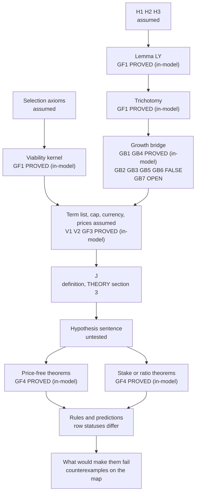

# The derivation chain

*Sunday 22 November 2026. One reading of rows already on `main` at `5fa4b8c`. It proves nothing and adds no CLAIM_MAP row. `THEORY.md` governs where a note disagrees with it (THEORY header). Status words are the claim map's. The four labels used below are **derived**, **derived in a stated limit**, **assumed**, and **open**. A theorem inside a model says nothing by itself about nature.*

The sentence of the hypothesis is, byte for byte, the sentence in THEORY §3, CORE, and README:

**The law of adaptive organization (hypothesis): strongly selected systems minimize the cost of judgment.**

**Hold this.** Persistence alone yields a viable set and does not rank inside it. Copying, when offspring falls in each coordinate of a chosen bad vector, never keeps a dominated design. Knowing the growth exponent picks one argmax. Knowing only that monotonicity lets an observer name the front, and does not prove that one copying process sits on the whole front. Weak selection on a gapped finite menu recovers a ranking and nothing else. The diffusion limit keeps a variance penalty. A ruin level set is a half-space in an exponent coordinate, and a bounded interval of refresh time on one published path. The term list, the cap, risk-neutral expected currency, and linear nonnegative prices are assumptions. Inside those assumptions the master equation is the definition of the problem. Minimizing it gives price-free constraints, and, separately, comparative statics that need a stake or a ratio. The rules and the open predictions are corollaries of that defined cost. No link is a result about a real system.

The edge into Lemma LY is H1–H3, the lemma's premises. The selection axioms are not that list. V1, V2, and GF3 are **PROVED (in-model)** classifications. The assumptions of those classifications are the inputs. Closeness under persistence only is A2-P and `theory/SCALE_ENDS.md` §6b. It is not a second status of GF1. Occupation of the front is outside GF1's proved claim (V5 **OPEN**).

Each link below has the statement, the claim-map status, the assumptions by name, the Lean check, and the textbook prior art.

## 1. Selection axioms — assumed

**Statement.** Over any interval of persistence a design accrues a cost rate \(J\ge 0\), and a design that cannot cover \(J\) shrinks or is eliminated (A1). Copying or retention favors lower cost. The strong form is the linear Malthusian map \(m=m_0-\alpha J\) with Wrightian \(r=\exp(m)\) and \(\alpha>0\) constant on the graph (A2-L). A merely monotone map (A2-M) favors cheaper designs and does not give a Boltzmann weight. Persistence only (A2-P) has no copying. The world may drift (A3); the static world is \(\sigma^2=0\). These are premises about a class, not theorems (`theory/SELECTION_AXIOMS.md` §2).

**Status.** The axioms are assumptions in that note. They are not rows. The theorems that use them are R1 **PRIOR ART**, R2 **PROVED (in-model)**, R3 **OPEN** (`measurement/CLAIM_MAP_v2.md` section R).

**What R1 and R2 actually deliver.** Under A1, A2-L, \(N\mu\ll 1\), a connected undirected design graph with equal mutation clocks, and no frequency dependence, the monomorphic chain has \(\pi\propto e^{-\beta J}\) with \(\beta=\alpha\nu\) (haploid Moran \(\nu=N-1\); diploid Wright–Fisher \(\nu=2N-1\), an approximation). On a quadratic well in \(d\) whitened coordinates the excess is \(d/(2\beta)\). The fractional form \((\mathbb{E}[J]-J^\star)/J^\star\approx d/(2\sigma N_e)\) needs \(J^\star>0\), \(N_e=\nu\), and the zero of the cost fixed. V1 records that the fractional excess moves with the additive constant (Corollary SA1c; `theory/GENERAL_FORM.md` §6). That package is prior art applied to this \(J\), not a new theorem (R1). In a drifting world the operational excess \(\sqrt{kw\sigma^2/6}+d/(2\beta)\), and the total rate including lumps \(2\sqrt{kw\sigma^2/6}+d/(2\beta)\), are the sum of two known terms under SA2-A, SA2-B, and SA2-C: zero discount, the lumpy coordinate off the substitution chain, the optimum moving only in that coordinate, a reset that changes only that coordinate, and some mutation rate with both \(N\mu\ll 1\) and \(t_{\mathrm{mix}}(y)\ll b^{\star 2}/\sigma^2\). If no mutation rate satisfies both, SA2 is not claimed (R2; `theory/SELECTION_AXIOMS.md` §4). SA-P1, the comparison of that excess with \(d/(2\sigma N_e)\), is a sketch and is not locked (R3). R2 is the lumpy redesign excess. A moving optimum in the soft coordinates is section S (`theory/DRIFT_SELECTION.md`; CORE §8): S1 **PRIOR ART**, S2 **PROVED (in-model)**, S3 **OPEN**, S4 **OPEN**. N66 **PROVED (in-model)** is the one-coordinate lattice-to-diffusion bound DS1 uses. It does not cover an OU centre. S1 is prior art, not a proved row.

**Lean.** The Gibbs identity \(\mathbb{E}_\pi[J]-J^\star=d/(2\beta)\) for a positive-definite quadratic, given the Boltzmann weight, is machine-checked (`Equipartition.gibbs_excess_quadratic`, `formal/lean/README.md`). SA1, the per-process \(\beta\), the well-supported approximation, SA2 as a selection statement, and the fractional form are not formalized (same file, "What is not formalized"). The identity \(wb^{\star 2}/6=\sqrt{kw\sigma^2/6}\) is algebraic in \(b^\star\), from \(k,w,\sigma^2>0\) and \(b^{\star 2}=\sqrt{6k\sigma^2/w}\) (`LayerLifetime.barrier_band_identities`). The average-cost expression is an input of the \(T^\star\) minimizer in §9.2, not of this identity.

**Prior art.** Sella and Hirsh 2005 for the stationary weight. Tenaillon, Silander, Uzan and Chao 2007, from Hartl and Taubes 1998 and Poon and Otto 2000, for the quadratic drift load \(d/(2\beta)\). Chalkley 1997, exact at zero discount, and Dixit 1991, for the lumpy band (also CL19, **PRIOR ART**). Lynch et al. 2016 for the drift-barrier scale; the factor 10 in THEORY §3 is the repository's choice (`theory/SELECTION_AXIOMS.md` §3, §7).

A2-M does not give \(d/(2\beta)\). A2-P does not give the Moran or Wright–Fisher theorems. Strong mutation, frequency dependence, and a binding ruin constraint inside \(\pi\) are outside SA1 (`theory/SELECTION_AXIOMS.md` §2).

## 2. Viability kernel — derived for the object, open for closeness

**Statement.** Under persistence only (S-P, the selection note's A2-P restated with no scalar \(J\)), a design is eliminated when a named scarce account hits a ruin set, and designs that miss that set are not ranked against each other. For a static design the resulting set is Aubin's viability kernel. It does not rank designs inside the set, and it is not the Pareto front (`theory/GENERAL_FORM.md` §2, §3 (iv)(vi)).

**Status.** GF1 **PROVED (in-model)** for that classification. The pair of scores \((1,0.2)\) and \((0.5,0.2)\) is the counterexample in `theory/GENERAL_FORM.md` §3 (iv): both have ruin probability below 1, and the first is strictly dominated. The GF1 row's named counterexamples are the \(\lambda\) pair and the invasion gap. A closeness theorem for persistence-only structures is **open**. A2-P says the Moran and Wright–Fisher theorems do not apply, and `theory/SCALE_ENDS.md` §6b lists the missing piece: a persistence-only version of Theorem P for non-replicating held structures.

**Assumptions.** S-P. No use of A2-L, H3, or a scalar cost.

**Lean.** Not machine-checked. No viability declaration in `formal/lean/` (`formal/lean/README.md` lists what is formalized; this is not among it).

**Prior art.** Aubin, *Viability Theory*, the edition under doi 10.1007/978-0-8176-4910-4 (`theory/GENERAL_FORM.md` §3 (vi), §8).

## 3. Lemma LY — derived under H1–H3

**Statement.** Let the environment be exogenous and ergodic, and let a pure design's offspring \(W\) depend only on the design and the environment (H1). Let retention be the Lyapunov exponent \(\lambda=\mathbb{E}[\log W]\), finite (H2). Let offspring be strictly decreasing in each coordinate of a chosen bad vector, with \(W>0\) (H3). Then \(z\le z'\) and \(z\neq z'\) imply \(\lambda(z)>\lambda(z')\), so every maximizer of \(\lambda\) is Pareto in \(z\) (`theory/GENERAL_FORM.md` §3).

**Status.** GF1 **PROVED (in-model)** for the lemma, the log-linear corollary, the trichotomy, and two counterexamples. Occupation of the front is outside the proved claim. H3 is a hypothesis. The replicator equation does not supply it (`theory/GENERAL_FORM.md` §2).

**Assumptions.** H1, H2, H3. S-W is representation A7: the law of the world does not depend on the design. H1 includes that and adds ergodicity, plus offspring that depends only on the design and the environment. H1 is not A7. H3 is the vector form of A2-M (`theory/GENERAL_FORM.md` §2). The coupled case is CX2, **OPEN**.

**Lean.** Not machine-checked.

**Prior art.** The Pareto order is textbook. The comparison under H1–H3 is the note's packaging (`theory/GENERAL_FORM.md` §8). A log-linear map \(\log W=-\langle c(\omega),z\rangle\) with \(c\ge 0\) makes growth minimize \(\langle\mathbb{E}[c],z\rangle\) in growth units (corollary LY-c, inside GF1). That linear cost is not the master equation: \(\lambda\) is an expected logarithm, and V2 records that Kelly growth and expected currency have different argmins.

**Where H3 fails, the lemma is not claimed.** LY-1: expected bads \((1,0)\) have \(\lambda=-0.804718956\), and \((2,0.4)\) has \(\lambda=0.095310180\). H1 and H2 hold. H3 fails for the expected bads. Both offspring numbers are positive (GF1). LY-2: H1 fails under random matching, and a strictly dominated type goes to fixation (invasion gap 2 at frequency 0).

## 4. The trichotomy — derived as a classification

**Statement.** Three different things can be known (`theory/GENERAL_FORM.md` §3).

1. **Known exponent.** Under H1–H2, copying emits the complete preorder \(\lambda\). The selected set is \(\arg\max\lambda\). It may be one point. **Derived** under H1–H2.
2. **Monotonicity only.** Under H1–H3, \(\lambda\) satisfies the strict product order S-M+. An observer who knows only S-M+ cannot rule out a Pareto point: for each such point there is a retention that satisfies S-M+ and selects it. The front is the union of those argmax sets. It is an identified set. **Derived** as that identification. That one copying process occupies the front is **open**. GF1 states the occupation claim as not proved. V5 stays **OPEN**.
3. **Persistence only.** S-P produces the viability kernel of §2. It does not produce the front. **Derived** as the classification in GF1 (iv)(vi).

A lexicographic order, a ruin threshold, and the Lundberg objective are stronger complete rankings than the product order. S-M+ does not produce them (GF1 (v)(vii)). H1–H2 already supply a complete ranking, and it is \(\lambda\), which need not be any of those three.

**Lean.** Not machine-checked.

**Prior art.** Pareto identification and scalarization are textbook (Debreu 1954; Geoffrion 1968; Miettinen). The trichotomy as a reading of this growth exponent is the note's packaging (`theory/GENERAL_FORM.md` §8).

## 5. Growth bridge — derived in two stated limits; the equation is not the limit

**Statement.** On a gapped finite menu, weak selection recovers the ranking only. The diffusion limit keeps \(\mu-\sigma^2/2\). An interior stake separates the argmaxes. The term list and the cap are inputs (`theory/GROWTH_BRIDGE.md` §0, §6).

**Status.**

| Row | Status | What it is |
|---|---|---|
| GB1 | **PROVED (in-model)** | Two scoped expansions |
| GB2 | **FALSE** | The unscoped identity \(\mathbb{E}[\log W]=\mathbb{E}[W-1]-\mathrm{Var}(W)/2+O(\text{third moment})\) |
| GB3 | **FALSE** | Diffusion scaling, or an interior stake, reduces \(\lambda\) to risk-neutral expected currency |
| GB4 | **PROVED (in-model)** | Extinction and hitting formulas; the B9 level set in \(\tau\) is a bounded interval |
| GB5 | **FALSE** | That hitting geometry is the master equation |
| GB6 | **FALSE** | H3 for memory, acquisition, task loss, ruin, and attention from first principles |
| GB7 | **OPEN** | A real offspring map in the weak-selection regime on those coordinates |

**Derived in a stated limit (GB1).** Menu: \(W_i=1+\varepsilon X_i\), with \(\varepsilon|X_i|\le 1/2\) almost surely, a finite third moment, a unique mean leader, and a fixed gap \(\gamma>0\). For small enough \(\varepsilon\), \(\arg\max\lambda\) agrees with \(\arg\max\mathbb{E}[W]\). The expansion is \(\lambda=\varepsilon\mathbb{E}[X]-(\varepsilon^2/2)\mathbb{E}[X^2]+O(\varepsilon^3)\). The agreement is an agreement of argmaxes. On this menu the gap stays fixed while \(\varepsilon\to 0\), and the second-moment term cannot flip it. Diffusion: \(W=1+\mu\Delta t+\sigma\sqrt{\Delta t}\,Z\) with \(|W-1|\le 1/2\). The growth per unit time tends to \(\mu-\sigma^2/2\). At \(\mu=0.2\) and \(\sigma^2=0.5\) the limit is \(-0.05\): positive drift, negative growth.

**Derived, and not a cap in the design coordinate (GB4).** Near-critical Galton–Watson survival is \(2(m-1)/\beta_2\). Feller extinction is \(\exp(-\alpha z/\beta)\) for positive drift. Brownian ruin is \(\exp(-2\mu x/\sigma^2)\) for positive drift. Birth-death, Feller, and Brownian level sets are half-spaces in the exponent coordinate. The Galton–Watson half-space in the plane of \((m-1,\beta_2)\) exists after the linear approximation. On the published path of Lemma B9 the preimage in refresh time \(\tau\) is the bounded interval \([0.183706411069,\,0.299049733488]\) at \(\varepsilon_r=10^{-3}\) and \(B=0.5\). The four points \(\tau_S=0.236207526722\), \(\tau_G=0.302668099260\), \(\tau_{\mathrm{cap}}=0.299049733488\), and \(\tau_E=0.316227766017\) are distinct. A requirement between \(\theta(\tau_G)\) and \(\theta(\tau_E)\) puts expected cost at \(\tau_J=0.309679835108\), apart from \(\tau_G\).

**Assumptions that remain.** The term list, the free level of the cap, risk-neutral expected currency as the exact objective, and H3 on each coordinate the cost treats as a bad (GB5, GB6, Theorem GB). Copying does not supply the budget map that makes the partials \(-\kappa\), \(-c\), and \(-c_a\).

**Lean.** Not machine-checked.

**Prior art.** Taylor's theorem for the expansion. Kelly 1956 for the stake. Lewontin and Cohen 1969 for expected-log growth. Gillespie 1977 for selection on offspring-number variance. Gillespie 1974 remains the separate \(O(1/N)\) term in `theory/DYNAMICS.md`, not this penalty. Haldane 1927, Feller 1951, Iglehart 1969, and Cramér's survey for the extinction and ruin formulas, with the algebra re-derived in the note (`theory/GROWTH_BRIDGE.md` §7). The separation of the two limits as answers about this equation, the point \(\tau_G\), and the coordinate audit are what the note adds.

## 6. The assumed inputs — assumed

GF3 **PROVED (in-model)** says nonnegative additive \(J\) with a ruin cap is the special case exactly when (R-a), (R-b), and (R-c) hold. That iff has those three clauses. The term list is an input (selection note §2; growth bridge §6; GF2). It is not a fourth clause. V4 and V5 stay **OPEN**. The classification does not derive the assumptions.

| Input | Name in the notes | Row |
|---|---|---|
| Risk-neutral expected currency | GF3 (R-a); representation A2. Von Neumann–Morgenstern plus an index affine in currency loss. Logarithmic utility is a von Neumann–Morgenstern index and is Kelly's criterion | V2 **PROVED (in-model)** for the argmin gap. Worked mixture \(q^\star=0.26\) against per-unit means \(1.235\) and \(1.0425\) (CT42) |
| Ruin as a half-space cap | GF3 (R-b). A finite price on ruin, and maximizing the Lundberg exponent, are different scalars | V2: on the published path \(\tau_S=0.2362\) and \(\tau_E=0.3162\). GB4 gives the sharper quartet |
| Linear nonnegative prices | GF3 (R-c). Convex route: a supporting price \(p\ge 0\), \(p\neq 0\), at a Pareto point of a convex free-disposal set (Debreu 1954). Debreu route: A1–A7 on at least three essential intervals give an additive cost up to one positive scale and one additive constant; signs need A8, each concatenating coordinate a bad; linearity needs concatenation; a discrete layer count is an integer Cauchy term under an extra separability assumption | V1 **PROVED (in-model)**. The witness \(I+A-\mathbb{E}[\ell]\) satisfies A1–A7 and has a negative error price |
| The coordinates themselves | The term list is an input (selection note §2; growth bridge §6). A floor mentions a slot. It does not make retention decrease in that slot | GF2 **PROVED (in-model)** for the mention-audit. V4 **OPEN**: which concatenating coordinate the acquisition price is linear in. V5 **OPEN**: the five-name front as a hypothesis |

One currency is A4. Without it the scalar sum does not start (`theory/GENERAL_FORM.md` §5). S-A, the assumption \(A\ge c\cdot r\), is an assumption and not a sensor law (`theory/SHANNON_2026-11-21.md` §2). Attention as a fifth peer of memory, acquisition, error, and ruin is not a derived bad (GF2). Layer count is a bad only under the extra monotonicity that an extra layer raises some other bad (GF2).

**Lean.** V1, V2, and GF3 are not machine-checked.

**Prior art.** Debreu's additive representation; the monotone Cauchy equation; von Neumann and Morgenstern; Aczél, Forte and Ng for the nonnegative Shannon cone; Debreu 1954 and Geoffrion 1968 for supporting prices; Zadeh, Bowman, Wierzbicki, and Miettinen for scalarizations that reach unsupported points (`theory/REPRESENTATION.md` §0, §10; `theory/GENERAL_FORM.md` §8). The packaging on this coordinate list is the claim of the representation note. It is not a derivation of \(J\) from persistence.

## 7. The master equation — a definition inside those assumptions

**Statement.** A system that must act ahead of a world it does not control chooses a design to minimize

\[
J=\kappa I_{\mathrm{mem}}+hK+w\,\mathbb{E}[\ell]+A+L
\qquad\text{subject to}\qquad P(\mathrm{ruin})\le\varepsilon_r.
\]

**Status.** THEORY §3: the equation is assembled from known parts and is the statement of the problem, not a theorem. The same paragraph points at the representation note and at section X. GB5 is **FALSE** for the claim that maximizing \(\lambda\) in a small-noise limit yields this display. No row was added here. The definition is already that paragraph, and the boundary around it is V1, V2, GF3, GB5, and GB6.

**Label.** **Assumed**, as the definition, once §6 is granted. **Derived** only as the classification GF3: the display is the special case under (R-a), (R-b), and (R-c). The ideal-gas comparison in `theory/GENERAL_FORM.md` §0 is that comparison of assumptions. It is not a claim that judgment is a gas.

**Lean.** `FiniteDesignMenu.J` machine-checks the split \(J=S+wE\) on a finite menu whose feasible set does not depend on the stake (`formal/lean/README.md`). That is the split CT33 uses. The five-term expression and the cap are not that declaration.

**Prior art.** Each term is textbook: Sims 2003, Ortega and Braun 2013, Kalman 1960, Kelly 1956, Landauer 1961, Still et al. 2012, Black and Cox 1976 (THEORY §10; `theory/NOVELTY_NOTE_2026-11-21.md`). The whole objective, as posed, was not found in the repository's searches. Those searches were not exhaustive. The master-equation review calls the package a modest synthesis and, in the same review, a genuine but elementary contribution (`theory/NOVELTY_NOTE_2026-11-21.md`).

## 8. The principle, and the hypothesis sentence

**Statement.** The cost \(J\) is a definition. The principle is that strongly selected, persistent adaptive systems sit near the design that minimizes \(J\), within the tolerance their selection can resolve (THEORY §4). Under A1, A2-L, weak mutation, and SA1–SA1b, the in-model excess is \(d/(2\beta)\), and that excess is small only when \(\sigma N_e\) is large next to the number of soft coordinates. A moving optimum in the soft coordinates is section S, as in §1: S1 **PRIOR ART**, S2 **PROVED (in-model)**, S3 **OPEN**, S4 **OPEN**. The empirical bet is that qualifying systems meet those assumptions with parameters that make the remainder small, and that this \(J\) is the cost A2 acts on (`theory/SELECTION_AXIOMS.md` §10). SA-P1 tests the excess and is not locked (R3 **OPEN**).

The sentence is the bold sentence at the top of this note. "Strongly selected" is the five-part operational definition in THEORY §3: a cost-to-fitness map \(\sigma\), a population proxy \(N_e\), a band \(\varepsilon=10/(\sigma N_e)\) that selection can resolve, power against a named rival, and at least ten redesign times in one world. Cities, nation-states, global economies, and the biosphere are excluded until a class-specific proxy is preregistered. The sentence is not rewritten by the selection note, the representation note, the general-form note, or the growth bridge.

**Status.** The principle about nature is untested. No system has been shown to qualify (STATUS; `CORE.md`). The in-model excess is R1 **PRIOR ART** under the assumptions just named. Measured-input optimality is N13 **OPEN**. The cross-substrate form is J6 **OPEN**. J3 **WITHDRAWN**: the theory as a whole is not called a law; only the hypothesis sentence carries the word.

**Lean.** The hypothesis is a claim about the real world and is not formalized (`formal/lean/README.md`, first pages and "What is not formalized").

**Prior art.** A variational principle with free prices is the shape THEORY §4 names. Alchian 1950 is the prior-art assumption that selection holds designs near an optimum (THEORY §9). The formula for the excess is the prior art in R1, once A2-L is assumed.

## 9. Theorems — price-free, then those that need a stake or a ratio

GF4 **PROVED (in-model)** is a scope list. It proves no new inequality. The minimal extra assumption is the whole of what each line names.

### 9.1 Price-free

These use S-M and the floors, or a definition, and no price (`theory/GENERAL_FORM.md` §6).

| Result | Row | What is free of prices | Lean |
|---|---|---|---|
| Antitone front | V6 **PROVED (in-model)** | Two Pareto points move against each other in any pair of coordinates. The definition of Pareto (`theory/GENERAL_FORM.md` §6) | Not machine-checked |
| A Pareto point exists | F-0, the price-free line of GF4 **PROVED (in-model)** | Continuous score on a nonempty compact design set (`theory/GENERAL_FORM.md` §3). V6 does not state F-0 | Not machine-checked |
| Information floors | CT1 **PROVED (in-model)**; S1 in the Shannon note; PD1a **PROVED (in-model)** | \((I,e)\) or \((r,e)\) cannot fall below the proved curve. Stationary for S1; a density for PD1a. They do not pick a point | CT1 and PD1a are not formalized. CT4's convexity of \(L(I)=D(IB(I))+\kappa I\) and the first-bit sign in right-slope form are machine-checked. That \(L\) bounds a cost is not (`formal/lean/README.md`) |
| Staler reading | CT8, alias of K6, **PROVED (in-model)** | A staler reading is a garbling in a stationary Markov world with renewal checks | Not machine-checked |
| Buffer shape | CT25 **PROVED (in-model)** | \(B\ge z_\varepsilon\sigma\tau^H\) is the shape of a per-window chance constraint. Self-similarity of the error. No price on the error | Not machine-checked |
| No exact finite design | L3 inside CT21 **PROVED (in-model)** | \(E_K>E_\infty\) on a non-rational spectrum. "\(K^\star\to\infty\) as \(R\to\infty\)" needs the ratio \(R\) | CT21 is not formalized |
| Layer cap as dominance | GF2; GF4 | \(K\) past the McMillan degree is dominated at the minimum-error end only if an extra layer raises a bad | Not machine-checked |

The world's judgment frontier \(\mathcal{F}_W=\{(I,r,K,D)\}\) and its support function are Theorem S2 in the Shannon note: \(J^\star(p)=-\sigma_{\mathcal{F}}(-p)\), and this equals the operational least cost only when some minimizer has \(A=c\cdot r\) and \(L=0\). Technical efficiency needs no prices (Theorem S3, Farrell 1957, Debreu 1951). Joint achievability with both memory and reads priced is **open** (efficiency \(J_{\mathrm{floor}}/J=0.9574\) on one grid point; `theory/SHANNON_2026-11-21.md` §3). S1 does not charge a layer. A memoryless read can have \(K=0\) and still carry information.

CX1 stays **OPEN**. Section T is a partial resolution: the flow form of CT1–CT4 is proved for drifting worlds (PD1a and PD2–PD5 **PROVED (in-model)**; PD1b and PD7 **PRIOR ART**). When world variance diverges, the raw stock \(I(M_t;X_t)\) cannot be the viability term (PD6 **PROVED (in-model)**). A renormalized stock and the other open parts are PD8 **OPEN**. Section T was re-confirmed on 23 November 2026 (READY). These rows are not promoted past the remaining PD8 items; CX1 stays **OPEN**.

### 9.2 Needs a stake, a price ratio, or a scalar cost

Dropping the named extra assumption is a counterexample in `theory/GENERAL_FORM.md` §6.

| Result | Row | Extra assumption | Lean |
|---|---|---|---|
| Master Theorem (i), existence, \(K\le J(\mathcal{D}_1)/h\) | CT20 **PROVED (in-model)** | \(\mathcal{M}_{LG}\); a surviving design | Finite-menu existence and the \(K\) bound are machine-checked. The continuous Weierstrass argument is not |
| Master Theorem (ii), monotone layer count and read rate | CT20, CT33 **PROVED (in-model)** | Sensing fixed for the layer count. Ruin slack or absent. Single crossing in the stake | Finite-menu CT33 (error nonincreasing, spend nondecreasing) and the sensing-fixed layer count are machine-checked. \(f^\star\) nondecreasing in \(w/c\) is not. With reads chosen, \(K^\star\) can fall. With ruin binding, spend can fall and error rise (`scope_checks.py` §1b) |
| Judgment spend | CT33 **PROVED (in-model)** | Scalar \(J=S+wE\) on a menu that does not depend on \(w\) | The finite-menu case is machine-checked |
| Layers by degree | CT21 **PROVED (in-model)** | Linear-Gaussian, squared error, counted by degree. Interlacing needs exogenous noise and speed-free upkeep. The ratio \(R=wE_\infty/h\) picks \(K^\star(R)\) | Not machine-checked. N60 **PROVED (in-model)** given convexity, numerical. N64 **PROVED (in-model)** for the from-0 count when decrements are non-increasing; the from-0 direction and the converse under positive distinct decrements are machine-checked (`N60Exact`). Model S convexity for \(J\le 2\) is not formalized. N67 **PROVED (in-model)** for a weak third mode. N68 **OPEN** for three or more distinct rates, none negligible |
| Cost shares \((\alpha-1):1\) | CT24 **PROVED (in-model)**; the ratio also needs CT12 | Linear prices, a price-independent feasible set. One exact-read power-law tracker for the ratio | Not machine-checked. A binding ruin constraint is the existing counterexample (shares 0.528 and 0.472, elasticities summing to 1.147) |
| Excess \(d/(2\beta)\) | R1 **PRIOR ART** | Scalar cardinal cost, A2-L, quadratic well, whitened coordinates, scale fixed if \(\beta\) is held fixed | The Gibbs identity is machine-checked. A homogeneous cost of degree \(p\) has mean \(d/(p\beta)\); the quartic case is \(1/(4\beta)\) (`theory/GENERAL_FORM.md` §6) |
| Price of survival | CT22 **PROVED (in-model)** | Scalar diffusion path, \(J''>0\), \((s^2)''>0\), \(\theta'\neq 0\) off the survival endpoint | \(B_{\min}\), certification at \(B_{\mathrm{slack}}\), and optimality of the expected-cost design for \(B\ge B_{\mathrm{slack}}\) are machine-checked. The binding multiplier \(\mu_s=-m'/\theta'\) is not |
| Physics floor \(\sigma\sqrt{2kT\cdot w}\) | CT7 **PROVED (in-model)** | A price per nat in one random-walk model | Not machine-checked |
| Read-rate elasticity \(1/\alpha\) | CT12, alias of N7, **PROVED (in-model)** | The ratio \(wq/c\) and the power-law plant | Not machine-checked. CT10, effort nondecreasing in stakes, is machine-checked |
| Lifetime \(T^\star=\sqrt{6k/(w\sigma^2)}\) | CL19 **PRIOR ART** | The minimizer of \(k/T+w\sigma^2 T/6\). The ratio \(k/w\), zero discount, a Brownian gap, a lumpy reset. CT25 is the buffer shape \(B\ge z_\varepsilon\sigma\tau^H\), a different row | Machine-checked as the unique minimizer of the given average cost \(k/T+w\sigma^2 T/6\). The stochastic derivation of that expression is an input |
| Sharing threshold \(N^\star(\rho)\) | CT14, alias of B2, **PROVED (in-model)** | A scalar cost in the class \(P(a,b)\), and the drift ratio \(\rho=q_g/q_u\). That ratio is a parameter of the world, not a price | Not machine-checked |

The Master Theorem's home is THEORY §5 and Appendix B.9: exogenous Gaussian world, stationary or with stationary increments, white noise or exact reads, first-order stores, squared error, ruin through the Lundberg bound. Parts (ii) and (iii) were restated after the v2.3 review found them too wide. The layer results are linear-Gaussian (THEORY §9). Other rows proved in a model that use the scalar cost, and that GF4 does not put in the price-free column, stay where section O puts them: CT26–CT36 and CT37–CT43. This note does not re-derive them.

## 10. Rules and predictions

THEORY §7 derives seven design rules from \(J\) and groups them into four: hold, estimate, watch, learn. The derivation runs from the defined cost to the rules. Rules 1 and 6 are only partly derived. Rules 3 and 4 are known or close to tautologies.

| Rule | Group | Rows | Status in THEORY §7 | Lean |
|---|---|---|---|---|
| 2. Keep while value beats upkeep; otherwise let it fade | Hold | CT4, CT9, CT11 | Proved in a model. Fails when the world is not Markov in the coordinates kept | CT9 and CT11 are not formalized. CT4 is partial (§9.1) |
| 4. Keep a superseded version until proof, when upkeep is below \(p\cdot\nu\cdot(L_f-L_r)\) | Hold | CT26 **PROVED (in-model)** | Proved in a toy, close to a tautology. Needs recoverability | Not machine-checked |
| 3. Move a belief by the reliability of the signal | Estimate | CT21 | Known: Kalman 1960, Muth 1960 | Not machine-checked |
| 5. Act from the current model; a copy's error grows with hops and with drift | Estimate | CT8, CT19 **PROVED (in-model)** | Proved in a model. Fails for non-Markov observed variables | Not machine-checked. Local versus shared on the repository's cost expressions, the fast-local / slow-shared sign, is machine-checked (`LocalShared.switch_iff`): a drift switch exists iff delay is on the shared channel only and \(k_S<N k_L\) |
| 1. Act early; interrupt when stake times chance, plus what the outcome would teach, beats the cost | Watch | CT19; CT27 for the teaching term | Partly derived. The interrupt inequality is Howard 1966. The teaching value is model-specific | Not machine-checked |
| 7. Watch more as drift times stakes rises, and stop when a cheaper fallback exists | Watch | CT10 **PROVED (in-model)**, CT12, CL1 **PROVED (in-model)**, CT22 | Proved in a model. The core of the cliff is known for web crawlers (Cho and Garcia-Molina 2003) | CT10 is machine-checked. CL1 is not |
| 6. Record whether each prediction was used, ignored, or late | Learn | CT27 **PROVED (in-model)**, CT30 **PROVED (in-model)** | The update rule is proved in a model (Muth 1960 in substance). That real ants and synapses implement it because selection favored it is untested | Not machine-checked |

**Predictions about systems, all open unless a row says otherwise** (THEORY §8). N56 **OPEN**: layer count, memories, and read rates against \(\arg\min J\) from a measured spectrum, noise, and prices, in a system that qualifies. N51 **OPEN**: look-rate elasticity \(1/\alpha\). N54 **OPEN**: the redesign record is about 10–100 of the slowest tracked time scales long. N55 **OPEN**: scatter of log read-interval scales as \(1/\sqrt{\alpha-1}\). N57 **OPEN**: a tracker with negligible read noise spends \(\alpha-1\) on looking for every 1 lost to being wrong. N27 **OPEN**: central share falls with \(q\cdot\ell^{\alpha-1}\). N52 **OPEN**: cheap lookup removes holding layers and not enforcement layers; the step from the per-fact theorem to whole levels is extrapolated. K7 **OPEN**: stress strengthens, up to a ceiling that CT25 gives in a model. K4 **NOT A TEST (qualification not established; proxy: failed)**: the shock times square-root time reading; no valid fix time was measured. CL1 is proved in a model; the field reading of the watching cliff is not a passed test. The sharing onset CT14 is proved in a model and untested in the field (THEORY §8).

DIR1 is a directional, price-free reading on the published record. It is **INCONCLUSIVE** (STATUS). D1–D4 do not separate this cost from any other cost-benefit optimizer. D5 was unscored. It is not a qualification under THEORY §3, and it is not N56.

Price-free signs are classified in `theory/PRICE_FREE_2026-11-21.md`. Argmin \(J\) depends only on price ratios (`theory/REVEALED_PRICES_2026-11-21.md`). That note proposes a change to the miss rule and does not apply it (OPEN_WORK C7).

## 11. What would make them fail

Each line is a counterexample or an open miss condition already in the repository. A failure of an assumption removes the link that names it. It does not, by itself, remove a link that does not use it.

| If this fails | The link that stops | Where it is already shown |
|---|---|---|
| Offspring does not fall in the expected bads | Lemma LY for those coordinates | LY-1, inside GF1 |
| Offspring depends on the other designs' frequencies | The complete preorder \(\lambda\) | LY-2; a rock-paper-scissors cycle has no frequency-independent scalar (GF1) |
| A fixed mean gap is not small next to \(\varepsilon\) | The ranking agreement of GB1 | The three-design menu in `theory/GROWTH_BRIDGE.md` §9: the growth argmax agrees at small \(\varepsilon\) and flips at a larger \(\varepsilon\). On GB1 the gap stays fixed while \(\varepsilon\to 0\) |
| Diffusion scaling, or an interior stake, is read as expected currency | GB3 **FALSE** | Mean excess \(0.01\) has \(\lambda_B=-0.010274369557\). Stake \(f^\star=0.2\) against the expected-offspring corner \(0.99\). Limit \(-0.05\) at \(\mu=0.2\), \(\sigma^2=0.5\). Those witnesses are not the GB1 menu |
| Someone treats a ruin level set as the five-term equation | The step from GB4 to the master equation | GB5; \(\tau_J\neq\tau_G\) inside a binding cap |
| H3 is demanded from copying alone | The partials on memory, acquisition, and attention | GB6 |
| The objective is log-growth or a survival exponent | The argmin of expected currency | V2; CT42; Lemma B9 |
| The score set is the three-point dent and mixtures are infeasible | Nonnegative linear prices selecting every Pareto point | \(C=(0.6,0.6)\) minimizes no nonnegative weight (GF3, V6) |
| Ruin binds on the stakes compared | Master Theorem (ii) and CT33 | `scope_checks.py` §1b |
| Reads are chosen | The claim that \(K^\star\) never falls with stakes | CT20; THEORY B.9 |
| A store's own noise dominates, exponent \(s\) | "Every layer runs faster than its mode" | P9 **PROVED (in-model)**: \(\lambda\tau^\star=(1-s)/s\) at low signal-to-noise. At \(s=1/2\), \(\lambda\tau^\star=1\) |
| The spectrum is not rational, or a rhythm is counted as one real store | A finite exact design, or the from-0 count | L3; the two-oscillator counterexample, \(R=3\), formula 2, argmin 3 (CORE; `core/KEYSTONE_NOTE.md`) |
| The system shapes the world it tracks | S1 as proved, and H1 | CX2 **OPEN**; failure classes U6 |
| The birth rate is linear in cost, or mutation is strong | \(d/(2\beta)\) | A2-L versus a linear \(r\); SA1's weak-mutation hypothesis (`theory/SELECTION_AXIOMS.md` §2, §6) |
| A qualifying class, with the five THEORY §3 items recorded before the comparison, lands outside the preregistered band more often than the preregistered binomial allowance, or needs a cost off the closed list, or fails to move with a measured input beyond the redesign band of CT41 | The hypothesis, for that class. Two classes at different scales, for the cross-scale reading | THEORY §3 and §8. N56 **OPEN**. No such class has been shown to qualify |

An antitone cloud of traits does not test the general form (GF5 **OPEN**; the worked cloud is the counterexample). Excess over the Gauss–Markov relaxation does not certify a miss of the achievable front (GF5; joint achievability stays open in the Shannon note §3).

## Weakest links

Ranked by how much of the chain hangs on the assumption, and by how little is known in its favor. The strengthening and breaking results named here are the ones already specified in the repository. None of them is a new proposal.

1. **The objective itself** (term list, risk-neutral expected currency, linear nonnegative prices, half-space cap). The master equation, the stake-or-ratio theorems in §9.2, and the rules that minimize \(J\) use it. The price-free lines in §9.1 do not: the antitone front, existence, the information floors, CT8, CT25's buffer shape, and L3's \(E_K>E_\infty\). It is assumed. V2 and GB3 and GB5 are proved separations, so the support for treating this objective as the output of growth is the counterexamples. The result that would strengthen it is a locked comparison, on one system that qualifies, of expected currency against Kelly and against Lundberg (the sketches in `theory/GENERAL_FORM.md` §7 and GB7 **OPEN**; nothing is locked). The result that would break it is a selected design at the unsupported dent, or \(\arg\max\lambda\) different from the expected-cost argmin inside a slack cap. The published path already separates \(\tau_S\), \(\tau_G\), \(\tau_E\), and \(\tau_{\mathrm{cap}}\) in a model. **Derived in a stated class, and not a removal of this link.** For an exogenous equilibrium OU signal under a mean-squared decision loss, and for the telegraph under Hamming error, the memory-bath heat at fixed decision error is **PROVED (in-model)**, and the infimum is approached at finite heat. The telegraph floor is PR #175, merged as `f18f21f` (reviews #176 `5fbf525` and #177 `c9f02df`). The scalar OU floor is PR #178, merged as `b46bf9f` (review #179 `74e02e7`): the infimum is \(kT\) times the Kalman rate, and the centered spring scored by raw coordinate error still sits \(kT\,a\) above that rate. That gap is the scoring of that coordinate. The reviews of PR #175 remain the record for it. The independent-mode floor and the rank-one sum loss are PR #180, merged as `d1d6ea5` (review #181 `fbf03b7`). IP5 stays **FALSE**: the master equation is not the Lagrangian of the physical frontier. The derived object does not supply the term list, risk-neutral expected currency, linear prices, the half-space cap, the stake \(w\), a separate acquisition summand, or linking. It is not the Shannon joint-achievability gap (link 7). H3 is untouched. The consolidated reading, and a rewrite of THEORY §3 that is not applied, are `theory/GENERAL_FORM_PHYSICS_2026-11-22.md` and OPEN_WORK T40. T37 records the first proposal.

2. **H3.** Lemma LY, the identified front, and any claim that selection refuses a dominated design hang on it. It is assumed. GB6 is **FALSE** for "from first principles." The result that would strengthen it is an offspring map, with the other bads held fixed, monotone in the preregistered coordinates. The result that would break it is a real map with the sign of LY-1.

3. **A2-L, and the identification of this \(J\) as the cost inside that map.** The distance \(d/(2\beta)\) and the reading "near the minimum" hang on it. The weight is prior art once the map is granted (R1). The map is not derived. Local linearity is enough for SA1b and not enough for the global weight in SA1. The result that would strengthen it is SA-P1, which is R3 **OPEN** and not locked. The result that would break it is a lag-corrected excess outside the preregistered factor of \(d/(2\sigma N_e)\), or a birth rate linear in cost.

4. **Strong selection, as THEORY §3 defines it.** Every sentence about nature hangs on it. No system has been shown to qualify (STATUS; `CORE.md`). The result that would strengthen it is one class with items (a)–(e) recorded before the comparison, then N13 or N56. The result that would break the hypothesis for that class is the miss rule in THEORY §3 and §8.

5. **An exogenous world (H1, S-W, representation A7).** The information floors and Lemma LY hang on it. It is a standing assumption. CX2 is **OPEN**. The result that would strengthen it is a classification of which real couplings are \(\beta\)-potential (U7 **OPEN**). The result that would break the exogenous theorems in that class is a co-adapting system in the failure classes of U6 (cycle, runaway, delay).

6. **Convexity of the layer-error curve, for the closed-form count.** The slogan "one layer per separated scale" as a formula hangs on it. \(K^\star=\arg\min J\) does not: the count is computed by optimizing \(J\) (THEORY §3; OPEN_WORK T18, deprioritized). N60 is conditional on convexity. N68 is **OPEN**. The rhythm counterexample already breaks the increment formula (CORE). A proof of Model S convexity for three or more distinct rates, or a certified counterexample, is the result that would settle it. N67 settles only a weak third mode.

7. **Joint achievability of the information floor.** A numerical efficiency hangs on it. The logic of \(J\) does not. The edges are known. The interior is **open** (Shannon note §3). A design that meets both bounds, or a proof of a strict gap, would settle the number. It would not rewrite the definition.

S-A, the linear read-price assumption, is narrower: it is load-bearing for the assembled information floor and is named as an assumption in the Shannon note §2.

## What is ours versus known

Checked against `theory/NOVELTY_NOTE_2026-11-21.md`, THEORY §10, `litmap/PRIOR_ART.md` (14 Nov 2026; "Adds" means not found in that sweep, not proved new), `theory/SHANNON_2026-11-21.md` §6, `theory/SELECTION_AXIOMS.md` §0 and §7, `theory/REPRESENTATION.md` §0, `theory/GENERAL_FORM.md` §8, and `theory/GROWTH_BRIDGE.md` §7. The prior-art search is not exhaustive (THEORY §10).

**Known, and used as known.**

- Pareto order, supporting prices, proper efficiency, and scalarizations that reach unsupported points (Debreu, Geoffrion, Zadeh, Bowman, Wierzbicki, Miettinen).
- Additive numerical representation of a separable preorder, and the Cauchy equation (Debreu; stated as V1).
- Technical and allocative efficiency (Farrell 1957; Debreu 1951). Phenotype fronts (Shoval et al. 2012).
- Kelly 1956, Lundberg, Sella and Hirsh 2005, and the quadratic excess \(d/(2\beta)\) (Tenaillon et al. 2007 and the papers they credit). R1 is **PRIOR ART**.
- The viability kernel (Aubin). Causal and sequential rate-distortion (Neuhoff and Gilbert; Tatikonda, Sahai and Mitter; Tanaka et al.; Kostina and Hassibi).
- Monotone comparative statics (Topkis 1978; Milgrom and Shannon 1994). Kalman 1960 and Muth 1960 for the estimator. Landauer 1961 and Still et al. 2012 for the physics floors. Sims 2003 for expected loss plus a price on information.
- Rules 1–7 taken one by one (`litmap/PRIOR_ART.md`, bottom line). Cache level counts of the Chow type are novelty 0 in that domain (`theory/CACHE_HIERARCHY_PRIOR_ART_2026-11-21.md`, cited from PRIOR_ART).
- The lumpy band (Dixit, Chalkley) and the inventory safety factor behind \(B/(\sigma\sqrt{\tau})\).

**Packaging the repository claims, with the review's own limit on the claim.**

- The specific sum — memory price, upkeep per layer, stake-weighted loss at the moment of use with lateness counted as error, read and link costs — under a hard ruin cap, with the measured world as the only input (`theory/NOVELTY_NOTE_2026-11-21.md`). THEORY §10 calls this package the theory's own, as far as anyone has found, and says several one-line results are probably new in form while the economics repeats public-goods, Coase, and Shephard results. The master-equation review, quoted in the novelty note, says "Modest synthesis, not a new result" and, later in the same review, "a genuine but elementary contribution" for the package not found stated together. Both sentences stand. "Not found" is the honest word.
- The Lyapunov comparison under H1–H3, the trichotomy, the split between a floor that mentions a slot and H3, and the false package sentence that a small-noise limit yields the master equation (`theory/GENERAL_FORM.md` §8; `theory/GROWTH_BRIDGE.md` §7). The geometry is textbook. The hostile reading that says so is accepted in the general-form note.
- A price per layer and the ruin cap beside the causal rate-distortion program, still without a formula for the fewest layers that reach a given accuracy (`theory/SHANNON_2026-11-21.md` §0 and §7).

**Dated list, not re-adjudicated here.** `litmap/PRIOR_ART.md` still lists, as pending targeted searches, the T3a threshold, the square-root evaporation rule, the temperature identity, geometric level counts, the Rosen–Still–lateness synthesis, and a multi-scale preregistered program. Later notes have credited pieces that list treated more generously: the quadratic excess is prior art (R1, v2.74 credit). THEORY §10 credits the ratio \(z\) to the inventory safety factor, and first passage to Black and Cox. CL4 is that first-passage formula, **PRIOR ART**, credited to Black and Cox, as is the passage in CT25. This note does not reopen those rows.

## Disagreements, left in place

THEORY governs where a note disagrees with it. This section records the clashes a reader of the chain will hit. It does not pick a winner except where THEORY already does.

1. **Two frontiers.** Theorem S2 in `theory/SHANNON_2026-11-21.md` defines the frontier as \((I,r,K,D)\). Shannon §5 and the earlier one-pager's §1 Part 2 ([`history/2026-11-22_CORE_before_front.md`](https://github.com/Chad-Mitchell/theory-of-adaptive-organization/blob/1eed183f3888e8e3eead5956bbf1e8cb4233510a/history/2026-11-22_CORE_before_front.md)) read the price-free half of the hypothesis as "selected systems sit near that frontier." V5 **OPEN** is a different object: memory held, information bought, error, attention, and ruin risk. The V5 row says S2's vector is \((I,r,K,D)\) and that the five names are not that vector. GF2 says attention is not a derived bad and that the five-name list is not derived. GF1 says occupation of the front is not proved. V5 is "not a replacement of the Part 2 sentence" (`theory/REPRESENTATION.md` §7). The hypothesis sentence remains the sentence about the cost of judgment.

2. **What the growth limit yields.** THEORY §3 says the equation is the statement of the problem, not a theorem, and points at the representation note and at section X. GF3 says the equation is the special case under risk-neutral currency, a half-space cap, and linear nonnegative prices. GB5 says the hitting geometry is not that equation, and the package sentence "maximizing \(\lambda\) in a small-noise limit yields \(J\)" is **FALSE**. Those three agree if "special case under named assumptions" is read as a classification and the assumptions stay assumed. The directions note now says PR #154 is merged (`fb6c17f`; confirm #157 `797b14b`). V5 stays **OPEN**. Section 1.2's bullets remain the review snapshot. That snapshot matches GF4 on the stake split and matches GF3 on the cap. §1.1 still says the additive equation is likely a special case. GF3 is the proved classification under the named assumptions, GB5 is **FALSE** for the unscoped limit, and THEORY §3 keeps the equation as the statement of the problem.

3. **Ruin and convexity, two sentences that look opposed.** Shannon Theorem S3: \(P(\mathrm{ruin})\le\varepsilon\) does not give convexity of the restricted set, because ruin is not determined by the mean loss. GF3 (R-e) and V6: a coordinate cap \(\rho\le\varepsilon\) on a convex score set preserves convexity, and a chance constraint imposed on the design before scoring need not. The general-form note marks as **FALSE** the earlier claim that a plain cap breaks convexity of a convex score set. The two sentences are the two cases GF3 separates. They are not rewritten here into one sentence.

4. **Persistence only.** A2-P: the Moran and Wright–Fisher theorems do not apply, and a persistence-only closeness result remains **open** (`theory/SELECTION_AXIOMS.md` §2; `theory/SCALE_ENDS.md` §6b). GF1: under S-P the object is the viability kernel, which does not rank inside the viable set, and that classification is **PROVED (in-model)**. The open item is a closeness theorem. The proved item is that the kernel does not rank. Both stand. The diagram draws them as different nodes.

5. **The same letters are different axioms.** Selection A1, A2-L, A2-M, A2-P, and A3 (`theory/SELECTION_AXIOMS.md` §2) are not representation A1–A8 (`theory/REPRESENTATION.md` §1) and are not Appendix B's A1–A5. THEORY §4 already says the selection note's A1 and A2-L are not Appendix B's A1–A5. This chain uses the source name each time. H1–H3 are the copying hypotheses of `theory/GENERAL_FORM.md` §2. S-A is the read-price assumption of the Shannon note.

6. **Pointers.** Fixed in this pass, as factual lines only. No claim status moved.
   - [`OPEN_WORK.md`](https://github.com/Chad-Mitchell/theory-of-adaptive-organization/blob/1eed183f3888e8e3eead5956bbf1e8cb4233510a/OPEN_WORK.md) header now says `main` `5fa4b8c` and CLAIM_MAP v2.81, with v2.71 merged as PR #144. T19 now says Lean batch 2, PR #155, merged as `886d69b` (confirm #160 `eddf64e`).
   - CORE's `main` SHA is `5fa4b8c` (PR #168), in the header and at the close. The convexity line says N67 is proved for a weak third mode, and N68 stays open. N67 is **PROVED (in-model)**. N68 stays **OPEN**.
   - `theory/SELECTION_AXIOMS.md` header now says the THEORY §4 fold merged with PR #144. The body already states \(\beta=\alpha\nu\).
   - [`theory/README.md`](https://github.com/Chad-Mitchell/theory-of-adaptive-organization/blob/1eed183f3888e8e3eead5956bbf1e8cb4233510a/theory/README.md) now says THEORY v2.9 draft states the core.
   - The directions note now says PR #154, PR #153, and PR #155 are merged (item 2, and the order-of-work line).
   - This PR updates STATUS. At `origin/main` `5fa4b8c`, [`STATUS.md`](https://github.com/Chad-Mitchell/theory-of-adaptive-organization/blob/1eed183f3888e8e3eead5956bbf1e8cb4233510a/STATUS.md) (retired 25 November 2026) still says `main` is `2d9a812` (PR #165). The edit on this branch sets that pointer to `5fa4b8c` (PR #168).

   Left as written, because this pass did not rewrite them:
   - OPEN_WORK T11 and section T were later re-confirmed on 23 November 2026 (READY); the stale pending-confirm wording was updated then. PR #149 is merged.
   - `theory/GENERAL_FORM.md` header still says branch `general-form-2026-11-22`. The note is on `main` (PR #161, confirm #164). OPEN_WORK T32 still says it needs a reviewer.

## What this note does not do

It does not change the hypothesis sentence, a locked preregistration, or a claim status. It does not claim the chain is machine-checked beyond the Lean declarations named above. It does not treat an in-model theorem as a fact about nature. It does not add a CLAIM_MAP row: the definition of \(J\) is already THEORY §3, and the boundary around it is V1, V2, GF3, GB5, and GB6.
